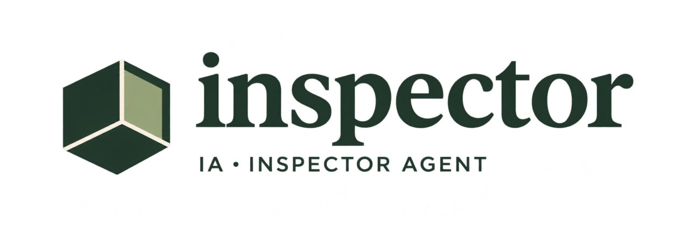
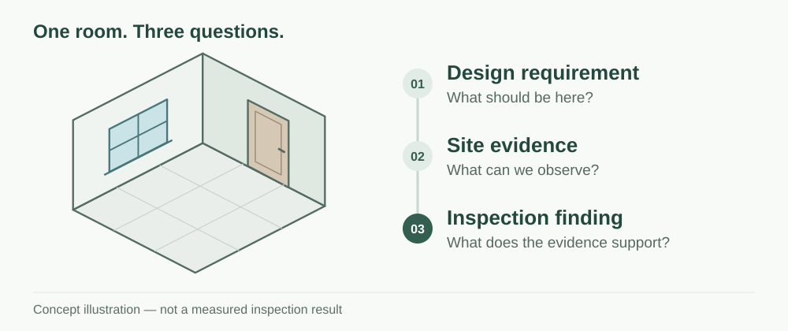
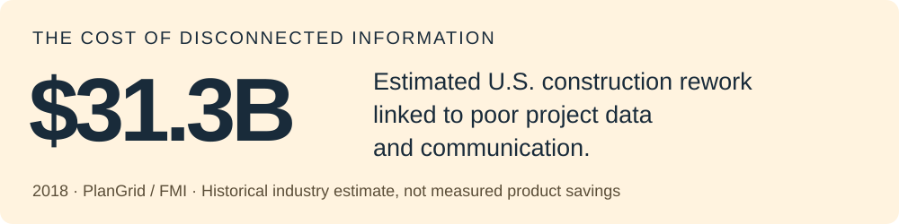
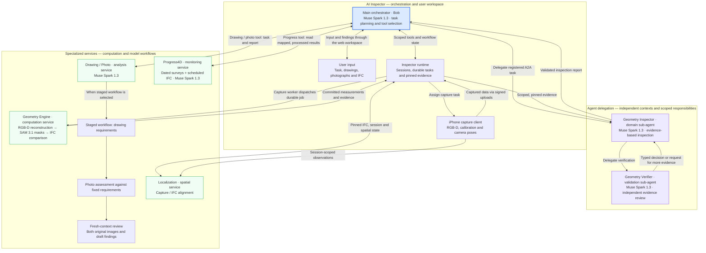

<p align="center">
  
</p>

# AI Construction Inspector

**A powerful multi-agent system for construction quality control and progress monitoring.**

**Delegate the evidence-gathering and analysis work of construction inspection to a coordinated AI system.** AI Construction Inspector connects people on site, project documents and specialized agents in one ambitious, practical product: identify discrepancies, review completed work and give managers structured evidence for the next decision.

**One business workflow, versatile inspection capabilities.** Drawing/photo analysis, scan-to-BIM comparison and progress review serve the same objective: control the quality and monitor the execution of construction work. Their different inputs let teams choose the evidence that fits the task, from a drawing and photograph to calibrated depth captures or repeated surveys.

**Sophisticated engineering behind a simple working interface.** The conversational workspace combines visual reasoning, metric reconstruction and a hierarchy of inspection agents. Users can submit project files, dictate a request and inspect findings beside their source evidence. The iPhone client adds assigned RGB-D capture for depth-based inspection; teams using the hosted workspace do not deploy its internal services.

**[Open the web demo](https://inspector.campuscompile.eu/demo)** · [Three-scenario walkthrough](ai_inspector/docs/guided-demo.md#reviewer-quick-start) · [Explore the evidence](docs/evidence/2026-11-03/README.md) · [Run the components](docs/reproducible-setup.md)

| Project | Details |
|---|---|
| Event | [Meta Global AI Developer Hackathon](https://cerebralvalley.ai/e/meta-ai-developer-hackathon) · Track 2 |
| Hackathon dates | 26 October–4 November 2026 |
| Team development period | 27 October–3 November 2026 (implementation history in this repository) |
| Meta models | **Muse Spark 1.3 · SAM 3.1 · Muse Voice Transcribe 1.0** |
| Creators | Tykhin Biriukov, Egor Pichugin and Oleg Kulikov |

[Demo walkthrough](#demo-walkthrough) · [Problem](#problem) · [Value](#value) · [Measured results](#measured-results) · [Architecture](#architecture) · [Meta models](#how-we-use-meta-models) · [Service details](#service-details) · [Approach comparisons](#approach-comparisons)

## Run the repository demo

For a self-contained evaluation, start with the [prepared Geometry walkthrough](demo/README.md). Python 3.11+ is sufficient; the command downloads and verifies the complete prepared dataset automatically, then writes a readable report and interactive scan/IFC view. No API key is needed for the default mode.

```sh
python3 demo/run.py --mode prepared
python3 demo/run.py --verify-output demo-output
```

[Add a live Meta summary](demo/README.md#add-a-live-meta-summary), or [recompute from RGB-D with live SAM](demo/README.md#full-recomputation-on-linux-python-312-recommended). Prepared mode identifies every retained stage explicitly. Full recomputation uses the production Geometry algorithms and a fresh output directory. See the guide for exact prerequisites, expected outputs and your own capture data.

## Demo walkthrough

[Open AI Inspector](https://inspector.campuscompile.eu/demo) and choose an example in the left sidebar. Each example opens a details dialog where you can inspect and download its source files before choosing the next action. Files, Tasks and Capture Devices start collapsed and remain available for your own work.

| Choose | Explore | Product value |
|---|---|---|
| **Model & site photos** | The reference IFC opens first; switch to the site photo and capture metadata, or explore a configured saved model-to-scan comparison | Investigate differences in their spatial and visual context |
| **Drawing & installation** | A window drawing and two installation photographs, with prepared input files or a labelled saved comparison | Review the installation against its design requirements |
| **Construction progress** | A reference IFC and seven dated synthetic survey photographs, or the configured saved weekly timeline | Follow the relationship between planned work and observed progress |

**Prepared inputs** and **recorded results** have separate actions. **Use these inputs** adds the listed attachable files and prepares a task in chat; **Analyze these inputs** sends that task through the normal analysis path when a chat model is configured. New findings depend on the connected analysis services. **Show example result** opens a retained result and does not perform a fresh reconstruction or inspection. Browsing an example does not create a chat or add files automatically. The [reviewer quick start](ai_inspector/docs/guided-demo.md#reviewer-quick-start) describes the steps and configuration.

For new work, the entry point matches the task: **drawing + photo** for visual inspection, **RGB-D capture + IFC** for metric comparison, and **dated photo surveys + scheduled IFC** for progress analysis. An existing calibrated RGB-D session can be reprocessed without another phone capture. The [public real-room package](https://github.com/TykhinBiriukov/ai-construction-inspector/releases/tag/evidence-2026-11-03) includes 99 observations, their 396 capture files, a pinned IFC, meshes and processing manifests. The [Progress4D input folder](resources/progress4d/inputs) contains the reference IFC, seven capture manifests and 312 synthetic survey photographs, separate from its sibling replay outputs.

Demo labels distinguish real captures, synthetic inputs, recorded results and mock fixtures. A reference model, preview photo and capture manifest do not replace validated complete RGB-D intake. Complete capture archives remain separate from ordinary chat attachments.

<a id="problem-and-value"></a>

## Problem

### A simple question: can the next stage start?

A room looks ready. The next crew is scheduled. Before work continues, someone must establish whether what was built matches the design and whether the required checks are complete. The answer may be scattered across drawing revisions, BIM models, site photographs and inspection records.



**While the decision waits, work can wait too.** Coordinating an inspection, resolving missing information and obtaining sign-off can hold up the next stage while project costs continue. New Zealand's building regulator explicitly identifies inspection delays as a source of additional costs and missing information as a reason applications are put on hold. [MBIE: inspection wait-times and requests for information](https://www.building.govt.nz/getting-started/how-the-building-system-protects-you/building-consent-system-performance-monitoring).

**A completed inspection can still miss an important detail.** Attention lapses, incomplete evidence and inconsistent checks can leave a defect unnoticed. If it is discovered after subsequent work has covered the area, the team may need to reopen finished work, revise the design or rebuild the affected installation. The [Lean Construction Institute](https://leanconstruction.org/lean-topics/8-wastes-of-lean/) identifies both waiting and defects requiring correction as sources of wasted time and resources.

**Some consequences go beyond time and money.** An unresolved defect in a safety-critical system can put people's lives at risk. The [Grenfell Tower Inquiry, Phase 2, Volume 4, §§64.41–64.44](https://assets.publishing.service.gov.uk/media/66d817d9c52d5fb4c82dddf0/CCS0923434692-004_GTI_Phase_2_Volume_4_BOOKMARKED.pdf) documents inspections that failed to detect serious workmanship defects in cavity barriers. It shows why reliable inspection, evidence and follow-through matter beyond project handover.



**$31.3 billion** was PlanGrid and FMI's estimate for U.S. construction rework attributable to poor project data and communication in **2018**—48% of estimated rework costs. This historical figure describes the wider industry problem; it is not a total for inspection delays, a valuation of safety harm or a claim about savings from AI Inspector. [Construction Disconnected, pp. 19–20](https://www.autodesk.com/blogs/construction/wp-content/uploads/2023/03/Construction_Disconnected.pdf).

## Value

### Bring the evidence into the decision earlier.

AI Inspector helps engineers connect the design requirement, the site observation and the finding in one review. It compares supplied drawings and photographs, reviews scan-to-BIM evidence, and keeps findings linked to their sources. The goal is to reduce the effort needed to prepare a sound decision and make important gaps harder to overlook.

**Help reduce evidence-related waiting.** Put the selected sources and comparison results together so the reviewer can investigate a discrepancy without repeatedly assembling the same context. This targets the preparation and clarification work around a decision; approval schedules and formal sign-off remain with the responsible people and processes.

**Preliminary estimate: faster acceptance inspections.** Based on our preliminary estimate, acceptance inspections could be completed at least **3–4 times faster** by eliminating specialist travel time and reducing the time spent coordinating inspections.

**Make repeated checks more consistent.** Turn a selected drawing into explicit requirements, reuse compatible checklists for later photographs, and review geometric differences against the selected reference model. Each result shows the evidence and its limits, helping reviewers distinguish a supported discrepancy from an unanswered question.

**Support earlier correction and safer decisions.** Surface potential issues for investigation while work is still accessible. When a detail is hidden or the evidence is insufficient, keep that uncertainty visible so the team can arrange a closer inspection, additional capture or appropriate testing. The intended contribution is better-supported review; the current prototype does not certify building safety or demonstrate a reduction in accidents.

| Step | People and agents working together | Value for the construction team |
|---|---|---|
| Define the check | A manager supplies the task and relevant design documents | A clear inspection objective tied to the project |
| Collect site evidence | A person on site supplies photographs or uses the assigned iPhone capture session | Evidence collection can start with someone already at the location |
| Process and validate | Specialized workflows compare observations with requirements or geometry; model review and deterministic checks validate the findings | Structured analysis with traceable supporting evidence |
| Make the next decision | The manager reviews findings and decides on progression, correction or specialist involvement | An informed handoff between inspection and project execution |
| Repeat as work advances | New observations reuse applicable requirements and feed subsequent reviews | Consistent follow-up throughout the work |

<details>
<summary>Follow one inspection question</summary>

**Question:** “Does this room match the design, and what still needs checking before the next stage?”

1. **Requirement:** select the relevant drawing or IFC and define the inspection task.
2. **Observation:** supply the corresponding photograph or complete capture; preserve its source identity.
3. **Finding:** inspect the comparison and supporting evidence. An observable discrepancy and an unobserved detail remain different outcomes.
4. **Next action:** the responsible reviewer decides whether to correct work, obtain more evidence or proceed with the applicable acceptance process.

This is an illustrative review workflow, not a recorded result or an automatic authorization to continue construction. Implementation links: [drawing/photo checks](#drawingphoto-structured-reasoning-reusable-requirements-and-a-fresh-review), [Geometry review](#geometry-inspector-and-geometry-verifier-focused-expertise-and-rigorous-review), [capture and result contract](ai_inspector/docs/capture-to-geometry.md).

</details>

<details>
<summary>How we will evaluate the value—and make capture more accessible</summary>

| Intended benefit | Evidence needed on real projects |
|---|---|
| Less preparation and clarification time | Engineer time per reviewed finding and time spent collecting missing evidence; distinguish these from administrative waiting |
| Fewer overlooked defects | False and missed findings against independently reviewed cases, including safety-critical cases within the supported scope |
| More traceable decisions | Time to locate the original source and verify the finding |
| Useful repeat inspections | Agreement of dated observations with independently reviewed site records |

Professional mobile mapping systems such as [NavVis VLX 3](https://www.navvis.com/vlx-3) and [Leica Pegasus:Backpack](https://leica-geosystems.com/ja-jp/about-us/news-room/customer-magazine/reporter-79/capturing-reality-on-the-go) already support reality capture. Our direction is more accessible collection through compatible LiDAR-equipped consumer devices and, later, autonomous equipment. Price, survey-accuracy parity and project savings still require field evaluation.

The PlanGrid/FMI study surveyed 599 construction industry participants, including 500 in the U.S. Its survey and industry-level estimates establish context, not measured product performance. [Study demographics, p. 4](https://www.autodesk.com/blogs/construction/wp-content/uploads/2023/03/Construction_Disconnected.pdf).

</details>

| Who uses it | The job | What AI Inspector brings together |
|---|---|---|
| Quality-control engineer | Check installation against the design | Drawing-derived requirements, photo assessment and reviewed findings |
| Acceptance engineer | Explain and revisit a discrepancy | IFC element identities, measurements, original photographs and source references |
| Site engineer | Document the physical condition of a room | iPhone RGB-D capture, metric reconstruction and model comparison |
| Project manager | Review progress across repeated surveys | Dated evidence, scheduled IFC elements and a shared progress viewer |

**A compelling commercial opportunity: repeated inspection across the construction lifecycle.** The same project generates new photographs, design revisions, capture sessions and progress reviews. Reusable requirements and persistent evidence make that repetition valuable: teams can build on earlier work while preserving the source of each finding. Contractors and inspection teams are natural buyers because these workflows sit directly inside quality control, acceptance and project delivery. The business audience spans building contractors, renovation teams and infrastructure contractors: the shared task is documenting work, comparing it with project requirements and coordinating the next decision. Teams select the inspection capability and evidence format appropriate to each task.

**Accessible capture, powerful processing, one elegant workspace.** Drawing/photo inspection starts with documents and a photograph. Depth inspection adds a LiDAR-equipped iPhone and its calibrated observations. The product combines familiar collection tools with advanced geometry and AI review behind a single interface.

**Grounded in valuable, firsthand construction experience.** Egor Pichugin worked as a quality-control engineer performing site inspections. Oleg Kulikov worked in engineering management and acceptance of renovation and major refurbishment. Tykhin Biriukov worked on solar-panel installation. Their experience shapes the product around the questions practitioners actually ask: what needs attention, where is the evidence, and what should be checked next?

## Measured results

The implementation is accompanied by **real-room processing records, numerical comparisons and reproducible experiment artifacts**. These concrete results showcase the depth of engineering behind the product.

| Measurement | Recorded result | Evidence |
|---|---|---|
| Projection consistency on the real-room capture | Mean frame-median depth residual **10.99 → 7.93 mm (27.8% reduction)** on the same 68 accepted frames | [Paired real-capture analysis](docs/evidence/2026-11-03/workflow-evolution.md#2-paired-projection-comparison-on-the-real-capture) |
| Camera-pose recovery in 12 generated room cases with known ground truth | Mean translation error **70.16 → 5.07 mm (92.8% reduction)** | [Controlled numerical comparison](docs/evidence/2026-11-03/controlled-comparison.md) |
| Correct wall-side correspondence in 18 controlled cases | Incorrect displacement measurements **9/18 → 0/18** | [Wall-correspondence comparison](docs/evidence/2026-11-03/controlled-comparison.md) |
| Reuse of unchanged Meta segmentation inputs | Retained run records **462 SAM cache hits and 0 misses** | [Real-room run records](docs/evidence/2026-11-03/README.md) |

**A laser-measured physical reference.** The real-room IFC was constructed from laser measurements of the room, as confirmed by the team. The saved comparison reports reconstructed-surface deviations from this reference after rigid alignment: P95 values of approximately **27, 66, 31, 99 and 53 mm** across five observed surfaces. [Reference provenance and measurement definitions](docs/evidence/2026-11-03/README.md#what-the-result-means).

**Laser reference dimensions used in the opening checks.** The project owner confirms that the laser measurements match the reference IFC dimensions exactly. The values below are transcribed from that IFC reference, with object identities retained in the [numerical verification record](docs/evidence/2026-11-04/reference-verification.json).

| Reference object | IFC GlobalId | Laser reference width | Laser reference height |
|---|---|---:|---:|
| Door matched to `mesh_door_002` | `0oE0T2Q6P6px_guRMq_GEr` | **919 mm** | **2173 mm** |
| Window matched to `mesh_window_004` | `1q37$RPED5g9Qi8ZTYNzyK` | **3331 mm** | **1513 mm** |

Reference identity: `reference.ifc`, SHA256 `4a618081be81cad4b7bba0eec22486038bc96d37e4778276d2f20a7d8143c51d`. These physical reference dimensions are the comparison baseline; the reconstructed scan dimensions and signed differences are recorded separately in the linked verification record.


The real-room Geometry run integrates **99/99 RGB-D frames** and produces **469,270 surface points and 896,924 mesh triangles**, with source identities preserved through reconstruction, segmentation and comparison. The public result includes six object candidates and five observed surfaces. The [evidence guide](docs/evidence/2026-11-03/README.md) connects the capture, model provenance, processing history and findings; the [download guide](docs/evidence/2026-11-03/data-access.md) provides versioned records and integrity checks.

**Completed Inspector/Verifier review.** All **11 review batches** for the real-room result completed on 2 November 2026. A separate numerical check recomputed four matched door/window dimensions against the laser-derived IFC, including source hashes and signed differences. [Review outcomes and reference verification](docs/evidence/2026-11-04/README.md).

**Demonstrated value: a traceable inspection package from site capture.** In the recorded real-room case, AI Inspector processes **99 RGB-D observations**, reconstructs the room, compares observed geometry with the laser-derived IFC, and delivers an interactive design-versus-scan view with source-linked findings. Four opening dimensions are independently recomputable from the packaged contours and IFC. The engineer receives the reference value, observed value and signed difference together with the evidence, rather than having to assemble that comparison manually.

The Inspector/Verifier stage reviews **11 candidate cases** and records a disposition and rationale for every case. It rejects three candidates and turns eight into specific evidence requests—such as the project acceptance tolerance, complete opening coverage or alignment evidence—so the next inspection action is explicit. These are the outcomes of the archived 2 November review, not failed processing stages. The product value is a repeatable **capture → comparison → evidence review → next-action report** workflow that supports the manager's decision to progress, correct or request an engineering check.

Controlled validation demonstrated the Inspector–Verifier workflow’s ability to identify a known discrepancy and support its conclusion with traceable evidence.

The drawing/photo evidence includes recorded live-model analyses, a same-input comparison of shared-context and staged workflows, and three runs with reusable frozen requirements. Progress4D includes six dated development evaluation records and a saved seven-week walkthrough. [Inspect the cases and reports](docs/evidence/2026-11-03/README.md).

## Architecture

**One cohesive product experience, a powerful multi-agent architecture underneath.** Bob, the main orchestrator, routes tasks through scoped tools and registered domain inspectors. Geometry Inspector owns the inspection task and delegates evidence validation to its own Geometry Verifier. Each agent has a separate context, instructions, tools and execution budget.

**Thoughtfully layered verification is built into the architecture.** The Geometry Verifier reviews pinned candidate evidence. Drawing/Photo's staged workflow uses a fresh model context to review the draft against both original images and fixed requirements. Deterministic checks validate identities, measurements, evidence references and schemas. This combines specialized model reasoning with explicit computational checks.



The Inspector runtime owns capture assignments, uploads and durable computation jobs. Geometry Engine, Drawing/Photo, Progress4D and Localization are specialized services with explicit contracts; Geometry Inspector and Geometry Verifier form the agent delegation hierarchy. Heavy reconstruction runs outside the chat request, and committed results return to the inspection workflow. Source for all components is collected on `main`, with component setup and deployment documented in their guides.

### Thoughtful engineering built around the workflow

| Engineering choice | Why it matters | Implementation to inspect |
|---|---|---|
| Durable commands before side effects | A lost connection can be reconciled using the same operation instead of creating duplicate work | [Agent harness](ai_inspector/src/ai_inspector/agent_runtime.py), [orchestrator](ai_inspector/src/ai_inspector/agent.py) |
| Explicit ownership and fenced leases | An expired worker cannot publish over the current owner after a restart | [Capture workflow](ai_inspector/src/ai_inspector/workflow.py), [Geometry API/worker](geometry-engine/geometry_engine_api) |
| Typed model output and predefined tools | Model suggestions are checked against schemas, permissions and task scope before execution | [Model client](ai_inspector/src/ai_inspector/model_client.py), [inspector registry](ai_inspector/src/ai_inspector/inspectors.py) |
| Immutable inputs and content-addressed evidence | A finding can be traced to a specific drawing, capture, IFC and successful processing attempt | [Geometry handoff](ai_inspector/docs/capture-to-geometry.md), [workspace](ai_inspector/src/ai_inspector/workspace.py) |
| Separate computation and interpretation | Geometry produces numerical evidence; language models explain and review bounded evidence | [Geometry pipeline](geometry-engine/geometry_engine/pipeline.py), [review contract](ai_inspector/docs/ifc-discrepancy-review.md) |
| Small, versioned service boundaries | Components can use different native dependencies and independent persistence without coupling their lifecycles | [A2A protocol](ai_inspector/src/ai_inspector/a2a_protocol.py), [component setup](docs/reproducible-setup.md) |
| Evidence-rich presentation | Results retain source provenance, measurement context and visibility information | [Geometry viewer contract](ai_inspector/docs/capture-to-geometry.md#inspection-results-viewer), [drawing/photo schemas](drawing_photo_service/models.py) |
| Metadata-only observability | Latency, attempts, usage and prompt versions can be examined without automatically exporting source images or chat text | [Observability](ai_inspector/src/ai_inspector/observability.py), [Langfuse guide](ai_inspector/docs/agent-chat.md#langfuse-cloud-traces-prompts-and-evaluation) |

These mechanisms give the product a durable foundation: operations retain their identity across retries, completed computations can be recovered, and findings remain connected to the evidence that produced them.

### What makes this inspection system technically distinctive

**Powerful visual intelligence, grounded in structured requirements and measurable evidence.** The system gives VLM analysis an explicit inspection process: drawing-derived checklists, distinct assessment and review contexts, numerical geometry, and deterministic validation of report structure and source bindings. Geometry Inspector adds a dedicated Verifier agent to its evidence-review hierarchy.

- **Stable requirements across repeated checks.** Drawing/Photo extracts the design requirements before assessing the observation, then reuses their identities when a new photograph arrives.
- **Focused reasoning and a fresh review.** The staged workflow separates requirement extraction, photo assessment and review into **three model contexts**. Recorded runs reuse **one 11-item checklist across three analyses**.
- **Semantic perception connected to metric geometry.** SAM masks are projected and fused using depth evidence; numerical code calculates geometric comparisons, while Spark agents interpret and review the findings.
- **Findings an engineer can investigate.** Source images, evidence regions, IFC identities and measurement bindings connect conclusions to their supporting material.

[Drawing/photo workflow and recorded comparisons](docs/evidence/2026-11-03/README.md#2-drawingphoto-from-joint-context-to-frozen-requirements) · [Agent verification contract](ai_inspector/docs/ifc-discrepancy-review.md)

## How we use Meta models

**Deeply integrated Meta intelligence powers the product's reasoning, perception and voice interaction.** Each integration has a concrete responsibility in the inspection workflow.

| Component | Model and interface | Model responsibility | Responsibility retained by code |
|---|---|---|---|
| Main orchestrator and Geometry review agents | `muse-spark-1.3`, Meta Model API Chat Completions | Understand the task, select permitted tools, inspect supplied evidence and explain accepted results | Authorization, bounded execution, request identity, numerical bindings and final report validation |
| Drawing/photo analysis | `muse-spark-1.3`, images, structured output and `crop_region` | Extract design requirements, inspect the corresponding photograph and review findings | Source-role restrictions, crop coordinate mapping, checklist identity and verdict-schema checks |
| Geometry segmentation | `sam-3.1`, Meta Model API Responses and `meta-sam-parser` | Produce masks for walls, floors, ceilings, windows, window frames and doors | RGB-D reconstruction, visible-triangle projection, fusion, rigid registration and measurements |
| Progress4D visual evidence | `muse-spark-1.3`, image input and JSON schema | Assess product evidence from selected views and distinguish visibility/material/installation claims | Camera reconstruction, IFC registration, visibility gates, temporal aggregation and forecast rules |
| Voice input | `muse-voice-transcribe-1.0`, Meta Model API `/asr/transcribe` | Turn a spoken inspection request into text | Push-to-talk capture, mono PCM WAV conversion, authentication, audio validation and insertion into an editable message draft |

The [shared agent harness](ai_inspector/src/ai_inspector/agent_runtime.py) manages durable model requests and tool execution. The [Meta adapter](ai_inspector/src/ai_inspector/model_client.py) validates returned messages. The [SAM adapter](geometry-engine/geometry_engine/segmentation/sam_backend.py) uses hosted inference and the official decoder; metric reconstruction and comparison run on CPU. The [voice adapter](ai_inspector/src/ai_inspector/voice.py) turns push-to-talk speech into an editable draft, with audio handled in memory. Model interfaces: [Meta model catalog](https://dev.meta.ai/docs/models) · [SAM API](https://dev.meta.ai/docs/sam/overview).

### Why Meta models matter to the solution

Meta models connect our agentic inspection system to the physical world through drawings, site photographs and visual evidence linked to 3D captures. They help agents understand the task, interpret design requirements, choose relevant inspection steps and identify building elements in what was actually observed. Voice transcription lets an engineer express the task naturally on site.

Their role continues after the initial analysis. Our pipeline gathers the evidence, and a separate agent powered by a Meta model reviews proposed findings against the supplied measurements, images and known limitations. For drawing and photo checks, a fresh model context revisits the conclusions using the original sources and fixed requirements. These reviews can challenge unsupported claims and ask for more evidence when a conclusion cannot be justified.

The distinctive contribution is this combination of perception, coordinated action and verification. The model capabilities that help one agent investigate a construction question also help another review the evidence behind the answer. This gives engineers a clearer basis for trust: they can see what supports a finding and what remains uncertain.

## Service details

### Inspector: a cohesive, capable engineering workspace

The web workspace brings chat, drawings, photographs, IFC models and review artifacts together with Three.js, web-ifc and PDF.js. The backend owns persistent sessions, capture assignments, processing operations and agent execution. Typed artifacts make findings explorable alongside their source material. Durable commands, request identities and fenced task ownership preserve continuity across long-running work and reconnects.

[Backend and setup](ai_inspector/README.md) · [Agent contract](ai_inspector/docs/agent-chat.md) · [API](ai_inspector/src/ai_inspector/api.py) · [Web integration](ai_inspector/docs/web-integration.md) · [Viewer](ai_inspector/viewer/README.md)

### Geometry Inspector and Geometry Verifier: focused expertise and rigorous review

Geometry Inspector owns the geometry/BIM inspection task. Its Geometry Verifier receives a bounded evidence package and returns a typed review decision. Both operate as independent A2A services with their own task stores and workers. Source hashes, candidate identities and measurement bindings connect the agent's conclusion to the computation that supports it; the orchestrator validates the accepted report before presenting it.

[Roles, schemas and setup](ai_inspector/docs/ifc-discrepancy-review.md) · [Agent services](ai_inspector/src/ai_inspector/discrepancy_agents.py) · [Report schemas](ai_inspector/src/ai_inspector/discrepancy.py) · [Evidence adapter](ai_inspector/src/ai_inspector/discrepancy_evidence.py)

### Geometry Engine: sophisticated metric reconstruction meets Meta perception

Geometry Engine reconstructs observed surfaces from RGB-D frames with **Open3D TSDF and original ARKit camera poses**. Meta SAM segments structural elements in selected RGB views. Depth-supported projection and multiview fusion connect those masks to the mesh; observed contours provide opening candidates. Rigid IFC registration and geometric comparison produce dimensions, displacements and surface differences.

The design combines **semantic understanding with numerical measurement**. The mesh preserves the observed geometry; registration uses a rigid transform with scale fixed to one. Dominant normals, yaw hypotheses and robust point-to-plane ICP support alignment. Projection-camera adjustment improves mask placement against the fixed mesh.

**Efficient reuse is engineered into the pipeline.** Exact-input SAM caching reuses unchanged masks across geometry settings and IFC comparisons. Each completed stage publishes a manifest with content hashes, allowing workers to restore verified computations after a restart. Reconstruction, segmentation, comparison and viewer export remain separately traceable.

[Service and setup](geometry-engine/README.md) · [Reconstruction](geometry-engine/geometry_engine/reconstruction/service.py) · [Registration](geometry-engine/geometry_engine/comparison/bim_registration.py) · [Mask fusion](geometry-engine/geometry_engine/segmentation/mask_fusion.py) · [Opening contours](geometry-engine/geometry_engine/openings/mesh_boundaries.py) · [Inspector handoff](ai_inspector/docs/capture-to-geometry.md)

### Drawing/Photo: structured reasoning, reusable requirements and a fresh review

The service compares a drawing or PDF page with a site photograph for the user's inspection task. Its **staged workflow** separates three responsibilities: extract requirements from the drawing, assess the photograph against those fixed requirements, then review the findings in a fresh context with both originals. Stable requirement IDs and source bindings make the checklist reusable for subsequent photographs.

Requirements cover geometry, material, product, measurement, installation and performance. Evidence regions connect design claims and site observations. Named grid views and server-side crop mapping keep image references tied to the original pixels. The shared-context `legacy` workflow and the staged workflow are both implemented. The checked-in Cloudflare configuration and reproducible setup guide select **`staged`**, bringing checklist-based assessment and fresh-context review into that configuration.

[Service and API](drawing_photo_service/README.md) · [Legacy engine](drawing_photo_service/engine.py) · [Staged requirements and prompts](drawing_photo_service/staged.py) · [Evidence grounding](drawing_photo_service/grounding.py) · [Persistence](drawing_photo_service/app.py) · [Inspector adapter](ai_inspector/src/ai_inspector/drawing_photo.py)

### Progress4D: a richer view of construction progress

Progress4D combines overlapping photo surveys, an IFC work schedule and Meta visual assessment. PyCOLMAP reconstructs camera poses and sparse geometry; the configurable OpenMVS CPU path adds a dense textured surface. Registration connects observations to the model, while selected views supply product-level evidence for Muse Spark. Deterministic temporal logic produces a timeline, counts, activity and conditional forecasts.

The progress viewer brings these dated results into the Inspector workspace through a scoped bridge. Versioned evidence cards, source dates and separate material/installation fields make the reasoning behind each status inspectable.

**Reading the percentages:** each stage card shows **confirmed work / all planned IFC elements in that stage**, including retained earlier observations. It describes construction progress, not model accuracy or workflow quality. For example, week 4 framing is **44/44 = 100%**, even though the current survey no longer directly sees the covered frame. “Unknown” means no current or retained confirmation for that planned element; it does not mean a model error or proven absence. The archived **current-survey present confirmation rate** (`current_survey_present_confirmation_rate`) measures current-survey confirmations against evaluator-labelled existing elements visible in at least two photos. It is separate from stage progress and does not include retained confirmations from earlier surveys. [Formulas and worked examples](progress4d_service/README.md#reading-progress-and-evaluation-metrics).

[Service, supported inputs and setup](progress4d_service/README.md) · [Pipeline](progress4d_service/pipeline.py) · [Surface adapter](progress4d_service/surface.py) · [Visual assessment](progress4d_service/perception.py) · [Temporal logic](progress4d_service/temporal.py) · [Inspector integration](ai_inspector/docs/progress4d.md)

### iPhone capture and Localization: bring physical observations into the workflow

The SwiftUI/ARKit client captures RGB imagery and, on LiDAR-equipped devices, depth and confidence with camera intrinsics, poses and frame identities. Inspector assigns the session; the phone uploads through scoped signed permissions. Keychain credentials and persistent retry journals support secure, recoverable capture delivery.

Localization provides session-bound spatial observations and capture/IFC alignment using depth backprojection, gravity-aligned plane fitting and rigid registration. Its IFC room model establishes the coordinate frame for supported capture workflows.

[iOS setup](ios/README.md) · [Server integration](docs/inspector-server-integration.md) · [Mobile integration](docs/mobile-integration-status.md) · [Capture format](ai_inspector/docs/zip-capture.md) · [Localization setup](localization_service/deploy/README.md) · [Cloud API](localization_service/cloud_server.py) · [Registration](localization_service/registration.py) · [Inspector adapter](ai_inspector/src/ai_inspector/localization.py) · [Localization experiments](localization_service/README.md)

## Approach comparisons

**The implementation reflects careful refinement and substantial technical depth.** The project records alternative approaches, same-input comparisons and numerical experiments alongside the code.

| Area | Implemented refinement | Why it matters |
|---|---|---|
| Geometry reconstruction | Original ARKit poses with TSDF; projection-only camera adjustment | Preserves the metric reconstruction while refining semantic projection |
| Structural evidence | Depth-supported multiview mask fusion and mesh contours | Connects Meta semantics to observed surfaces and opening geometry |
| Drawing/photo reasoning | Separate requirement extraction, assessment and final review | Reuses design requirements while reviewing each photograph in its own context |
| Repeated computations | Exact-input SAM cache and durable stage manifests | Reuses matching inference and recovers completed work |
| Progress evidence | Larger independent view cards with distinct material/installation fields | Gives visual assessment richer evidence and structured outputs |

The [workflow evolution study](docs/evidence/2026-11-03/workflow-evolution.md) links historical implementations and paired real-room diagnostics. The [controlled comparison](docs/evidence/2026-11-03/controlled-comparison.md) includes generated ground truth, per-case records and four figures. The [drawing/photo comparison](docs/evidence/2026-11-03/README.md#same-input-legacystaged-run) records model calls, processing time and findings on the same inputs.

The numerical foundations include [volumetric depth fusion](https://graphics.stanford.edu/papers/volrange/), [Open3D TSDF](https://www.open3d.org/docs/latest/tutorial/t_reconstruction_system/integration.html), [robust point-to-plane alignment](https://www.open3d.org/docs/latest/tutorial/pipelines/robust_kernels.html) and depth/overlap grouping adapted from [Open3DIS](https://arxiv.org/abs/2312.10671). Progress reconstruction uses [COLMAP](https://colmap.github.io/), [OpenCV StereoSGBM](https://docs.opencv.org/4.x/d2/d85/classcv_1_1StereoSGBM.html) and [OpenMVS](https://github.com/cdcseacave/openMVS/blob/v2.4.0/README.md). Project-specific adapters, evidence contracts, registration and review workflows connect these methods into the product. [Method notices and upstream references](geometry-engine/THIRD_PARTY_NOTICES.md).

## Reproducible setup

For the product walkthrough, [open the hosted demo](https://inspector.campuscompile.eu/demo). For development and new processing, the [step-by-step setup guide](docs/reproducible-setup.md) explains environments, credentials, startup order and workflow inputs.

| Workflow | Guide |
|---|---|
| Workspace and Meta-powered chat | [Inspector setup](ai_inspector/README.md) |
| Drawing/photo analysis | [Drawing/photo service](drawing_photo_service/README.md) |
| RGB-D reconstruction and IFC comparison | [Geometry API and worker](geometry-engine/README.md) |
| Geometry agent review | [Inspector and Verifier](ai_inspector/docs/ifc-discrepancy-review.md) |
| Photo-based progress monitoring | [Progress4D](progress4d_service/README.md) |
| Phone capture | [iOS](ios/README.md) |
| Spatial integration | [Localization](localization_service/deploy/README.md) |

The [evidence guide](docs/evidence/2026-11-03/README.md) connects source data, summaries and manifests. The [data access guide](docs/evidence/2026-11-03/data-access.md) provides versioned public packages and integrity checks.

## Verification

Component tests exercise deterministic behavior and service contracts. The [evidence cases](docs/evidence/2026-11-03/README.md) document recorded model runs and numerical experiments with source identities and reproduction protocols. Generated `/docs`, `/openapi.json` and `/contracts` describe the service schemas. [Backend verification workflow](ai_inspector/README.md#verification).

## Component and license references

The implementation uses existing numerical and visualization libraries alongside Meta models. Component dependencies and notices are authoritative: [Geometry dependencies](geometry-engine/pyproject.toml) and [third-party notices](geometry-engine/THIRD_PARTY_NOTICES.md), [Inspector dependencies](ai_inspector/pyproject.toml), [document viewer licenses](ai_inspector/viewer/README.md), [drawing/photo dependencies](drawing_photo_service/requirements.lock), and [Progress4D native dependencies and OpenMVS AGPLv3 notice](progress4d_service/README.md#native-surface-reconstruction). This README does not grant a different license to those dependencies.
