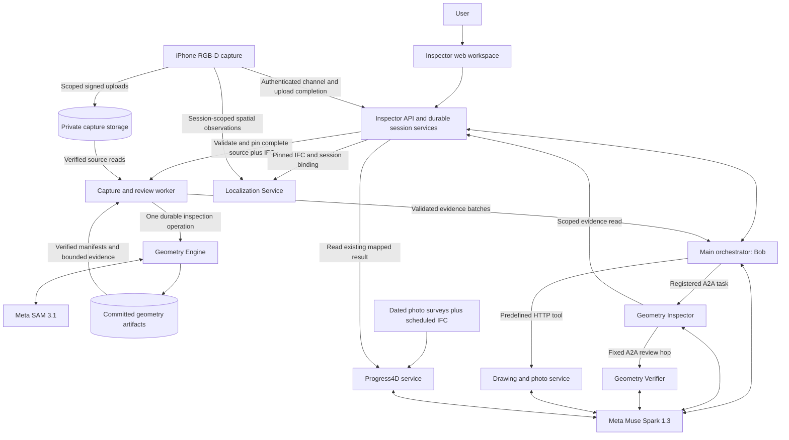
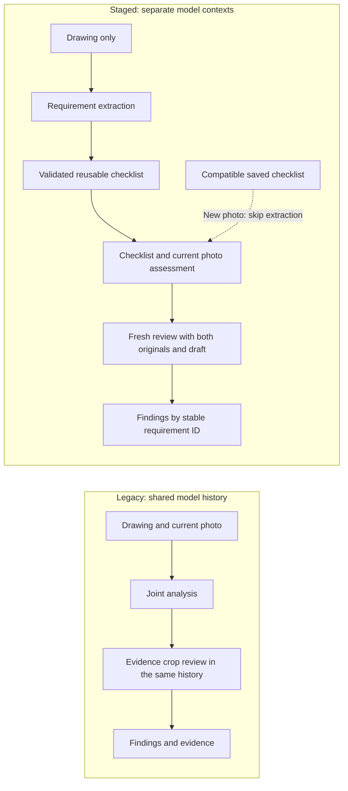
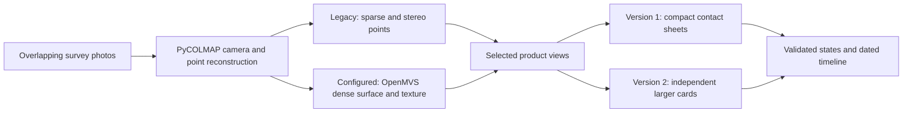

# AI Construction Inspector

**Turn site photographs, depth captures and building plans into traceable inspection findings.**

AI Construction Inspector helps a construction team connect what was designed with what can actually be observed on site. In one workspace, a user can compare a photograph with a drawing, review a scan against a building information model (BIM), and explore construction progress over time. Findings stay connected to their source evidence; missing visibility remains a reason to gather more evidence.

| Project | Details |
|---|---|
| Event | [Meta Global AI Developer Hackathon](https://cerebralvalley.ai/e/meta-ai-developer-hackathon) |
| Track | Track 2 |
| Hackathon dates | 26 October–4 November 2026, as published by the organizer |
| Team development period | |
| Web demo | |
| Creators | Tykhin Biriukov, Egor Pichugin and Oleg Kulikov |
| Meta models in the implementation | Muse Spark 1.3 and SAM 3.1 |

The team knows this problem from work in construction. **Egor Pichugin** worked as a quality-control engineer and regularly inspected work on construction sites. **Oleg Kulikov** held an engineering management role and worked on acceptance of renovation and major refurbishment of premises. **Tykhin Biriukov** worked on solar-panel installation. That experience shaped the project around practical questions: which element needs attention, what evidence supports the finding, and what should be checked next?

[Demo walkthrough](#demo-walkthrough) · [Problem and value](#problem-and-value) · [Architecture](#architecture) · [Meta models](#how-we-use-meta-models) · [Service details](#service-details) · [Approach comparisons](#approach-comparisons) · [Reproducible setup](docs/reproducible-setup.md) · [Roadmap](#roadmap)

## Demo walkthrough

This system works with more than ordinary chat attachments. A scan comparison needs RGB photographs, LiDAR depth and confidence, camera calibration and poses, capture metadata, and an IFC reference model. Progress monitoring needs overlapping dated surveys and a model with a work schedule. A visitor should be able to explore the product without first obtaining a compatible device, access to a construction site and its design files.

The demo uses prepared inputs and saved computation results. Start with the [versioned evidence cases](docs/evidence/2026-11-03/README.md): the primary case is a completed Geometry reconstruction from **99 real-room RGB-D observations**, with public numerical reports, source hashes and image-reference identities. The complete IFC/capture/mesh archive is prepared locally; public release of those source assets is awaiting explicit dataset-publication consent.

| Case | Available evidence | What it establishes |
|---|---|---|
| Real-room scan versus BIM | Public comparison reports and hashes; prepared archive holds 396 capture files, pinned IFC, point cloud, meshes and stage manifests | Completed Geometry computation; 6 object candidates, 5 observed surfaces and traceable source frames |
| Photograph versus drawing | Same-input legacy/staged reports; three frozen-checklist runs with audit diagnostics and evidence regions | Historical live model analyses, requirement reuse and retained uncertainty; the edited-gap case did not obtain its expected mismatch |
| Construction progress | Six dated development evaluation records and the saved seven-week walkthrough | Recorded monitoring behavior and coverage limits; the seventh scene is prepared visualization |

The [case guide](docs/evidence/2026-11-03/README.md) distinguishes source provenance, saved results, fresh analysis and remaining validation. Geometry object matches are associations, not certified acceptance decisions. The real-room output has not been independently surveyed for measurement accuracy, and a final Inspector/Verifier review is not established by the Geometry result alone.

For the interactive workspace, follow the [guided demo](ai_inspector/docs/guided-demo.md). Selecting a saved scenario reads retained results; it does not perform a new reconstruction. Model follow-up questions and fresh analysis are separate paths. A reviewer can inspect the release package without a running service or model credentials.

## Problem and value

Inspection requires someone to reconcile drawings, revisions, models, site conditions and photographs. Fragmented evidence makes defects harder to identify, explain and revisit. Repeated manual comparison also consumes engineering time that could be spent resolving the actual issue.

PlanGrid and FMI's *Construction Disconnected* study estimated that poor project data and communication accounted for **$31.3 billion in U.S. construction rework in 2018**, or **48% of rework costs**. The study surveyed 599 industry participants. These are historical survey-based industry estimates, not losses attributed specifically to final acceptance and not measured savings from this project. [Study, printed pages 4 and 19–20](https://www.autodesk.com/blogs/construction/wp-content/uploads/2023/03/Construction_Disconnected.pdf).

*Source: [PlanGrid/FMI, Construction Disconnected (2018), printed page 20](https://www.autodesk.com/blogs/construction/wp-content/uploads/2023/03/Construction_Disconnected.pdf). The categories share one denominator: attributed U.S. rework costs.*

Professional mobile mapping already addresses reality capture. For example, [NavVis VLX 3](https://www.navvis.com/vlx-3) is a wearable system with LiDAR and cameras, while [Leica Pegasus:Backpack](https://leica-geosystems.com/ja-jp/about-us/news-room/customer-magazine/reporter-79/capturing-reality-on-the-go) illustrates backpack-based mapping. Our direction is to make evidence collection and inspection more accessible through LiDAR-equipped consumer devices and, later, autonomous capture equipment. We have not established price or survey-accuracy parity with these systems.

| Intended value | Mechanism in this project | How to evaluate it on real projects |
|---|---|---|
| Reduce repetitive comparison work | Drawing-derived checklists, reusable requirements and element-linked evidence | Engineer time per accepted finding, including correction and review |
| Make discrepancies easier to investigate | Source hashes, IFC identities, photos and measurements remain linked | Time to locate and verify the source of a finding |
| Avoid unsupported certainty | Visibility, correspondence and quality limits stay explicit | False findings, missed findings and useful requests for additional evidence |
| Make repeated surveys useful | Dated observations and a shared progress viewer | Agreement with independently reviewed site records |

These are product hypotheses; savings need to be measured on real projects.

## Architecture

Users interact with one **AI Inspector**. Internally, conversation, durable workflow ownership, numerical computation and evidence review have separate responsibilities.

Arrows represent implemented interfaces, not a statement that all services are currently deployed together. Heavy reconstruction runs outside the chat request. Source code for all components is collected on `main`; deployment branches, configuration and credentials remain independently managed.

### Design choices and their purpose

| Engineering choice | Why it matters | Implementation to inspect |
|---|---|---|
| Durable commands before side effects | A lost connection can be reconciled using the same operation instead of creating duplicate work | [Agent harness](ai_inspector/src/ai_inspector/agent_runtime.py), [orchestrator](ai_inspector/src/ai_inspector/agent.py) |
| Explicit ownership and fenced leases | An expired worker cannot publish over the current owner after a restart | [Capture workflow](ai_inspector/src/ai_inspector/workflow.py), [Geometry API/worker](geometry-engine/geometry_engine_api) |
| Typed model output and predefined tools | Model suggestions are checked against schemas, permissions and task scope before execution | [Model client](ai_inspector/src/ai_inspector/model_client.py), [inspector registry](ai_inspector/src/ai_inspector/inspectors.py) |
| Immutable inputs and content-addressed evidence | A finding can be traced to a specific drawing, capture, IFC and successful processing attempt | [Geometry handoff](ai_inspector/docs/capture-to-geometry.md), [workspace](ai_inspector/src/ai_inspector/workspace.py) |
| Separate computation and interpretation | Geometry produces numerical evidence; language models explain and review bounded evidence | [Geometry pipeline](geometry-engine/geometry_engine/pipeline.py), [review contract](ai_inspector/docs/ifc-discrepancy-review.md) |
| Small, versioned service boundaries | Components can use different native dependencies and independent persistence without coupling their lifecycles | [A2A protocol](ai_inspector/src/ai_inspector/a2a_protocol.py), [component setup](docs/reproducible-setup.md) |
| Evidence-aware presentation | Unknowns, partial visibility and synthetic origin survive into the user's result | [Geometry viewer contract](ai_inspector/docs/capture-to-geometry.md#inspection-results-viewer), [drawing/photo schemas](drawing_photo_service/models.py) |
| Metadata-only observability | Latency, attempts, usage and prompt versions can be examined without automatically exporting source images or chat text | [Observability](ai_inspector/src/ai_inspector/observability.py), [Langfuse guide](ai_inspector/docs/agent-chat.md#langfuse-cloud-traces-prompts-and-evaluation) |

These choices address concrete failure modes: mobile disconnects, long reconstruction jobs, uncertain network outcomes and malformed model output. Durable ownership, idempotent operations and versioned evidence make failures recoverable and findings auditable.

## How we use Meta models

Meta models are part of the actual processing paths, including orchestration, visual interpretation and segmentation. The interfaces below are documented in Meta's [model catalog](https://dev.meta.ai/docs/models) and [SAM 3.1 API guide](https://dev.meta.ai/docs/sam/overview); the table identifies the capabilities this project actually uses.

| Component | Model and interface | Model responsibility | Responsibility retained by code |
|---|---|---|---|
| Main orchestrator and Geometry review agents | `muse-spark-1.3`, Meta Model API Chat Completions | Understand the task, select permitted tools, inspect supplied evidence and explain accepted results | Authorization, bounded execution, request identity, numerical bindings and final report validation |
| Drawing/photo analysis | `muse-spark-1.3`, images, structured output and `crop_region` | Extract design requirements, inspect the corresponding photograph and review findings | Source-role restrictions, crop coordinate mapping, checklist identity and verdict-schema checks |
| Geometry segmentation | `sam-3.1`, Meta Model API Responses and `meta-sam-parser` | Produce masks for walls, floors, ceilings, windows, window frames and doors | RGB-D reconstruction, visible-triangle projection, fusion, rigid registration and measurements |
| Progress4D visual evidence | `muse-spark-1.3`, image input and JSON schema | Assess product evidence from selected views and distinguish visibility/material/installation claims | Camera reconstruction, IFC registration, visibility gates, temporal aggregation and forecast rules |

The [shared harness](ai_inspector/src/ai_inspector/agent_runtime.py) freezes each model request before network I/O; the [Meta adapter](ai_inspector/src/ai_inspector/model_client.py) validates returned messages and exposes safe errors. The [SAM adapter](geometry-engine/geometry_engine/segmentation/sam_backend.py) uses hosted inference with bounded responses and the official decoder; no local SAM weights or NVIDIA GPU are required for that path. See also the [drawing/photo client](drawing_photo_service/engine.py) and [Progress4D perception](progress4d_service/perception.py).

Models do not receive unrestricted shell, SQL or HTTP tools. Raw IFC/point-cloud bytes are not represented as though a language model had measured them. The two Geometry review roles and the drawing/photo review phases use the same model family; additional review is not independent metrological validation. Configured keys and successful local fixtures do not establish live access to a particular Meta account.

## Service details

### 1. Inspector backend, orchestrator and web workspace

**Role.** Own user chats, capture assignments, accepted sources, Geometry operations and the presentation of results. Native execution uses FastAPI/Pydantic with SQLite by default and optional PostgreSQL/private remote storage; a separate Cloudflare deployment path is provided. The browser renders IFC, PDF and images using Three.js, web-ifc and PDF.js.

**Agent execution.** Bob is the internal main orchestrator. Each registered inspector has its own instructions, permitted tools, step budget, state and history through `AgentHarness`. Direct tools cover capture/session status, saved Geometry results, drawing/photo comparison and, for a mapped project, saved Progress4D results. Registration and selected files determine which tools are offered. The model cannot register arbitrary services or choose service endpoints.

**Recovery.** Chat/run history, pending model requests and planned tool commands are durable. Exact request IDs and bodies distinguish retry from new work. A completed request replays its result; an uncertain request keeps its operation identity. Model `tool_call_id` is not the backend operation ID. At most two invalid-argument repair attempts are allowed within the model-turn budget, and rejected calls never execute.

**Capture lifecycle.** The server generates session IDs. Assignment, device presence, acknowledgement, camera start, accepted source and Geometry completion are separate facts. A tab closing or phone going offline does not cancel the session. A new explicitly requested capture after sealing creates a linked session. Upload safety and source validation precede dispatch; only the existing capture worker creates the initial Geometry operation.

**User workspace.** Files, selections, plans and observations are scoped to the caller/chat. Originals and accepted history retain their identity. The viewer links geometry findings to IFC elements and image evidence; opening it does not trigger analysis. Typed response artifacts are rendered as data, not model-supplied executable HTML. Manual work-plan confirmation remains an operator action.

**Boundary.** General user-input orchestration and general BIM room validation remain future work. The imported room label or successful IFC rendering is not proof of geometric room membership. Native settings start with an empty remote-agent registry; checked-in cloud configuration and a live service are separate evidence.

**Inspect:** [backend setup](ai_inspector/README.md) · [agent contract](ai_inspector/docs/agent-chat.md) · [API](ai_inspector/src/ai_inspector/api.py) · [web contract](ai_inspector/docs/web-integration.md) · [viewer](ai_inspector/viewer/README.md).

### 2. Geometry Inspector and Geometry Verifier

**Role.** Geometry Inspector owns the geometry/BIM inspection task. Geometry Verifier is its narrower verification sub-agent, not another inspector directly reporting to Bob. Both run as independent native A2A HTTP+JSON services with their own task stores and workers.

**Evidence flow.** The capture worker validates compact Geometry results and prepares bounded candidate batches. Geometry Inspector can read only the pinned evidence granted to its task and can delegate only to its configured verifier. The verifier is tool-free. It returns a typed decision over the supplied candidates; deterministic code checks case IDs, source/evidence hashes and measurement bindings before assembling the report. Bob checks the accepted report again before using it.

**Versioning.** Default profiles are version `3`; new Geometry reviews use evidence projection `2` over compact result `2.0`. Legacy requests retain their original evidence and replay behavior. Bob→Inspector registration, Inspector→Verifier registration and live agent cards must agree independently.

**Recovery and limits.** Separate persistent task stores, frozen child requests, bounded polling and lease fencing permit remote work to continue without the browser. Default model budgets are 12 turns for Geometry Inspector and 3 for the verifier. Waiting for the verifier is bounded by 120 polls or 10 minutes. These are execution limits, not measured response times. Additional evidence may still be needed; an empty candidate set is not a compliance certificate.

**Inspect:** [roles, schemas, bindings and native setup](ai_inspector/docs/ifc-discrepancy-review.md) · [service factories](ai_inspector/src/ai_inspector/discrepancy_agents.py) · [report schemas](ai_inspector/src/ai_inspector/discrepancy.py) · [evidence adapter](ai_inspector/src/ai_inspector/discrepancy_evidence.py).

### 3. Geometry Engine

**Role.** Reconstruct metric observed geometry from RGB-D capture and compare it with an IFC design. This is a computation service; it does not make the final inspection decision.

```mermaid
flowchart LR
    A[RGB-D and original ARKit poses] --> B[CPU TSDF reconstruction]
    B --> C[Mesh cleaning and frame selection]
    C --> D[Hosted Meta SAM masks]
    D --> E[Depth-supported projection and multiview fusion]
    E --> F[Observed opening contours]
    F --> G[Rigid IFC registration]
    G --> H[Surface and opening differences]
    H --> I[Compact 2.0 evidence and optional viewer]
```

**Geometry.** Open3D TSDF integrates depth using the original ARKit poses. The default voxel size is 0.02 m and truncation is 0.08 m; these are algorithm settings, not verified measurement accuracy. Camera adjustment for projecting masks leaves mesh vertices fixed. Masks are projected onto visible, depth-supported triangles and fused across views; opening candidates come from mesh contours and their wall interfaces.

**Registration and comparison.** Dominant normals and four yaw hypotheses initialize robust point-to-plane ICP with a Tukey loss. Registration is rigid with scale fixed to one: the scan is not resized or reshaped to match the design. Observable directions, gravity agreement and competing poses contribute to rejection of weak or ambiguous alignment. This is a bounded, predominantly orthogonal-room approach, not general whole-building registration. Outputs include matched IFC IDs, dimensions, displacement and partial surface deviations.

**Research basis and project adaptation.**

| Method and primary source | How this implementation uses it |
|---|---|
| Volumetric depth fusion: [Curless and Levoy, SIGGRAPH 1996](https://graphics.stanford.edu/papers/volrange/), [Open3D TSDF integration](https://www.open3d.org/docs/latest/tutorial/t_reconstruction_system/integration.html) | Open3D's CPU voxel integration with ARKit input adaptation, confidence filtering and source provenance |
| Robust point-to-plane alignment: [Open3D robust kernels](https://www.open3d.org/docs/latest/tutorial/pipelines/robust_kernels.html) | Tukey weighting reduces outlier influence; project code adds bounded yaw hypotheses and alignment rejection checks |
| Cross-view mask grouping: [Open3DIS, CVPR 2024](https://arxiv.org/abs/2312.10671) | Adapts depth consistency and region-overlap grouping to CPU mesh-face areas, with per-frame vote caps and semantic conflict checks; does not run the full learned Open3DIS pipeline |

Exact upstream code references and licenses are retained in [Geometry method notices](geometry-engine/THIRD_PARTY_NOTICES.md). These sources explain the methods, not the accuracy of this project's adaptation.

**Durability.** `POST /inspections` returns `202` after persisting the job. PostgreSQL owns jobs, stage attempts and leases; large artifacts live in Storage. Each successful stage commits an immutable manifest with hashes and sizes. A restarted worker restores verified completed stages into a fresh workspace. Transient failures have bounded retries; failed or partial uploads do not become checkpoints. Viewer export is separate and can reuse completed computations.

**Efficiency.** SAM inference is cached by exact image, prompt, model/decoder identity and preprocessing version. Geometry settings or a different IFC can reuse unchanged 2D masks while recomputing dependent stages. Each prompt is cached independently, including verified empty results. A new comparison uses a new operation identity and retains previous results.

**Output meaning.** Compact `2.0` lengths are metres and differences are `scan − IFC`. Unknown measurements stay `null`. Unobserved and unavailable-reference objects remain distinct from absence or successful matches. Processing tolerance, partial compared area and quality flags are not construction acceptance criteria. The current API is intended for a trusted single-tenant boundary; public application authentication and per-user tenancy are not built into this component.

**Inspect:** [service/API/setup](geometry-engine/README.md) · [reconstruction](geometry-engine/geometry_engine/reconstruction/service.py) · [registration](geometry-engine/geometry_engine/comparison/bim_registration.py) · [mask fusion](geometry-engine/geometry_engine/segmentation/mask_fusion.py) · [opening contours](geometry-engine/geometry_engine/openings/mesh_boundaries.py) · [Inspector acceptance](ai_inspector/docs/capture-to-geometry.md).

### 4. Drawing/photo analysis service

**Role.** Compare one explicitly supplied 2D drawing or PDF page with one site photograph for a concrete user task. Inputs are bounded images/page renders; this service does not search a drawing library, fetch arbitrary URLs, parse IFC/DWG or derive reliable dimensions from uncalibrated photographs.

**Two implemented workflows.** `legacy` analyzes both sources in one conversation and reviews evidence crops in that history. `staged` separates requirement extraction, photo assessment and final review into fresh model contexts:

**Checklist as a source artifact.** The actual schema is [`Checklist` / `ChecklistItem`](drawing_photo_service/staged.py). It permits up to 12 atomic requirements with stable `R01`-style IDs. Photo and review phases must preserve each requirement's ID, category, criterion and design claim exactly.

| Category | What a requirement may establish | Evidence boundary |
|---|---|---|
| `geometry` | Visible presence, count, position or relationships | Visual similarity does not identify a material or manufacturer |
| `material` | An explicitly specified material class | Drawing annotation and appropriate observable evidence are required |
| `product` | A specified manufacturer, model or grade | Similar shape alone is insufficient |
| `measurement` | A dimensioned quantity with units | A photograph without a reliable scale cannot verify it |
| `installation` | A specified process or interface | Concealed workmanship may be unverifiable in the supplied view |
| `performance` | A specified functional/test property | Appearance alone cannot replace the relevant test evidence |

**Illustrative checklist: window detail.** Assume a drawing explicitly shows the following requirements. The observations below are hypothetical, not an extracted checklist or a recorded demo result. Each row assesses one property:

| ID / category | Requirement extracted from the drawing | Evidence in the current photo | Result |
|---|---|---|---|
| `R01` / `geometry` | A continuous strip spans the lower frame-to-wall interface | The corresponding strip is visible continuously across the entire required span | `match` for visible continuity only |
| `R02` / `material` | The strip is specified as a waterproof membrane | The strip is visible but its composition cannot be identified | `inconclusive`; appearance does not verify material |
| `R03` / `installation` | The membrane is bonded behind the frame | The bonded interface is concealed | `inconclusive`; concealed is not missing |
| `R04` / `measurement` | The overlap meets the dimension printed on the drawing | The photo has no reliable scale | `inconclusive`; request measurement evidence |

A `mismatch` requires a visible contradiction at the corresponding location. The saved source artifact contains each requirement's ID, category, criterion, design claim, drawing evidence regions and limitations; the [schema and phase prompts](drawing_photo_service/staged.py) define the complete format. The snapshot binds the drawing hash, page, dimensions, task context and named views. A subsequent photo can reuse it without inheriting earlier photo observations. The Inspector adapter selects a compatible checklist from the same chat; changing the scope requires an explicit new checklist.

**Grounding and uncertainty.** Models refer to named A–J/1–10 grid views. Server code maps crop references back to the original image rather than trusting model-generated exact pixel coordinates. A finding carries design and photo claims, correspondence, visibility, evidence regions, verdict, limitations and questions. Uncertain correspondence or inadequate visibility cannot produce a conclusive verdict. Final review uses the same model and is a self-check, not independent validation.

**Execution.** Both modes have a 240-second budget checked between model calls and at most 9 model calls; staged allows at most 3 per phase, including crop/repair calls. This is not a guaranteed wall-clock cutoff for native processing. Requests, originals, reports and audit are persisted in SQLite or a separate PostgreSQL schema. Exact replay retains the task ID/body. Async admission is supported, but inference runs in-process: interruption can produce `execution_interrupted`, not automatic continuation inside the minion. Inspector's durable polling does not change that boundary.

**Inspect:** [service and API](drawing_photo_service/README.md) · [legacy engine](drawing_photo_service/engine.py) · [staged prompts and checklist](drawing_photo_service/staged.py) · [grounding](drawing_photo_service/grounding.py) · [admission/persistence](drawing_photo_service/app.py) · [Inspector adapter](ai_inspector/src/ai_inspector/drawing_photo.py).

### 5. Construction monitoring / Progress4D

**Role.** Convert dated overlapping photo surveys into reconstructed views and product-level progress evidence against an IFC work schedule. This is a separate photo-only path; it does not require the LiDAR Geometry pipeline.

**Processing.** PyCOLMAP reconstructs camera poses and sparse points. Permanent IFC walls/slab provide metric registration; scheduled products are excluded from alignment targets. The configurable OpenMVS CPU path creates a dense mesh with photographic textures. IFC geometry is not substituted for observed surfaces. Selected view evidence is assessed by Muse Spark, then deterministic temporal logic produces the saved timeline, counts, activity and conditional forecasts.

**Scope.** One axis-aligned rectangular room; 8–100 overlapping upright photographs from one camera with fixed zoom and equal dimensions; timezone-aware dates; one IFC schedule with explicit tasks, products and finish-start dependencies without lag. Quantities count identified products, not measured areas or volumes. Hidden work retains its evidence date and uncertainty. Forecasts based on assumptions are labeled separately from rates computed from fully observed counts.

**Variants.** The original path produces sparse/stereo points using PyCOLMAP and OpenCV StereoSGBM. With `PROGRESS4D_OPENMVS_BIN`, the service runs OpenMVS 2.4.0 for dense reconstruction and textured GLB output. Evidence version `2` uses independent, larger two-view cards, frontal-view ranking and separate material/installation fields. Neither a more detailed mesh nor a higher-resolution card establishes better accuracy without evaluation.

**Method references.** [COLMAP's documentation and research references](https://colmap.github.io/) describe the camera/sparse reconstruction foundation. [OpenCV StereoSGBM](https://docs.opencv.org/4.x/d2/d85/classcv_1_1StereoSGBM.html) documents the stereo matcher used by the point path; [OpenMVS 2.4.0](https://github.com/cdcseacave/openMVS/blob/v2.4.0/README.md) documents dense reconstruction and texturing from calibrated cameras and sparse points. IFC registration, product evidence, temporal aggregation and the chat bridge are project-specific layers.

**Durability and integration.** A SQLite queue persists immutable submissions and attempt history; one API process owns a data directory and manages reconstruction child processes. The native Inspector `progress4d_result` tool reads an already processed project bound to that chat by server configuration. Its same-origin bridge checks access and forwards bounded artifacts without exposing service credentials. Chat does not submit a new survey or reconstruct arbitrary uploaded folders through this tool. The current Cloudflare entry point does not pass through the Progress4D configuration; the native integration is the documented path.

**Inspect:** [service, capture constraints and native setup](progress4d_service/README.md) · [pipeline](progress4d_service/pipeline.py) · [surface adapter](progress4d_service/surface.py) · [visual assessment](progress4d_service/perception.py) · [temporal logic](progress4d_service/temporal.py) · [chat/viewer bridge](ai_inspector/docs/progress4d.md).

### 6. iPhone capture application

**Role.** Acquire observations and deliver them with their calibration and identity. The SwiftUI/ARKit app targets iOS 17. RGB-only observations are possible on iPhone 11; depth-dependent workflows require a compatible LiDAR device.

Each observation retains RGB, depth/confidence when available, frame metadata, camera intrinsics and pose. Independent ARKit segments preserve tracking context. The phone initiates its authenticated channel, receives an assignment, and uploads through scoped signed permissions. Device credentials stay in Keychain. Retry journals retain exact operation identity, and upload failure does not delete local originals.

Normal inspection sessions are owned by Inspector. The separately labeled standalone test-capture mode does not itself establish an assigned BIM inspection. Hardware capture needs a real device; the simulator and a successful build cannot validate ARKit/LiDAR behavior. Building the app requires macOS/Xcode, independently of the backend's Windows setup.

**Inspect:** [iOS setup](ios/README.md) · [server integration](docs/inspector-server-integration.md) · [implementation and pending checks](docs/mobile-integration-status.md) · [capture format](ai_inspector/docs/zip-capture.md).

### 7. Localization Service

**Role.** Estimate the device/capture position relative to a supported room and provide spatial evidence. Inspector hands off the pinned IFC and session binding through a dedicated server credential; the phone receives a session-scoped token for spatial observations and poses. The cloud implementation persists state under its own restricted PostgreSQL role/schema.

**Supported solver.** A restricted IFC importer accepts an axis-aligned rectangular room with four walls, a floor and a space in metre units, including supported door/window openings. The selected entry door establishes the room frame. Depth backprojection, gravity-aligned plane fitting and bounded rigid registration use observed geometry. Coverage records depth support with observation provenance; it does not mean hidden surfaces or installation quality have been inspected.

**Limits.** General buildings, rotated/nonrectangular rooms, a general drift monitor and LLM instruction-ownership handoff are outside this implementation. Session-token revocation is tied to service-key rotation in the prototype. Earlier synthetic integration checks do not establish current deployment health or real-room accuracy. The cloud guide describes the newer adapter; the beginning of the original service README also preserves earlier LAN-harness history.

**Inspect:** [current cloud protocol and constraints](localization_service/deploy/README.md) · [cloud API](localization_service/cloud_server.py) · [registration](localization_service/registration.py) · [Inspector adapter](ai_inspector/src/ai_inspector/localization.py) · [original lab experiments](localization_service/README.md).

## Approach comparisons

The project combines implementation with exploration of alternative pipelines. The following tables compare **mechanisms and tradeoffs** for the stated inputs and recovery needs. Quantitative evaluation requirements follow the comparisons.

### Geometry: moving from experiments to the current measurement path

| Area | Earlier exploration described in project history | Current implemented path | Rationale and remaining tradeoff |
|---|---|---|---|
| Reconstruction | Pose refinement, ICP/pose-graph experiments | Original ARKit poses plus TSDF | Preserves recorded camera estimates; tracking quality can still limit reconstruction |
| Structural representation | Wall labels with plane-fitting experiments | Mesh labels with visible, depth-supported multiview fusion | Retains observed irregular geometry; incomplete capture leaves incomplete support |
| Opening boundaries | VLM selection, numbered image lines and manual-window experiments | Mesh contours and wall-interface support followed by IFC matching | Bases dimensions on geometry; uncertain contours and alignment must still be rejected |
| Repeated work | Local stage execution/resume | Durable stage manifests and exact-input SAM cache | Avoids unnecessary repeated inference and survives worker loss; storage and cache identities add operational complexity |

The [workflow evolution study](docs/evidence/2026-11-03/workflow-evolution.md) links the actual historical commits and reports two measured effects on the retained real-room case: mean per-frame median projection residual fell from **10.99 to 7.93 mm on the same 68 accepted frames**, with 9/77 views rejected; cached SAM processing took **2.7 versus 61.1 minutes**, preserving 362 output files byte-for-byte. These are conditional projection-consistency and historical cache-efficiency results, not independent accuracy or full old/new pipeline benchmarks. The analysis was run in an isolated GCP directory without fresh model calls or changes to the service.

The retired paths are described in the [Geometry README](geometry-engine/README.md) and [third-party/method notes](geometry-engine/THIRD_PARTY_NOTICES.md). They are not selectable production modes. The archives named in those notes (`legacy_pose_and_cli.zip` and `legacy_geometry_branches.zip`) and their experiment datasets are absent from this checkout. The earlier-method column therefore summarizes retained documentation; reproducing an old/new benchmark requires those original code/data artifacts.

### Drawing/photo: shared history versus staged requirements

| Dimension | `legacy` | `staged` |
|---|---|---|
| Initial model context | Drawing and photo together | Drawing alone builds requirements |
| Photo judgment | Developed in the shared history | Fresh context receives the frozen checklist and current photo |
| Final review | Same history plus evidence crops | Fresh context with both original sources and the draft |
| Repeat photo | Repeats the joint workflow | Can reuse the bound checklist and skip requirement extraction |
| Requirement categories | General finding structure | Stable IDs and six explicit property categories |
| Tradeoff | Simpler flow | More structured handoffs and schema checks; still susceptible to model reading errors |

The improvement claimed is **explicit separation and reuse of requirements**. Accuracy, latency and cost differences need an evaluation on the same held-out inputs. The configured Inspector default remains `legacy` unless `INSPECTOR_DRAWING_PHOTO_WORKFLOW=staged` is set.

### Progress4D: geometry output and evidence resolution

| Choice | Earlier/default option | Configured option | What changes |
|---|---|---|---|
| Reconstruction output | Sparse/StereoSGBM points | OpenMVS dense textured surface | A more detailed observed surface; native binaries and additional CPU work are required |
| Two-view evidence | Two 320×320 view cells; up to 12 products/request | Version 2: two 640×940 cells; up to 4 products/request | Larger independent evidence cards and smaller batches, with additional image/context cost |
| Judgment structure | Presence state and reason | Separate observed surface, material verification and installation state | Makes unsupported material/installation claims easier to identify |

OpenMVS hole closing and artificial tower points are disabled; incomplete coverage remains visible. No claim is made that the result is watertight or measures hidden surfaces. Versioned configuration, input hashes and synthetic/site labels must be retained when comparing variants.

### Evidence needed for quantitative comparisons

The repository includes validation code and a [saved same-input drawing/photo comparison](docs/evidence/2026-11-03/README.md#same-input-legacystaged-run) that supplies per-run time, calls and judgments. It has no independent accuracy labels or repeated trials. A future benchmark should publish input identities and provenance, model/prompt/algorithm versions, hardware, repetitions, failures and abstentions. Useful measures include registration error against an independent reference, false/missed findings, material versus geometry verdict quality, model calls, elapsed time and engineer review time. Runtime limits and configuration values above must not be presented as benchmark scores.

## Reproducible setup

Start with the [step-by-step setup guide](docs/reproducible-setup.md). It covers source revision, prerequisites, separate environments, where each key belongs, startup order, local ports, expected checks and the inputs needed to exercise each workflow.

| Goal | Start here | Additional requirements |
|---|---|---|
| Open the workspace and use chat | [Inspector](ai_inspector/README.md) | Python 3.12+, operator/device configuration and a working Meta key for chat |
| Compare a drawing and photo | [Drawing/photo](drawing_photo_service/README.md) | Separate minion process/environment, service token, Meta access, selected input pair |
| Process a fresh RGB-D capture | [Geometry](geometry-engine/README.md) | Complete capture, pinned IFC, private Storage, PostgreSQL, hosted SAM access and API/worker |
| Review Geometry evidence | [Two review agents](ai_inspector/docs/ifc-discrepancy-review.md) | Separate task stores, caller credentials, matching profile registrations and Meta access |
| Explore construction progress | [Progress4D](progress4d_service/README.md) | Scheduled IFC, dated overlapping photos, native dependencies; OpenMVS for textured output |
| Capture on a phone | [iOS](ios/README.md) | macOS/Xcode, real compatible iPhone, configured Inspector and upload storage |
| Use the restricted spatial solver | [Localization](localization_service/deploy/README.md) | Supported IFC, service/database setup and session-bound phone integration |

Components do not share one Python environment or a universal key. No production credentials are distributed. The [Geometry evidence guide](docs/evidence/2026-11-03/README.md) links public reports and the manifest of the prepared source archive. Raw capture/mesh assets await dataset-publication consent; other private captures and the full Progress4D development dataset are not distributed in the clone. Local `.env` files do not configure deployed services. Consolidating code on `main` does not deploy it or change a host's selected branch.

## Verification and current boundaries

For code review, follow the links above into source and maintained contracts. Generated `/docs`, `/openapi.json` or `/contracts` describe the applicable service schemas; the [cross-service API proposal](docs/iphone-geometry-bim-inspector-api-v0.1.md) remains a proposal wherever implementation differs.

Checks must keep three levels separate: deterministic/fixture behavior, live service integration, and real-site measurement/inspection quality. The optional companion workspace contains additional Inspector regression/evaluation artifacts outside Git; a plain clone does not include that suite. Tracked component tests are useful subsets, not a substitute for full integration acceptance. See [backend verification](ai_inspector/README.md#verification).

Material limits are intentional and visible: incomplete coverage, unvalidated room context, uncertain alignment, hidden construction, model failures and missing credentials must not become successful inspection claims. Geometry completion is not BIM compliance. Model review is not a certified acceptance decision. Public multitenant access, general building registration and proven autonomous site operation remain outside the current scope.

## Roadmap

1. **Complete independent reproduction of the evidence package.** The real-room reports and saved drawing/photo comparisons are linked above; the prepared source archive still awaits publication consent. Remaining work includes a terminal Geometry agent review, exact historical runtime revision recovery and a clean-environment reproduction by someone outside the team.
2. **Validate on real projects.** Calibrate measurement uncertainty and acceptance rules with domain experts, collect held-out site evidence, and measure false findings, abstentions and time saved.
3. **Broaden spatial and inspection coverage.** Extend supported IFC layouts and room validation, improve coverage/registration evidence, and complete the general clarification and follow-up workflow.
4. **Automate capture with a robot dog or another mobile platform.** The existing separation between capture, source validation, computation and inspection gives a useful integration boundary. A robot adapter would still need compatible calibrated RGB-D/pose data, device authentication, safe navigation, repeatable coverage and field validation. Hardware design and robot integration are future work.
5. **Support autonomous and human-assisted operation.** Aim for routine evidence collection and analysis without mandatory manual capture, while retaining human participation when requested or when evidence requires expert judgment. Current phone capture and limited background continuations are foundations for this direction, not a claim of end-to-end autonomy.

## Component and license references

The implementation uses existing numerical and visualization libraries alongside Meta models. Component dependencies and notices are authoritative: [Geometry dependencies](geometry-engine/pyproject.toml) and [third-party notices](geometry-engine/THIRD_PARTY_NOTICES.md), [Inspector dependencies](ai_inspector/pyproject.toml), [document viewer licenses](ai_inspector/viewer/README.md), [drawing/photo dependencies](drawing_photo_service/requirements.lock), and [Progress4D native dependencies and OpenMVS AGPLv3 notice](progress4d_service/README.md#native-surface-reconstruction). This README does not grant a different license to those dependencies.
