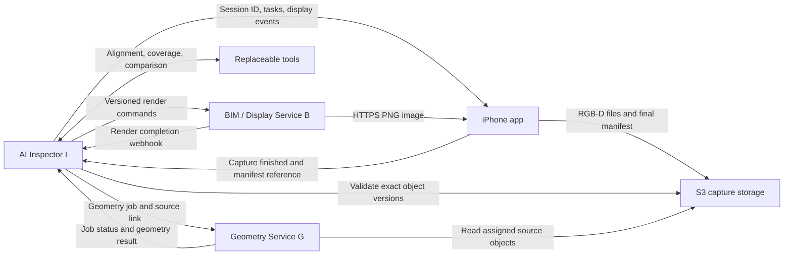

> **Update 2026-10-27 — first-case implementation:** the current iPhone/Inspector transport is specified in [the server-owner integration guide](../../docs/inspector-server-integration.md) and [mobile integration status](../../docs/mobile-integration-status.md). Oleg approved Supabase **signed upload plans**, using a separate scoped Inspector device token. The S3 versioning, S3 completion examples and earlier direct Supabase-user proposal below are superseded for this first case. Geometry ZIP is a separate pending API extension; dispatch stays with Inspector. The remainder preserves the broader earlier proposal for reference.

# iPhone → AI Inspector → Geometry Service + BIM / Display API — v0.1, редакция 5, на согласование

Дата: 2026-10-27. **PROPOSED / НЕ СОГЛАСОВАНО МЕЖДУ ВСЕМИ УЧАСТНИКАМИ.** Документ задаёт предлагаемый интерфейс; наличие работающей реализации не подтверждено. Редакция 4 отражает уточнение владельца Inspector: session_id создаёт Inspector; iPhone сохраняет весь набор RGB-D в S3 и возвращает Inspector ссылку после завершения capture; Inspector запускает Geometry Service по этой ссылке. Прямой связи телефона с Geometry Service нет.

Архитектурный контекст runtime взят из обсуждений «Design agent orchestrator» и «Open design orchestrator chat»; актуальный транспорт capture уточнён владельцем Inspector в этом чате. Детали Geometry Builder, iOS и BIM-провайдера согласуются с их владельцами.

Мобильные уточнения редакции 5: новые кадры используют frame.json 0.2, поддерживается RGB-only без LiDAR, добавлены точные ответы upload-plans. Это предложение со стороны iOS; принятие серверными реализациями ещё требуется подтвердить. Лимиты остаются конфигурацией будущей интеграции. PNG остаётся текущим display API; интерактивная 3D-модель обсуждается отдельно и этой редакцией не объявляется согласованной.

## 1. Границы и ответственность



- **Inspector I** создаёт capture session, назначает её разрешённому телефону, закрепляет project/room/model/policy и управляет состоянием. Принимает от телефона capture completion и ссылку на manifest, проверяет полный набор, фиксирует его неизменяемую версию и запускает G. Принимает результаты G, вызывает alignment/coverage/Compare tools, сохраняет выводы и управляет отображением B.
- **iPhone** получает session_id от I, сохраняет все captures под ним, загружает файлы в S3 и сообщает I о завершении после загрузки финального manifest. Не создаёт capture session_id и не вызывает G. Создаёт локальные UUID segment/observation/response/completion. Поддерживает локальное сохранение/повторы, текстовые задания и скачивание готовых BIM-картинок.
- **S3** хранит исходные файлы и manifest в выделенном session prefix. Это файловое хранилище; оно не выполняет геометрическую обработку и не принимает решений об инспекции. Inspector управляет выдачей доступа; телефон не получает AWS secret keys или service credentials.
- **Geometry Service G** принимает задания только от Inspector, читает разрешённый зафиксированный набор в S3 и возвращает фактическую геометрию с версиями и evidence refs. Не принимает uploads, session registration или команды от iPhone; не отправляет телефону события.
- **BIM / Display Service B** входит в систему Inspector и предоставляет отдельный API. Хранит эталонный BIM и готовит PNG по команде I: выбранная комната, виртуальный ракурс, цель и проверенные результаты. Телефон имеет доступ на чтение. Подсветка/ракурс не меняют исходную BIM-геометрию.
- **Агент Inspector** выбирает полезную цель и объясняет результат. Runtime проверяет предложения и версии, сохраняет состояние и вызывает tools. Pipeline принадлежит I; алгоритмы alignment/coverage могут быть заменяемыми модулями, workers или сервисами. Вызов LLM для каждого файла/кадра/render не требуется.

Во время съёмки отображается **цель задания**. Измеренное покрытие появляется **после обработки набора**. Inspector управляет ракурсом отдельной серверной BIM-картинки; пользователь может масштабировать её локально. Для хакатона — один проект и телефон. Эти решения подтверждены владельцем Inspector; конкретные service payloads остаются предложением команде.

## 2. Реализованное и предлагаемое

По исходному документу у iOS есть локальная сессия/файлы, UUID, SHA-256, синтетические данные и код ARKit; сеть, auth и реальная геометрическая корректность ещё не подтверждены. Приложение находится в ios/, исходная схема — ios/AIInspector/Observation.swift. Локальная мобильная реализация уже поддерживает RGB-only и новые кадры 0.2; это не подтверждение серверной интеграции. Session ID теперь нужно принимать от I: это изменение локальной/сетевой интеграции приложения.

Новые кадры используют **frame.json 0.2**; старые RGB-D кадры 0.1 остаются допустимыми. Бинарные соглашения RGB-D не меняются. Новый capture manifest, S3 upload plan, handoff I → G, WebSocket и серверные renders требуют реализации. Локальная демоинструкция не считается ответом живого AI.

## 3. Идентификаторы, доступ и версии

- I создаёт session_id один раз и сохраняет его до доставки телефону. chat_id, inspection_id и capture session_id различаются. Одна инспекция может иметь несколько последовательных capture sessions; parent_session_id связывает досъёмку. Новая съёмка после sealed получает новый ID от I.
- I закрепляет project_id, room_id, model_version, policy_version, capture_origin и input_mode. Повторная доставка assignment не создаёт новую сессию. Телефон хранит полученный ID после перезапуска и не подменяет его локальным UUID.
- Клиент создаёт UUID segment_id, observation_id, response_id, completion_id и upload request_id. Runtime создаёт geometry_job_id, operation_key и view_id. ID комнаты/элементов относятся к закреплённой версии BIM.
- Настройки телефона: inspector_base_url и bim_base_url. Доступ S3 приходит через ограниченные presigned HTTPS операции. **geometry_base_url и токен G телефону не выдаются.** Backend I имеет собственный geometry_base_url и service identity.
- API I/B — HTTPS, события I — WSS; Authorization: Bearer с audience/project/device scopes. Service credentials I/G/B не попадают на телефон. Presigned S3 URLs — краткоживущие разрешения на конкретные операции/объекты, отдельно от API bearer token.
- JSON UTF-8, даты UTC RFC 3339. timestamp_s ARKit — монотонное время, не UTC. API envelopes и capture_manifest_v1: schema_version="0.1". frame.json: новые кадры schema_version="0.2"; legacy RGB-D 0.1 также принимается. Неизвестная версия соответствующего документа → 422. Изменение единиц/осей/смысла существующих полей требует согласования версии. Контракт пока не выпущен; номер редакции документа не равен версии frame.json.
- Frame hashes — lowercase SHA-256 от точных байтов. Manifest и его S3 object version также фиксируются. Истёкший URL можно перевыпустить; логическая ссылка и исходные байты не меняются. S3 ETag не используется вместо SHA-256.
- Capture state, состояние обработки, task revision, display manifest revision, view revision и geometry/tool revisions раздельны. Успешный upload, completion receipt или render не означает успешную инспекцию.
- Один пишущий телефон на capture session. Project/session/device scopes проверяются на каждом API и при выдаче S3 доступа. Prefix сам по себе не является авторизацией.

## 4. Жизненный цикл

1. В рамках выбранной пользователем инспекции/комнаты AI Inspector инициирует съёмку. I создаёт session_id, закрепляет конфигурацию и назначает session телефону. Сессия хранится на I даже при отключённом телефоне.
2. Телефон получает assignment, сохраняет session_id и подтверждает начало. Каждый запуск/сброс ARKit создаёт новый segment_id внутри той же открытой capture session.
3. Телефон сохраняет кадры локально и загружает их в выделенный S3 prefix. Во время съёмки I/B могут обновлять цель, но измеренное покрытие ещё не показывается.
4. Пользователь заканчивает capture. Телефон фиксирует непустой inventory, дожидается загрузки файлов и последним загружает manifest. Затем отправляет I completion_id и ссылку на точную версию manifest. При отключении сети это сообщение остаётся в локальной очереди.
5. I долговременно принимает completion, проверяет S3/manifest/файлы. При ошибках отклоняет операцию с деталями и позволяет закончить загрузку. При успехе атомарно фиксирует источник и закрывает capture для новых входов.
6. I создаёт устойчивое geometry job и передаёт G ссылку на зафиксированный источник. G читает S3; телефон в обмене I ↔ G не участвует.
7. Готовый результат G проходит проверку связи с session/manifest/job. I вызывает alignment/coverage/Compare tools и сохраняет версии результатов. Непригодная привязка сохраняет unknown/inconclusive.
8. I обновляет B, B рендерит PNG и уведомляет I. I публикует display.updated в replayable WebSocket; телефон скачивает готовую картинку по HTTPS.
9. При необходимости досъёмки I создаёт follow-up session с новым session_id. Уже зафиксированный S3 набор и старый geometry job не изменяются.

## 5. Внешние и межсервисные API

### Маршруты приложения

| Сервис | Метод и путь | Назначение | Успех |
|---|---|---|---|
| I | GET /v1/devices/{device_id}/capture-assignments?after={cursor}&limit=100 | Получить назначенные устройству сессии с session_id | 200 |
| I | GET /v1/sessions/{s} | Конфигурация, capture/processing state и итог | 200 |
| I | POST /v1/sessions/{s}/capture-start | Идемпотентно подтвердить начало назначенной съёмки | 201 / 200 |
| I | POST /v1/sessions/{s}/upload-plans | Разрешённые S3 PUT для файлов либо manifest | 201 / 200 |
| I | POST /v1/sessions/{s}/complete | Передать ссылку на завершённый набор | 202 / 200 |
| I | GET /v1/sessions/{s}/events?after={cursor}&limit=100 | Replay / резервный polling | 200 |
| I | WSS /v1/sessions/{s}/events/ws?after={cursor} | События текущей инспекции/capture/display | 101 |
| I | GET /v1/sessions/{s}/snapshot | Атомарный session/instructions/displays/resume_cursor | 200 |
| I | GET /v1/sessions/{s}/instructions | Текущий список заданий | 200 |
| I | POST /v1/sessions/{s}/instructions/{i}/responses | Ответ/локальный прогресс пользователя | 201 / 200 |
| I | GET /v1/sessions/{s}/displays/{v} | Текущий display-манифест I | 200 |
| B | GET /v1/projects/{project_id}/models/{model_version} | Метаданные эталонного BIM | 200 |
| B | GET /v1/sessions/{s}/views/{v}/revisions/{r} | Точный render и ссылка на PNG | 200 / 202 |
| B | GET /v1/assets/{artifact_id} | Готовая PNG либо подписанный HTTPS URL из metadata | 200 / 304 |
| S3 | PUT по выданному I presigned URL | Загрузка конкретного файла/manifest | 200 |

Приложение не вызывает API G. s=session_id, i=instruction_id, v=view_id, r=view_revision. Cursors непрозрачны; пределы списков задаются конфигурацией. Значения SESSION_UUID, VERSION_ID, примерные размеры и нулевые hashes ниже — placeholders, не тестовые данные для реального приёма.

### 5.1 BIM и готовые серверные изображения

#### 5.1.1 Эталонная модель и доступ к её геометрии

B владеет неизменяемой model_version, комнатами, element IDs, нормализованными единицами и осями. I получает метаданные и геометрию комнаты через BIMPort; B предоставляет их инструментам со служебной авторизацией. Публичный GET model возвращает метаданные, например:

```json
{
  "schema_version": "0.1",
  "project_id": "demo-building",
  "model_version": "demo-room-v1",
  "room_ids": ["room-204"],
  "is_synthetic": true,
  "units": "m",
  "axes": "right_handed_y_up",
  "elements": [
    {"element_id":"door-01","ifc_guid":null,"room_id":"room-204","type":"door","label":"Doorway"}
  ]
}
```

3D-ассет USDZ не является обязательным ответом или зависимостью iPhone в этой редакции. B может использовать внутреннюю подготовленную сцену для рендерера. Форматы импорта BIM и вычислительной геометрии не задаются этим display API; импорт произвольного RVT/IFC на телефоне не требуется. Реконструкция G — отдельный производный результат и не заменяет эталонный BIM.

#### 5.1.2 Неизменяемый render у B

`render.format = raster_image_v1`: B возвращает **готовое серверное изображение**, обязательный формат первой интеграции — PNG. Это отдельная картинка комнаты/инструкции, а не совмещённое с живой камерой AR-наложение. Inspector задаёт виртуальную камеру; локальный zoom/pan картинки не изменяет её ракурс и не вызывает запись в B.

I назначает стабильный view_id для обзора комнаты либо отдельного задания. Каждая новая команда получает положительный view_revision. Телефон читает выбранную **готовую** ревизию по B GET view. Пример 200:

```json
{
  "schema_version": "0.1",
  "view_id": "view-ins-3",
  "view_revision": 4,
  "session_id": "SESSION_UUID",
  "inspection_id": "inspection-17",
  "project_id": "demo-building",
  "room_id": "room-204",
  "model_version": "demo-room-v1",
  "instruction_id": "ins-3",
  "instruction_revision": 1,
  "status": "ready",
  "input_refs": {"alignment":null,"coverage":null,"comparison":null},
  "render": {
    "format": "raster_image_v1",
    "rendered_at": "2026-10-27T10:01:04Z",
    "image": {
      "artifact_id": "render-ins-3-r4",
      "url": "/v1/assets/render-ins-3-r4",
      "url_expires_at": null,
      "media_type": "image/png",
      "width": 1280,
      "height": 960,
      "byte_length": 245760,
      "sha256": "0000000000000000000000000000000000000000000000000000000000000000"
    }
  },
  "error": null
}
```

- `status`: pending | ready | failed | superseded. Pending — 202 с render/error=null и Retry-After. Терминальные состояния — 200; ready содержит render, failed — error, superseded — render=null и superseded_by_revision. Последнее означает, что ожидавшая команда объединена с более новой; её не запускать повторно под старым ID. Готовый результат и его байты неизменяемы.
- Метаданные содержат project/inspection/session/room/model и контекст инструкции. У общего обзора instruction_id/instruction_revision=null. I и телефон сверяют контекст с выбранной задачей, а не доверяют только номеру картинки.
- URL — путь B либо выданный B подписанный HTTPS URL. Authorization B не отправляется на другой хост. Для подписанного URL url_expires_at обязателен; после истечения телефон повторяет GET той же render-ревизии. URL может обновиться, artifact_id/hash и байты остаются прежними. Хеши и размеры примера условные.
- I выбирает размер изображения в пределах лимитов B; пример 1280×960 не задаёт обязательный размер. Превышение лимитов отклоняется с 422, без скрытого изменения геометрии/ракурса. Клиент проверяет media_type, размер файла, hash и декодируемость PNG до показа.
- Чтение каждой ревизии/asset проверяет проектный доступ. Метаданные с временными URL возвращаются с Cache-Control: private, no-store. Защищённые байты картинки могут использовать private cache и ETag по содержимому; правила клиентского retention задаются отдельно. Кэш разделён по пользователю/проекту и очищается при выходе/отзыве доступа. Общедоступный bucket с картинками не подразумевается.

#### 5.1.3 Display-манифест Inspector: прогресс картинки отдельно от задания

Инструкция содержит `display_view_id`, общий экран — session.display_view_id. Ссылка обозначает **стабильное представление**, а не номер очередного render. Текущий выбор I читается через GET display и приходит полным объектом в display.updated:

```json
{
  "view_id": "view-ins-3",
  "revision": 9,
  "session_id": "SESSION_UUID",
  "inspection_id": "inspection-17",
  "project_id": "demo-building",
  "room_id": "room-204",
  "model_version": "demo-room-v1",
  "instruction_id": "ins-3",
  "instruction_revision": 1,
  "desired_ref": {"view_id":"view-ins-3","view_revision":5},
  "ready_ref": {"view_id":"view-ins-3","view_revision":4},
  "status": "pending",
  "error": null
}
```

- `revision` манифеста монотонно растёт в I. `desired_ref` — последняя запрошенная команда; `ready_ref` — последний выбранный готовый результат в **том же актуальном контексте**. Оба nullable. `status`: idle | pending | ready | failed; pending допускает готовую предыдущую картинку и подпись «Обновляется». Render failure сохраняется в display.error и не меняет итог инспекции.
- Только ready_ref разрешает показ новой картинки. Телефон получает метаданные и байты, затем повторно сверяет актуальный манифест и контекст. Более старая картинка не заменяет уже показанную новую. Если ready_ref изменился за время скачивания, скачанный старый файл не применяется поверх актуального выбора; при частых обновлениях уже отображённая пригодная картинка остаётся до завершения загрузки следующей.
- Изменение цели, текста/критериев задания или его отмена меняет instruction revision. I очищает ready_ref старого контекста и публикует актуальный манифест/инструкцию. Поздний render отменённой или предыдущей версии задания остаётся в истории. При отсутствии подходящей картинки показываются текст и нейтральный статус подготовки.
- Новое покрытие, постановка render и его завершение **не увеличивают instruction revision**, пока смысл задания тот же. Это предотвращает stale_instruction при обычном фоновом обновлении картинки. Событие display.updated меняет только display-манифест.
- Общий обзор комнаты имеет собственный view_id и instruction_id=null. На экране конкретного задания используется его display_view_id; общий обзор не подменяет контекст задания. При сбое B текстовые задания и загрузки в S3 продолжают работу. После offline/разрыва разрешено показать последнюю картинку подходящего контекста с пометкой времени и «Нет актуального обновления».

#### 5.1.4 Команда Inspector → B и уведомление B → Inspector

Только service identity I вызывает `PUT /internal/v1/sessions/{s}/views/{v}/revisions/{r}`. Пример команды:

```json
{
  "schema_version": "0.1",
  "session_id": "SESSION_UUID",
  "inspection_id": "inspection-17",
  "project_id": "demo-building",
  "room_id": "room-204",
  "model_version": "demo-room-v1",
  "view_id": "view-ins-3",
  "view_revision": 4,
  "instruction_id": "ins-3",
  "instruction_revision": 1,
  "input_refs": {"alignment":null,"coverage":null,"comparison":null},
  "display_state": {
    "visible_element_ids": null,
    "focus_element_ids": ["door-01"],
    "highlights": [{"element_ids":["door-01"],"style":"capture_target","label":"Снимите правый край проёма"}],
    "camera": {"position":[0,1.6,3],"target":[0,1,0],"up":[0,1,0]},
    "viewport": {"width":1280,"height":960},
    "image_media_type": "image/png"
  }
}
```

`visible_element_ids:null` — вся выбранная комната. Иначе focus/highlights — подмножества видимых разрешённых element IDs. Стили ручного display state: capture_target | selected | issue. Issue допускается только со ссылкой на сохранённую finding/comparison; measured coverage формирует B по проверенному input_refs.coverage, а не по произвольному цвету, выбранному LLM. Capture target не утверждает, что участок уже измерен. Camera задаётся в BIM-координатах, метры; position/target различаются, up ненулевой и не параллелен направлению взгляда. Допустим camera=null для сохранённого серверного preset комнаты. Это виртуальная камера, не измеренная поза iPhone.

Input refs указывают на неизменяемые результаты инструментов I (§7): `{result_id, revision}` или null. Они обязаны принадлежать той же inspection/session/model; если применима привязка — тому же segment и её версии. B читает результаты по настроенному внутреннему API I. Произвольные внешние URLs и callback URLs от клиента не принимаются. Отдельная регистрация сессии телефоном в B не требуется: B получает авторизованный контекст от I.

B проверяет IDs, BIM-контекст, лимиты, схему и права; после durable записи команды и задания отвечает 201 с view_id/view_revision/status. Точный повтор — 200 с состоянием той же операции; другое содержимое того же ID/revision — 409 idempotency_conflict. I сохраняет исходное тело и SHA-256 его точных байтов как command_sha256. Повтор после timeout использует то же тело и IDs.

B отправляет `POST /internal/v1/display-events` на фиксированный адрес I, например:

```json
{
  "schema_version": "0.1",
  "event_id": "display-evt-17",
  "type": "render.ready",
  "project_id": "demo-building",
  "session_id": "SESSION_UUID",
  "view_id": "view-ins-3",
  "view_revision": 4,
  "command_sha256": "0000000000000000000000000000000000000000000000000000000000000000",
  "created_at": "2026-10-27T10:01:04Z",
  "error": null
}
```

Типы: render.ready | render.failed | render.superseded; у failed error обязателен, у superseded — superseded_by_revision. I подтверждает 202 только после durable inbox, точный повтор — 200, другое содержимое event_id — 409. Дедупликация идёт по паре source service + event_id. B использует outbox/эквивалент и повторяет до подтверждения; I сверяет зависшие операции через B GET view, поэтому потерянный webhook не останавливает отображение.

Порядок исполнения:

1. Runtime I проверяет актуальность цели/результатов. В одной локальной транзакции сохраняет инструкцию при её изменении, display-манифест с desired_ref и исходящую render-команду. Текст доступен сразу.
2. Worker доставляет команду в B; B использует восстанавливаемую очередь. При недоступном B задания I и сохранённые объекты S3 не откатываются.
3. I получает webhook, сверяет его с сохранённой командой/hash и читает точное состояние B. Для готового результата проверяет контекст, refs и метаданные артефакта. B публикует ready только после проверки PNG и долговременной записи байтов; I не скачивает каждую картинку повторно, телефон проверяет полученные байты. Готовая ревизия того же актуального контекста может стать ready_ref, если она новее уже выбранной, даже когда более новая desired_ref ещё готовится. Это позволяет показывать прогресс при постоянном поступлении кадров.
4. I атомарно сохраняет выбранный ready_ref, новую revision манифеста и display.updated. Устаревший контекст/результат не меняет текущий экран. При подтверждённом superseded старая команда не переотправляется как новый render.
5. WebSocket доставляет небольшое сохранённое событие. Телефон читает выбранную картинку у B по HTTPS. После рестарта I восстанавливает outbox/inbox и незавершённые операции; телефон восстанавливает manifests и event cursor из snapshot.

Для каждого view достаточно одного выполняющегося render и одной ожидающей последней команды. Более новые команды заменяют ожидающие промежуточные; уже выполняющуюся можно завершить и показать при актуальном контексте. Ни одна принятая RGB-D запись или task/response event при таком объединении не теряется. Позднее можно разделить очередь render по проектам и workers без изменения клиентского формата.

### 5.2 Inspector создаёт сессию и передаёт её телефону

Создание инициируется авторизованным web/backend потоком: `POST /v1/inspections/{inspection_id}/capture-sessions`. Это управляющий маршрут I; телефон не создаёт session_id. Пример запроса:

```json
{
  "schema_version": "0.1",
  "request_id": "CREATE_REQUEST_UUID",
  "device_id": "iphone-1",
  "room_id": "room-204",
  "capture_origin": "device",
  "input_mode": "live_capture",
  "parent_session_id": null
}
```

I проверяет scope/устройство/room, берёт project/model/policy из инспекции, создаёт и сохраняет session + assignment в одной транзакции. 201 возвращает созданную сессию; повтор request_id/body — 200 с тем же session_id; другой body того же request_id — 409. Новый вызов без того же request_id — новая явно запрошенная сессия, а не транспортный retry.

GET capture-assignments возвращает `{"assignments":[...session objects...],"next_cursor":null}` для authenticated device. Переданный device_id сверяется с identity; он не позволяет читать чужие задания. Для MVP приложение опрашивает список при старте/возврате в foreground и пока ждёт assignment; интервал/backoff конфигурируется. Список отсортирован по серверному порядку назначения; непустой next_cursor читается до конца. Для поиска новых назначений после исчерпания списка клиент начинает новый обход; это страничный список назначений, а не event resume cursor. Повтор assignment дедуплицируется по session_id.

Пример назначенной сессии:

```json
{
  "schema_version": "0.1",
  "session_id": "SESSION_UUID",
  "inspection_id": "inspection-17",
  "project_id": "demo-building",
  "room_id": "room-204",
  "model_version": "demo-room-v1",
  "model_is_synthetic": true,
  "policy_version": "POLICY_VERSION",
  "device_id": "iphone-1",
  "capture_origin": "device",
  "input_mode": "live_capture",
  "created_at": "2026-10-27T10:00:00Z",
  "parent_session_id": null,
  "revision": 1,
  "capture_state": "assigned",
  "processing_state": "idle",
  "storage": {
    "storage_id": "capture-s3",
    "key_prefix": "projects/demo-building/sessions/SESSION_UUID/"
  }
}
```

capture_origin: device | synthetic; input_mode: live_capture | recorded_capture | synthetic_fixture. Replay не меняет происхождение реальных данных на synthetic. model_is_synthetic независимо от происхождения capture. Одна session не смешивает источники. I проверяет доступ к parent_session и совпадение проекта/модели.

POST capture-start: `{"schema_version":"0.1","operation_id":"START_UUID","device":{"name":"iPhone","os_version":"OS_VERSION","app_version":"0.1.0"}}`. I сверяет assignment и фиксирует capturing. Ответ 201/200: `{"session_id":"SESSION_UUID","operation_id":"START_UUID","capture_state":"capturing"}`. Повтор operation_id/body возвращает исходную квитанцию; другое содержимое того же ID — 409. При sealed/cancelled новая операция начала отклоняется. Полученный ранее assignment позволяет сохранять кадры локально offline; подтверждение начала отправляется с тем же session_id при восстановлении сети перед upload plans и completion.

### 5.3 S3 upload plan, сегменты и manifest

**Предлагаемая конфигурация S3:** выделенный private bucket с versioning; I выдаёт presigned SigV4 PUT для разрешённых ключей с checksum и If-None-Match: *. Телефон не имеет ListBucket/DeleteObject или постоянных AWS credentials. Для S3-совместимого провайдера эти гарантии проверяются на тестовой среде. Регион, encryption, лимиты, сроки URLs и retention задаёт backend-конфигурация. Механизмы: [presigned URLs](https://docs.aws.amazon.com/AmazonS3/latest/userguide/using-presigned-url.html), [условная запись](https://docs.aws.amazon.com/AmazonS3/latest/userguide/conditional-writes.html).

Типовые ключи:

```text
projects/{project_id}/sessions/{session_id}/observations/{observation_id}/frame.json
projects/{project_id}/sessions/{session_id}/observations/{observation_id}/rgb.jpg
projects/{project_id}/sessions/{session_id}/observations/{observation_id}/depth.f32
projects/{project_id}/sessions/{session_id}/observations/{observation_id}/confidence.u8
projects/{project_id}/sessions/{session_id}/manifests/{completion_id}.json
```

Телефон передаёт POST upload-plans с request_id, kind=observation_files и objects, например:

```json
{
  "schema_version": "0.1",
  "request_id": "UPLOAD_REQUEST_UUID",
  "kind": "observation_files",
  "completion_id": null,
  "objects": [{
    "observation_id": "OBSERVATION_UUID",
    "name": "rgb.jpg",
    "media_type": "image/jpeg",
    "byte_length": 123456,
    "sha256": "0000000000000000000000000000000000000000000000000000000000000000"
  }]
}
```

I формирует object_key сам, проверяет assignment, состояние session, разрешённые filenames/размеры и hashes. Возвращает items со status=upload_required | already_uploaded, object_key, ожидаемыми sha/size, upload_url, expires_at и точными headers; для already_uploaded дополнительно version_id, URL=null. Presigned параметры — временные credentials, не часть логической идентичности файла.

Пример ответа 201/200, когда файл нужно загрузить (URL, размер и hash условные; URL не рабочий):

```json
{
  "schema_version": "0.1",
  "request_id": "UPLOAD_REQUEST_UUID",
  "session_id": "SESSION_UUID",
  "kind": "observation_files",
  "completion_id": null,
  "items": [
    {
      "observation_id": "OBSERVATION_UUID",
      "name": "rgb.jpg",
      "status": "upload_required",
      "object_key": "projects/demo-building/sessions/SESSION_UUID/observations/OBSERVATION_UUID/rgb.jpg",
      "media_type": "image/jpeg",
      "byte_length": 123456,
      "sha256": "0000000000000000000000000000000000000000000000000000000000000000",
      "version_id": null,
      "upload_url": "https://capture-example.s3.eu-central-1.amazonaws.com/OBJECT_KEY?PRESIGNED_QUERY_PLACEHOLDER",
      "expires_at": "2026-10-27T10:15:00Z",
      "headers": {
        "Content-Type": "image/jpeg",
        "If-None-Match": "*",
        "x-amz-checksum-sha256": "AAAAAAAAAAAAAAAAAAAAAAAAAAAAAAAAAAAAAAAAAAA="
      }
    }
  ]
}
```

После проверки уже загруженного объекта I возвращает:

```json
{
  "schema_version": "0.1",
  "request_id": "UPLOAD_REQUEST_UUID",
  "session_id": "SESSION_UUID",
  "kind": "observation_files",
  "completion_id": null,
  "items": [
    {
      "observation_id": "OBSERVATION_UUID",
      "name": "rgb.jpg",
      "status": "already_uploaded",
      "object_key": "projects/demo-building/sessions/SESSION_UUID/observations/OBSERVATION_UUID/rgb.jpg",
      "media_type": "image/jpeg",
      "byte_length": 123456,
      "sha256": "0000000000000000000000000000000000000000000000000000000000000000",
      "version_id": "RGB_VERSION_ID",
      "upload_url": null,
      "expires_at": null,
      "headers": {}
    }
  ]
}
```

Ответ содержит по одному item на каждый запрошенный объект; сопоставление по observation_id + name, а не позиции массива. Некорректный запрос отклоняется целиком стандартной ошибкой API, без частичного плана. Для kind=capture_manifest envelope содержит completion_id из запроса, item.observation_id=null, item.name="capture-manifest.json", media_type="application/json", object_key заканчивается на manifests/{completion_id}.json. Остальные поля и правила статусов те же. Для upload_required version_id=null до успешного PUT; для already_uploaded version_id обязателен, upload_url/expires_at=null, headers={}. Телефон отправляет указанные headers без API Bearer токена; успешный PUT без version-id требует сверки через I, а не фиктивной квитанции.

Для upload_required обязательные headers включают Content-Type, If-None-Match: * и x-amz-checksum-sha256 (base64 байтов SHA-256, при том что JSON sha256 — hex). Используется одиночный PutObject на файл; S3 multipart upload не требуется для обычного RGB-D файла и является отдельным расширением для больших файлов. При успешном PUT телефон сохраняет x-amz-version-id. S3 receipt не является принятой инспекцией.

Точный повтор upload request_id/body возвращает ту же логическую операцию и свежие URL при необходимости; другой body того же request_id — 409. Истёкший URL обновляется через I без смены object key/hash. При 412 Object exists или timeout после PUT I устанавливает version_id из сохранённой квитанции либо HEAD текущего write-once объекта, затем сверяет checksum/size: совпадение → already_uploaded, несовпадение → 409 file_conflict. Данные под тем же observation_id не заменяются другими байтами. Неподписанные overwrite/delete операции запрещены политикой доступа. I использует сохранённый S3 checksum или пересчитывает содержимое, а не доверяет одному сообщению телефона. См. [проверку целостности S3](https://docs.aws.amazon.com/AmazonS3/latest/userguide/checking-object-integrity-upload.html).

Segment не регистрируется в G. Приложение создаёт segment_id на каждый запуск/сброс ARKit/непроверенную релокализацию и записывает его в frame.json и manifest. Между сегментами общая система координат не предполагается.

После окончания записи и загрузки файлов телефон формирует **capture_manifest_v1**. Сначала получает PUT plan с kind=capture_manifest, completion_id и единственным object name=capture-manifest.json, observation_id=null; I сопоставляет его ключу manifests/{completion_id}.json. Пример содержимого:

```json
{
  "schema_version": "0.1",
  "format": "capture_manifest_v1",
  "session_id": "SESSION_UUID",
  "inspection_id": "inspection-17",
  "project_id": "demo-building",
  "room_id": "room-204",
  "model_version": "demo-room-v1",
  "capture_origin": "device",
  "input_mode": "live_capture",
  "capture_closed_at": "2026-10-27T10:02:00Z",
  "observation_count": 1,
  "segments": [{
    "segment_id": "SEGMENT_UUID",
    "created_at": "2026-10-27T10:00:01Z",
    "units": "m",
    "coordinate_convention": "arkit_world_camera_v1",
    "matrix_layout": "rows_column_vectors"
  }],
  "observations": [{
    "observation_id": "OBSERVATION_UUID",
    "segment_id": "SEGMENT_UUID",
    "files": [
      {"name":"frame.json","object_key":"projects/demo-building/sessions/SESSION_UUID/observations/OBSERVATION_UUID/frame.json","version_id":"FRAME_VERSION_ID","byte_length":2048,"sha256":"0000000000000000000000000000000000000000000000000000000000000000"},
      {"name":"rgb.jpg","object_key":"projects/demo-building/sessions/SESSION_UUID/observations/OBSERVATION_UUID/rgb.jpg","version_id":"RGB_VERSION_ID","byte_length":123456,"sha256":"0000000000000000000000000000000000000000000000000000000000000000"},
      {"name":"depth.f32","object_key":"projects/demo-building/sessions/SESSION_UUID/observations/OBSERVATION_UUID/depth.f32","version_id":"DEPTH_VERSION_ID","byte_length":196608,"sha256":"0000000000000000000000000000000000000000000000000000000000000000"},
      {"name":"confidence.u8","object_key":"projects/demo-building/sessions/SESSION_UUID/observations/OBSERVATION_UUID/confidence.u8","version_id":"CONFIDENCE_VERSION_ID","byte_length":49152,"sha256":"0000000000000000000000000000000000000000000000000000000000000000"}
    ]
  }]
}
```

Каждый observation входит один раз и ссылается на объявленный segment; имена/ключи/versions принадлежат тому же prefix и observation. frame.json и rgb обязательны. depth обязателен только если frame.depth != null; confidence — только если frame.confidence != null. При RGB-only оба файла отсутствуют, их нельзя заменять пустыми файлами или синтетическими измерениями. Manifest перечисляет точный inventory без дубликатов; observation_count совпадает с длиной списка. Hash frame.json считается по исходным сохранённым байтам, без пересериализации. Новый manifest не меняет файлы наблюдений.

Необязательный excluded_observations — список `{observation_id, reason}` для ранее заявленных локальных записей, которые явно не включены в передаваемый набор; по умолчанию пуст. ID принадлежит этой session и не повторяется среди observations; причина непустая. I сохраняет исключения и учитывает их при достаточности evidence: исключённая запись не считается обработанной или подтверждающей выполнение задания.

Финальный manifest загружается **последним**, когда все указанные object versions доступны. Его собственные version_id/sha256/byte_length передаются I в completion. Частичные данные могут лежать в S3, но не становятся входом G до принятия manifest I.

### 5.4 Наблюдение и бинарные форматы

Каждое наблюдение сохраняется локально и отдельными объектами S3; HTTP multipart-запроса телефона к G нет. Файлы одного наблюдения:

| Роль | filename | Content-Type | Обязательность |
|---|---|---|---|
| `metadata` | `frame.json` | `application/json` | Да |
| `rgb` | `rgb.jpg` | `image/jpeg` | Да |
| `depth` | `depth.f32` | `application/octet-stream` | Только если metadata.depth != null |
| `confidence` | `confidence.u8` | `application/octet-stream` | Только если metadata.confidence != null |

Один набор получается из **одного ARFrame**. Независимо снятое фото нельзя соединять с произвольным кадром depth.

- RGB: JPEG исходного `capturedImage`, без поворота, crop, изменения размера и EXIF-поворота. Поворот экранного превью не меняет файлы и intrinsics.
- Depth: несглаженный `sceneDepth`, float32 little-endian, метры, row-major, без padding строк; ровно `width × height × 4` байт. Значения NaN/Infinity/≤0 сохраняются как есть, но исключаются из геометрии.
- Confidence: uint8 row-major, то же разрешение, ровно `width × height` байт; 0/1/2 = low/medium/high. Если нет карты — `confidence: null`, файл отсутствует.
- Без normal tracking реальный кадр не сохраняется. На устройстве с поддержкой sceneDepth клиент ждёт карту глубины. На устройстве без LiDAR сохраняется RGB-only наблюдение: фото, K_rgb, T_world_camera и время из одного ARFrame; это визуальное evidence, а не измерение поверхности. У синтетического кадра `tracking_state: synthetic`, `depth_source: synthetic_plane`.
- SHA-256 — lowercase hex от точных байтов файла. `byte_length` — точный размер файла. Имена файлов фиксированы, без произвольных путей.

Пример metadata, соответствует именам полей текущего Swift-кода:

```json
{
  "schema_version": "0.2",
  "observation_id": "OBSERVATION_UUID",
  "frame_id": "OBSERVATION_UUID",
  "session_id": "SESSION_UUID",
  "segment_id": "SEGMENT_UUID",
  "instruction_id": null,
  "capture_origin": "device",
  "timestamp_s": 15423.234,
  "saved_at": "2026-10-27T10:00:05Z",
  "rgb_size": [1920,1440],
  "depth_size": [256,192],
  "K_rgb": [[1400,0,960],[0,1400,720],[0,0,1]],
  "T_world_camera": [[1,0,0,0],[0,1,0,0],[0,0,1,0],[0,0,0,1]],
  "tracking_state": "normal",
  "depth_source": "sceneDepth",
  "depth_unit": "m",
  "image_orientation": "native_buffer_unrotated_no_exif_rotation",
  "source_to_stored_image": [[1,0,0],[0,1,0],[0,0,1]],
  "depth_to_rgb_mapping": "Unrotated aligned buffers; pixel origin top-left, u right/v down. Scale K_rgb rows 0/1 by depthWidth/rgbWidth and depthHeight/rgbHeight. Device reprojection validation pending.",
  "rgb": {"name":"rgb.jpg","byte_length":123456,"sha256":"0000000000000000000000000000000000000000000000000000000000000000"},
  "depth": {"name":"depth.f32","byte_length":196608,"sha256":"0000000000000000000000000000000000000000000000000000000000000000"},
  "confidence": {"name":"confidence.u8","byte_length":49152,"sha256":"0000000000000000000000000000000000000000000000000000000000000000"}
}
```

Размеры, intrinsics и поза в примере условные, не результаты измерения. Geometry Service проверяет JPEG dimensions, бинарные размеры, хеши, форму/конечность матриц, положительные focal lengths, валидность rigid transform и принадлежность segment/session. Для frame.json 0.1/0.2 `frame_id == observation_id`. `instruction_id` — контекст съёмки, а не доказательство принадлежности пикселей конкретному BIM-объекту. I проверяет принадлежность instruction_id сессии по истории заданий. Поздний кадр со старой инструкцией может оставаться evidence, но не подтверждает выполнение новой версии задания. G читает исходные файлы из S3 и не обращается к телефону.

Для RGB-only в frame.json 0.2 `depth_source="none"`, а `depth`, `depth_size`, `depth_unit`, `depth_to_rgb_mapping`, `confidence` — явные JSON null. Остальные поля кадра сохраняют тот же смысл. capture_origin=device и input_mode=live_capture не означают наличие LiDAR. Новые RGB-D кадры тоже имеют версию 0.2; в них поля глубины заполнены как раньше. Legacy 0.1 допускается только с обязательной глубиной по прежней схеме.

I принимает и хранит RGB-only как визуальные наблюдения. Приём источника не означает пригодность для реконструкции. До запуска G runtime проверяет поддержку фактического набора: если G требует depth, ему не передаются RGB-only как измерения. Без пригодных RGB-D данных I запрашивает досъёмку с LiDAR либо использует согласованный визуальный инструмент; итог геометрической проверки остаётся needs_more_data/unknown. Для смешанного набора фактически использованные и исключённые observations должны быть явно перечислены в результате G. Конкретную поддержку RGB-only в G необходимо подтвердить его владельцу; этот текст не объявляет алгоритм реализованным.

### 5.5 Телефон завершает capture: ссылка → Inspector

POST I /v1/sessions/{s}/complete:

```json
{
  "schema_version": "0.1",
  "completion_id": "COMPLETION_UUID",
  "capture_ref": {
    "storage_id": "capture-s3",
    "manifest_key": "projects/demo-building/sessions/SESSION_UUID/manifests/COMPLETION_UUID.json",
    "manifest_version_id": "MANIFEST_VERSION_ID",
    "manifest_byte_length": 4096,
    "manifest_sha256": "0000000000000000000000000000000000000000000000000000000000000000"
  }
}
```

Это устойчивая ссылка на конкретный S3 manifest, а не URL с истекающей подписью. I знает bucket/region по storage_id и самостоятельно выдаёт временный доступ. Произвольный bucket, внешний URL, локальный путь телефона или другой session prefix не принимается. Session ID в path, assignment, manifest и каждом frame совпадает. [S3 versionId](https://docs.aws.amazon.com/AmazonS3/latest/userguide/RetrievingObjectVersions.html) фиксирует конкретную версию вместо чтения текущего объекта по одному key.

1. I аутентифицирует устройство, сохраняет operation/body и capture_ref, переводит capture_state=submitted, processing_state=validating и отвечает 202 после durable commit: `{"session_id":"SESSION_UUID","completion":{"completion_id":"COMPLETION_UUID","status":"pending","error":null}}`. Другой completion при незавершённой проверке → 409 completion_in_progress. Точный повтор ID/body — 200 с состоянием этой операции; другой body того же ID → 409 idempotency_conflict.
2. Worker читает **точную версию** manifest, проверяет byte_length/hash/schema, совпадение конфигурации I, непустой inventory/segments и отсутствие дубликатов. Проверяет существование/size/SHA всех указанных object versions и соответствие frame metadata. Набор должен включать observation IDs, ранее заявленные capture_recorded; исключение записи требует явной причины, а не молчаливой потери. Для больших данных допускается проверенный S3 checksum; если его нет/он непригоден, hash пересчитывается. Геометрическая корректность проверяется G/tools отдельно.
3. При недостающих/несовпадающих файлах completion.status=rejected с деталями missing_files/hash_mismatches. Capture возвращается в capturing, input snapshot не фиксируется и G не запускается. Телефон завершает загрузку и отправляет **новый** completion_id/manifest. Повтор старого rejected возвращает прежний отказ.
4. При временной недоступности S3 проверка остаётся pending и повторяется с теми же IDs. Это не доказательство отсутствия набора. При успешной проверке I атомарно фиксирует accepted source (manifest version/hash), capture_state=sealed, completion.status=accepted, processing_state=queued_geometry и outbox запуска G.
5. После sealed новые upload plans, start или новый completion для этой session отклоняются с 409 session_closed; точный повтор принятой операции допустим. Выданные ранее URL могут ещё существовать, поэтому неизменяемость входа обеспечивают **зафиксированные object versions и hashes**, а не предположение, что ссылка сразу отозвана. Поздние посторонние объекты не входят в принятую версию manifest.

Полный набор фиксируется в Inspector; вызова G seal нет. Ошибка/timeout G после фиксации не открывает capture заново. Для нового evidence I создаёт другую session. Состояние открытых заданий collecting не блокирует передачу набора на анализ: их фактическая пригодность может быть определена только после обработки.

### 5.6 События, инструкции и восстановление

I ведёт одну сохраняемую историю session events. Основной foreground-транспорт — **WebSocket, исходящее соединение телефона с I**; GET events обслуживает replay и резервный polling. Бинарные картинки/RGB-D в поток событий не включаются.

GET events без after возвращает начало доступной истории. Пример:

```json
{
  "events": [{
    "event_id": "evt-17",
    "type": "instruction.created",
    "session_id": "SESSION_UUID",
    "created_at": "2026-10-27T10:01:00Z",
    "instruction": {
      "instruction_id": "ins-3",
      "revision": 1,
      "session_id": "SESSION_UUID",
      "model_version": "demo-room-v1",
      "target_element_ids": ["door-01"],
      "display_view_id": "view-ins-3",
      "text": "Снимите правый край проёма с другого ракурса.",
      "language": "ru",
      "state": "pending",
      "target_region": null,
      "audio": null
    }
  }],
  "next_cursor": "cursor-17",
  "has_more": false
}
```

Типы: instruction.created | instruction.updated | instruction.cancelled — полный объект instruction; session.updated — полное состояние I GET session; display.updated — полный display-манифест §5.1.3. События и курсоры одинаковы для HTTP и WebSocket. Доставка at-least-once; дедупликация по event_id, сохранение курсора только после применения всей доставленной порции. Старые/равные revisions одного ресурса не заменяют новые. Неизвестный тип пропускается с диагностикой и сохранением курсора.

Состояния instruction: pending | collecting | satisfied | cannot_complete | cancelled. display_view_id nullable; ссылка не содержит render-ревизии. Изменение задачи увеличивает revision; обычное display.updated её не меняет. При отмене старый контекст картинки снимается. Для v0.1 target_region/audio=null; координаты и измерения не извлекаются разбором текста.

**WebSocket:** `wss://<I>/v1/sessions/{s}/events/ws?after={cursor}`, Authorization в handshake, subprotocol inspector.events.v1. Сервер проверяет доступ и cursor до upgrade. Сначала replay после переданного курсора, затем новые события в том же порядке; регистрация live-подписки и чтение replay не оставляют промежутка с потерей событий. JSON-сообщение event batch:

```json
{
  "type": "events.batch",
  "events": [{
    "event_id": "evt-18",
    "type": "display.updated",
    "session_id": "SESSION_UUID",
    "created_at": "2026-10-27T10:01:04Z",
    "display": {
      "view_id": "view-ins-3",
      "revision": 9,
      "session_id": "SESSION_UUID",
      "inspection_id": "inspection-17",
      "project_id": "demo-building",
      "room_id": "room-204",
      "model_version": "demo-room-v1",
      "instruction_id": "ins-3",
      "instruction_revision": 1,
      "desired_ref": {"view_id":"view-ins-3","view_revision":4},
      "ready_ref": {"view_id":"view-ins-3","view_revision":4},
      "status": "ready",
      "error": null
    }
  }],
  "next_cursor": "cursor-18",
  "has_more": false
}
```

Для heartbeat используются WebSocket Ping/Pong; интервалы и idle timeout — конфигурация развёртывания. Auth expiry/revocation закрывает поток и требует обновления доступа. Если cursor устарел до upgrade — HTTP 410; после upgrade — `{"type":"stream.error","error":{"code":"cursor_expired","message":"Reload snapshot","retryable":false,"details":{}}}`, затем закрытие соединения. Ошибки доступа не вызывают бесконечное переподключение с тем же токеном.

При старте/истёкшем cursor телефон читает **GET snapshot**. Ответ `{"session":{...},"instructions":[...],"displays":[...],"resume_cursor":"..."}` получен из одной серверной точки: все части включают события не позднее resume_cursor. Клиент атомарно применяет снимок и подключается после resume_cursor. События, возникшие во время скачивания snapshot, доступны в replay. Существующий GET instructions остаётся снимком списка заданий; для полного восстановления нового клиента используется snapshot.

При разрыве соединения приложение сохраняет состояние, переподключается после последнего применённого cursor с backoff+jitter. Если WSS временно недоступен, использует GET events последовательно, ориентир polling 2 секунды. has_more=true — немедленно читает следующую порцию. Один активный транспорт на сессию; переключение транспортов не сбрасывает cursor. Ограниченная очередь отправки сокета при медленном клиенте может закрыться с resync_required: серверная история сохраняется, телефон восстанавливается через replay/snapshot. Надёжность доставки обеспечивает прикладная история, а не само наличие открытого сокета.

Foreground — условие целевой задержки. При уходе приложения в фон непрерывная доставка не является требованием; при возвращении выполняется синхронизация. Push/background notifications могут быть добавлены отдельно. Входящий webhook телефона не используется.

**I POST response:**

```json
{
  "schema_version": "0.1",
  "response_id": "RESPONSE_UUID",
  "instruction_revision": 1,
  "action": "capture_recorded",
  "text": null,
  "observation_ids": ["OBSERVATION_UUID"],
  "input_mode": "button",
  "audio": null
}
```

Действия: acknowledged | capture_recorded | cannot_complete | message. Capture_recorded означает, что телефон локально сохранил указанные observation IDs по заданию; это не подтверждение загрузки, принятия набора или пригодности измерений. I сохраняет IDs как заявленные, после принятия manifest сверяет их с набором, а затем проверяет evidence по результатам инструментов. Task остаётся collecting до выполнения критериев. Для capture_recorded нужен непустой список локальных наблюдений этой сессии, связанных с instruction_id; для остальных — пустой список. Для message нужен text; cannot_complete может содержать причину. input_mode: button | typed; voice — расширение.

Состояние collecting не запрещает отправить полный набор на обработку: проверка пригодности evidence может зависеть от Geometry Service. Если обработка выявила нехватку данных, I завершает результатом needs_more_data и создаёт новую follow-up session для досъёмки. В одной sealed session новая съёмка не открывается.

Квитанция: `{"response_id":"RESPONSE_UUID","status":"accepted"}` — принятие ответа, не достаточность evidence. Семантически устаревшая instruction revision → 409 stale_instruction с текущей инструкцией в details. Изменение display-манифеста само по себе не вызывает этот конфликт. При осознанной новой отправке после конфликта — новый response_id. Точный повтор успешного response_id/body возвращает исходную квитанцию **до** проверки текущей revision; другой body того же ID → 409.

### 5.6.1 Текущий MVP: локальные уведомления без APNs

Согласовано с Олегом: стартовый экран ждёт назначение Inspector, без камеры и автоматически открытой локальной сессии. При получении новой assignment во время работы приложения в foreground клиент сохраняет назначение и создаёт локальное системное уведомление, если пользователь разрешил уведомления. Повторная доставка той же session_id не создаёт повторных уведомлений. Нажатие открывает приложение; доступность/актуальность сессии проверяется через I до перехода к съёмке. Камера включается пользователем. В отсутствии сети/доступа показывается ожидание, а не выдуманное задание.

Этот режим не доставляет новые задания, когда iOS приостановила или закрыла приложение. При возвращении клиент перечитывает capture-assignments. Системное уведомление — дополнительный сигнал; отказ в разрешении не скрывает задание из интерфейса. На стартовом экране нет тестовых кнопок или входа в локальную съёмку; только заглушка ожидания назначения. Сетевой клиент assignment ещё требуется реализовать.

### 5.6.2 Будущее расширение APNs (выключено, не подключено)

Inspector остаётся инициатором: после долговременного создания session + assignment сохраняет исходящую push-операцию. APNs — уведомление о назначении, не источник истины. Polling assignments и replay/snapshot остаются обязательными при открытии приложения. Доставка и показ не гарантируются; отключённые уведомления не блокируют съёмку. Нативный APNs требует Apple Developer Program; текущая Personal Team этой интеграции не обеспечивает. Web Push через отдельное Home Screen веб-приложение — возможная альтернатива, ещё не выбранная и не реализованная.

Предлагаемые API I (сервер пока не реализован):

- PUT /v1/devices/{device_id}/push-registration с API Bearer: `{"schema_version":"0.1","provider":"apns","token":"HEX_DEVICE_TOKEN","environment":"development","topic":"com.aiinspector.capture"}`. 201 при создании, 200/204 при идемпотентной замене текущей регистрации устройства. I сверяет device identity, разрешённые topic/environment; токен не даёт прав на сессии. Один актуальный токен на device/topic/environment, без дублирования подписок. APNs token обновляется при каждом запуске; повтор PUT использует актуальный токен, ошибки доступа требуют обновления авторизации.
- DELETE того же пути отзывает регистрацию при выходе из аккаунта, 204 идемпотентно. Завершённый logout должен также отвязать регистрацию на сервере; отсутствие сети не даёт основания сообщать об успешном отзыве. Полноценный logout flow в iOS пока отсутствует.

Пример payload: `{"aps":{"alert":{"title":"AI Inspector","body":"Вам назначена новая съёмка"},"sound":"default"},"schema_version":"0.1","type":"capture.assigned","event_id":"11111111-1111-4111-8111-111111111111","session_id":"22222222-2222-4222-8222-222222222222"}`. IDs — UUID; одно исходящее событие сохраняет event_id при повторах. I использует apns-push-type=alert и topic/environment соответствующей регистрации. Доступ к APNs signing key есть только у сервера; ключи, токены и приватные задания не попадают в push/debug-логи. Невалидный/отозванный APNs token деактивируется; временные ошибки повторяются с ограниченным backoff.

При нажатии клиент проверяет доступ и актуальность через I GET session/snapshot, затем открывает назначение; отменённая/закрытая/недоступная сессия не начинает новую съёмку. Существующая несохранённая работа не переключается автоматически. Камера включается пользователем. В foreground допускаются banner и карточка, без смены активной сессии. Сейчас мобильный код только сохраняет проверенный по формату hint; authenticated lookup и навигацию ещё нужно связать с backend. Локальный тест или симуляция не подтверждают доставку I → APNs → iPhone.

### 5.7 Состояние Inspector и итог

I GET session / session.updated возвращает конфигурацию assignment из §5.2 и актуальные поля состояния. Ниже сокращённый пример полей состояния:

```json
{
  "session_id": "SESSION_UUID",
  "inspection_id": "inspection-17",
  "revision": 8,
  "capture_state": "sealed",
  "processing_state": "building_geometry",
  "completion": {"completion_id":"COMPLETION_UUID","status":"accepted","error":null},
  "source": {"status":"accepted","manifest_sha256":"0000000000000000000000000000000000000000000000000000000000000000","observation_count":1},
  "geometry_job": {"job_id":"GEOMETRY_JOB_UUID","status":"processing","geometry_revision":null},
  "display_view_id": "view-room-progress",
  "result": null,
  "error": null
}
```

- capture_state: assigned | capturing | submitted | sealed | cancelled. Processing_state: idle | validating | queued_geometry | building_geometry | evaluating | completed | failed | cancelled. Capturing не означает, что файлы уже в S3; sealed означает, что вход зафиксирован, но обработка может идти/ошибиться.
- completion=null до первой операции; затем текущая pending | rejected | accepted. Retry старого completion_id возвращает состояние именно старой операции. Отказ проверки источника — completion.error; сбой обработки — верхний error/geometry_job. Один timeout не меняет принятую операцию на failed.
- source=null до первой проверки; далее status=pending | rejected | accepted с manifest_sha256 и принятым observation_count, когда известен. Geometry_job=null до создания операции; status=queued | fetching | processing | ready | failed | cancelled. Внутренний retry не создаёт новый job при неизвестном результате.
- display_view_id — общий обзор комнаты/итога, у него instruction_id=null. Экран задания использует его display_view_id. Готовность картинки и ready_ref хранятся в отдельном display-манифесте I; она не продвигает processing state.
- Перед финалом I сохраняет результаты каждой обязательной проверки либо допустимую причину неопределённости. После sealed новые задания съёмки создаются в follow-up session, которую I связывает с той же inspection_id. Отмена обработки фиксируется в I; поздние результаты не продвигают отменённый workflow.

Пример result для завершённого анализа:

```json
{
  "outcome": "needs_more_data",
  "analysis_origin": "mock",
  "summary": "Недостаточно данных о правой стороне проёма.",
  "evidence_observation_ids": ["OBSERVATION_UUID"],
  "report_url": null
}
```

Outcome: issues_found | no_issues_detected | needs_more_data; analysis_origin: live_model | recorded_model | mock. Evidence принадлежит принятому набору; межсессионные findings внутри инспекции хранят явные session refs. No_issues_detected — результат текущего анализа, не сертифицированная приёмка. Completed не означает отсутствие дефектов. Display failure не меняет сохранённый итог.

### 5.8 Inspector запускает Geometry Service по ссылке

Ни один маршрут этого раздела не вызывается телефоном. У I/G/B — service identities с project/session scope; исходные AWS credentials хранилища телефону и G через приложение не передаются.

| Принимающий сервис | Метод/путь | Назначение |
|---|---|---|
| G | PUT /internal/v1/jobs/{job_id} | I создаёт устойчивый geometry job по зафиксированному источнику |
| G | GET /internal/v1/jobs/{job_id} | I сверяет статус и пропущенные уведомления |
| I | GET /internal/v1/sessions/{s}/capture-source | G получает/обновляет временный доступ только к принятому набору |
| I | GET /internal/v1/sessions/{s}/capture-source/files?after={cursor}&limit=100 | G получает страницы ссылок на точные object versions набора |
| I | POST /internal/v1/geometry-events | G сообщает состояние/готовность/ошибку задания |
| B | PUT /internal/v1/sessions/{s}/views/{v}/revisions/{r} | I задаёт render-команду |
| I | POST /internal/v1/display-events | B сообщает ready/failed/superseded |
| I | GET /internal/v1/sessions/{s}/tool-results/{result_id}/revisions/{r} | Авторизованный B/tool читает неизменяемый результат I |

I создаёт geometry_job_id и operation_key до вызова G, сохраняет job + outbox в той же транзакции, что принятый источник. Пример PUT job:

```json
{
  "schema_version": "0.1",
  "job_id": "GEOMETRY_JOB_UUID",
  "operation_key": "STABLE_OPERATION_KEY",
  "session_id": "SESSION_UUID",
  "inspection_id": "inspection-17",
  "project_id": "demo-building",
  "room_id": "room-204",
  "model_version": "demo-room-v1",
  "processing_profile_version": "GEOMETRY_PROFILE_VERSION",
  "source_ref": {
    "url": "https://inspector.example/internal/v1/sessions/SESSION_UUID/capture-source",
    "manifest_sha256": "0000000000000000000000000000000000000000000000000000000000000000",
    "manifest_version_id": "MANIFEST_VERSION_ID"
  }
}
```

Source_ref.url — стабильная служебная ссылка I на уже принятый S3 набор; host/путь выбирает I из доверенной конфигурации. G не следует произвольному URL от телефона. Получив эту ссылку, G запрашивает I со своей service identity; I проверяет доступ job/session и возвращает storage_id, manifest version/hash/byte_length, presigned manifest_url, expires_at и files_url из таблицы. Приложение в этом обмене не участвует.

GET capture-source/files выдаёт `items` с name, observation_id, object_key, version_id, byte_length, sha256, download_url, expires_at и next_cursor. Ссылки ограничены **точными версиями из принятого manifest**, а не всем bucket/prefix; страницы читают один неизменяемый snapshot. G скачивает байты напрямую из S3, не пересылая bearer token I на S3. При истечении URLs повторно получает доступ через I, сохраняя тот же job/source hash. Обновлённые подписи не меняют идентичность job и не требуют нового geometry run. Крупные RGB-D не проксируются через I.

G отвечает 201 после durable записи job/очереди; точный повтор job_id/body — 200 с состоянием того же job; другое содержимое принятого ID или тот же operation_key с другими входами — 409. Повтор timeout не создаёт новый ID. При повторной обработке после терминального сбоя I создаёт явно новый AnalysisRun/job только по политике, сохраняя parent job и ту же immutable source ref. Транспортный retry и новый запуск обработки различаются.

Пример готового события G → I:

```json
{
  "schema_version": "0.1",
  "event_id": "geometry-evt-17",
  "type": "geometry.ready",
  "project_id": "demo-building",
  "session_id": "SESSION_UUID",
  "job_id": "GEOMETRY_JOB_UUID",
  "job_revision": 4,
  "manifest_sha256": "0000000000000000000000000000000000000000000000000000000000000000",
  "geometry_revision": 1,
  "created_at": "2026-10-27T10:05:00Z",
  "error": null
}
```

Типы: geometry.updated | geometry.ready | geometry.failed. Updated содержит job status; ready требует geometry_revision; failed требует error и geometry_revision=null. I отвечает 202 после durable inbox; точный повтор source/event_id — 200, другой payload того же event_id — 409. G публикует через outbox/эквивалент и повторяет до подтверждения; I после рестарта/по таймауту сверяет GET job.

GET job содержит job/session/project, неизменяемые входы и source hash, status/revision/error; ready — geometry_revision, evidence_observation_ids, excluded_observations с причинами и artifacts. Artifact: artifact_id, kind=point_cloud | reconstructed_model, URL, media_type, byte_length, sha256. Если данные исключены, они не скрываются; I проверяет пригодность результата по policy. Событие observation.accepted от G больше не используется: G обрабатывает полный набор, принятый I.

I не применяет старые/чужие job results к текущей session: проверяет job_id, source hash, model/profile, актуальную workflow version и отмену. Неизвестные/неготовые данные не считаются успешной геометрией. Конкретный формат реконструкции/PLY и геометрические гарантии нужно согласовать с владельцем G.

## 6. Координаты — обязательный пункт согласования

- Все JSON-матрицы — **массивы строк**; умножаются на векторы-столбцы. Swift SIMD хранит столбцы: сериализация в приложении явно переставляет индексы.
- `T_world_camera` — 4×4, **camera → world текущего segment**, не world → camera. Метры, правая система; world Y вверх, камера смотрит вдоль −Z, её X вправо, Y вверх.
- `K_rgb` — 3×3 intrinsics сохранённого исходного RGB; не экранного превью.
- Proposed pixel convention: начало сверху слева, u вправо, v вниз. `K_depth = diag(depthWidth/rgbWidth, depthHeight/rgbHeight, 1) × K_rgb`.
- Для пикселя (u,v) с depth d: `p_optical = d × inverse(K_depth) × [u,v,1]`; затем `p_camera = diag(1,-1,-1) × p_optical`; затем `p_world = T_world_camera × [p_camera,1]`.
- Это предлагаемое соглашение. Pixel-center convention, соответствие RGB/depth и знак осей **обязательно проверить на реальном наборе** до фиксации v1. Не считать синтетические тесты доказательством качества LiDAR.
- В backend точка переводится в BIM через отдельно вычисленное `T_bim_world`. Исходные poses и measurements не переписывать под BIM и не притягивать измеренные дефекты к проектным поверхностям.
- Поля `depth_to_rgb_mapping`/`coordinates` текущих локальных файлов пояснительные; сервер использует согласованную схему v0.1, а не парсит произвольный текст как алгоритм.

## 7. Инструменты Inspector: привязка, покрытие, сравнение

**Решение владельца Inspector:** pipeline находится в I, вычисления выполняют заменяемые детерминированные инструменты. Выделять отдельную LLM или отдельный HTTP-сервис для каждого этапа необязательно. I предоставляет зафиксированные исходные данные S3, G — реконструкцию; B — эталонную геометрию. Реализация конкретного алгоритма и поддерживаемые проверки требуют отдельного согласования и не объявляются готовыми этим документом.

Последовательность I после capture completion: проверить и зафиксировать S3 manifest → GeometryPort.startBuild по ссылке на источник → принять и проверить geometry.ready → получить/проверить alignment → вычислить coverage → выполнить необходимые сравнения → сохранить результаты и обновить BIM render. Во время съёмки B показывает только цель; измеренное покрытие появляется после обработки полного набора. I сохраняет измерения и применяет policy, затем агент объясняет сохранённый итог. Gate перед запуском G проверяет доступность и целостность входа; он не требует результата coverage, для которого ещё нужна реконструкция G.

Для запуска инструмента I сохраняет operation_key из inspection/session, типа операции и неизменяемых версий входов, включая manifest_sha256. Запись создаётся до внешнего вызова. Инструмент поддерживает этот ключ либо поиск задания по нему. Завершение сопоставляется с job_id/operation_key и версиями, старый результат сохраняется для истории, но не меняет текущий контекст. LLM не получает произвольную запись в state/БД и не ослабляет закреплённую политику.

Минимальные зависимости:

| Инструмент | Входы | Проверяемый результат |
|---|---|---|
| Alignment | model_version, segment_id, калибровка, immutable evidence и независимые опорные данные | T_bim_world, метод/версия, метрики погрешности и неоднозначности, статус valid/invalid/unknown по policy |
| Coverage | Геометрия комнаты, пригодная alignment revision для segment, RGB-D/poses/intrinsics, показатели качества | Версионированные наблюдённые/неизвестные/недостаточные участки, evidence refs и quality issues |
| Compare | Закреплённый BIM, финальная geometry revision, пригодная alignment, policy/tolerances | Измерения по element/check ID, погрешность, evidence и непроверенные элементы; I вычисляет outcome |

Все принятые I результаты доступны через фиксированный служебный GET tool-result. Оболочка:

```json
{
  "schema_version": "0.1",
  "result_id": "coverage-17",
  "revision": 3,
  "kind": "coverage",
  "inspection_id": "inspection-17",
  "session_id": "SESSION_UUID",
  "project_id": "demo-building",
  "room_id": "room-204",
  "model_version": "demo-room-v1",
  "policy_version": "POLICY_VERSION",
  "created_at": "2026-10-27T10:05:03Z",
  "producer": {"tool":"coverage-tool","version":"TOOL_VERSION"},
  "status": "valid",
  "input_refs": {
    "alignment": {"result_id":"alignment-17","revision":1},
    "manifest_sha256": "0000000000000000000000000000000000000000000000000000000000000000",
    "geometry_revision": 1
  },
  "evidence_observation_ids": ["OBSERVATION_UUID"],
  "payload": {
    "geometry_package_version": "ROOM_GEOMETRY_VERSION",
    "regions": [{"region_id":"door-01-surface-right","element_id":"door-01","state":"observed"}],
    "quality_issues": []
  }
}
```

Оболочка — минимальная граница хранения/чтения Inspector. Детальные payload каждого kind, метод разбиения поверхностей и критерии принятия требуют согласования с реализацией tools; пример region не является готовым алгоритмом или подтверждённым реальным ID. B применяет coverage только когда поддерживает явно согласованный payload и geometry_package_version. Неподдерживаемая версия не превращается в фиктивное покрытие: measured overlay не отображается, I сохраняет ошибку совместимости, цель задания остаётся доступна.

Для alignment payload обязательны segment_id, T_bim_world и качество; reset ARKit требует отдельного результата для нового segment. Для coverage region IDs принадлежат подготовленной геометрии закреплённой модели. Крупные маски/инвентари могут быть immutable артефактами с content hash вместо массивов в событии. Отсутствие evidence, попадание поверхности в RGB-кадр и подтверждённое depth измерение имеют разные состояния. I не объявляет весь элемент покрытым из-за одного измеренного участка. Процент покрытия разрешён только с согласованным знаменателем/областью оценки.

До пригодной alignment и согласованного coverage payload input_refs.coverage=null: B может показывать BIM и цель, а измеренное покрытие/положение камеры остаётся unknown. Подсветка «снять здесь» не обозначает «уже снято». Новый более точный расчёт может уменьшить оценку покрытия; монотонна версия результата, а не процент. Ошибка alignment не превращается в вывод о смещённой стене.

Точный допуск, погрешность, критерии достаточности и schema Compare фиксируются отдельной policy/контрактом. no_issues_detected не преобразуется автоматически в compliant: I проверяет полноту scope и неопределённость. При недостатке данных результат — needs_more_data/внутренний inconclusive.

Голос остаётся расширением: можно озвучивать существующий text локально. Аудиозагрузка/распознавание и input_mode=voice согласуются отдельно и не блокируют текст.

## 8. Ошибки, повторы и сохранность

Ошибки I/B/G API:

```json
{
  "code": "capture_source_incomplete",
  "message": "Some capture files are unavailable",
  "retryable": false,
  "details": {"missing_files":["observations/OBSERVATION_UUID/depth.f32"],"hash_mismatches":[]}
}
```

| Случай | Действие |
|---|---|
| 400 / 422 | Исправить данные; неизменённый запрос автоматически не повторять |
| 401 / 403 API | Обновить доступ соответствующего сервиса, сохраняя очередь |
| 403 / expired presigned S3 URL | Запросить свежий upload plan/download access у I; не менять source IDs/hash |
| 404 | Проверить назначенную session, model, file version или job; недостающий файл не считается загруженным |
| 409 | Разобрать code; не создавать новый ID для обычного retry |
| 410 cursor_expired | Применить snapshot I и продолжить после resume_cursor |
| 412 S3 conditional PUT | Сверить существующий объект через I; совпадает → already_uploaded, иначе file_conflict |
| 413 / превышение лимитов | Показать ограничение, не менять RGB/depth без согласованной схемы |
| 429 | Учитывать Retry-After |
| Сеть / timeout / 5xx | Повтор той же операции/IDs/байтов, backoff с jitter |

Ориентир backoff: 1, 2, 4, 8… до 30 секунд, больше при Retry-After. Очередь переживает перезапуск. Телефон различает local_saved, uploaded_s3, accepted_by_inspector и processed; файлы не удаляются после одного PUT или HTTP 202. Срок хранения локальных/S3/render данных — конфигурация до интеграции.

I хранит принятые completion/job/tool/display операции и outbox/inbox. Сбой G не делает исходную ссылку открытой заново; сбой B не отменяет source или результат анализа. Presigned URLs, AWS/API credentials и содержимое кадров не пишутся в debug-логи. Жизненный цикл S3 не удаляет версии принятого источника, пока обязательные processing/retry операции используют их; retention должен учитывать и старые pinned versions, и текущие объекты.

## 9. Подтверждённые решения и открытые зависимости

Подтверждено владельцем Inspector:

- Session ID создаёт Inspector и передаёт iPhone.
- Телефон сохраняет весь RGB-D набор под этим ID в S3, после завершения возвращает Inspector ссылку на набор.
- Inspector запускает Geometry Service по ссылке; iPhone и G напрямую не связаны.
- Во время съёмки показывается цель; измеренное покрытие — после обработки набора.
- Inspector владеет pipeline и вызывает заменяемые alignment/coverage tools.
- B выдаёт готовую серверную BIM-картинку; ракурс задаёт I, телефон масштабирует локально. Обновление картинки ориентировано на 2–5 секунд; загрузка набора и реконструкция имеют отдельные длительности.
- Для хакатона — один проект и один телефон; интерфейсы сохраняют scopes/версии для роста.

Согласовать с владельцами реализаций:

- [ ] G принимает job/source link от I, читает разрешённые S3 versions, поддерживает operation key, job status и callbacks; телефон не вызывает G.
- [ ] iOS принимает backend session_id, сохраняет его offline, пишет segments/frame.json и финальный manifest, использует S3 checksum/presigned PUT и completion I.
- [ ] Заданы S3 bucket/region/versioning, политики условной записи и checksum, backend roles, сроки URL/retention и тестовая среда.
- [ ] Подтверждены I/B PNG, display manifests, WebSocket/snapshot/replay, render commands/webhooks и токены с проектными правами.
- [ ] Заданы лимиты набора/файлов/изображений, частоты запросов и очередей, история событий и таймауты. Значения — конфигурация, не выбор LLM.
- [ ] Согласованы вычислительная геометрия B, payloads alignment/coverage/Compare, поддерживаемые проверки и качество/допуски. Их реализация не объявляется готовой этим контрактом.

## 10. Приёмка интеграции

1. I создаёт один session_id; повтор запроса создания и повтор assignment не создают другую сессию. Телефон сохраняет ID после перезапуска.
2. Все локальные/S3 captures и manifest имеют этот session ID. Reset камеры создаёт segment, а не новый capture session; разные сегменты не смешиваются без alignment.
3. Телефон работает только с I/B/S3: сетевой клиент и конфигурация не содержат обязательного G endpoint/token.
4. Обрыв S3 PUT и timeout после успешной записи восстанавливаются с тем же объектом/checksum; 412 сверяется, без скрытого overwrite. Хеши frame.json и бинарных файлов соответствуют сохранённым байтам.
5. Completion с недостающими/подменёнными файлами отклоняется без запуска G. Принятая точная версия manifest и файлов фиксируется I; поздняя новая версия S3 не меняет вход job.
6. После restart/timeout I отправляет G тот же job_id/operation_key/source. G обновляет истёкший доступ через I, читает S3 и не обращается к телефону.
7. Геометрический результат проверен на реальном RGB-D: оси, intrinsics, depth и измеренная ошибка; исключённые кадры перечислены явно. Mock/synthetic/recorded различаются.
8. При съёмке показывается только цель. Измеренная coverage появляется после полного набора и пригодной alignment/tool schema; unknown не отображается как проверенное покрытие.
9. Render/progress не меняет semantic task revision. Captured acknowledgement не закрывает task без фактической проверки; collecting не блокирует запуск полного набора.
10. WSS replay/snapshot, повторные callbacks и старые geometry/render revisions не теряют события и не заменяют актуальный контекст. Истёкший PNG URL обновляется для того же artifact/hash.
11. После sealed новый capture получает ID от I с parent_session_id. Сбой G/B и поздние события не открывают старую съёмку и не запускают дубли операций.
12. Условия 2–5-секундного display-обновления измерены отдельно от времени upload/geometry; приведены p50/p95, сеть, модель и разрешение.
13. Доступ другого device/project к assignment, manifest, S3 URLs, job и PNG отклоняется. Данные не становятся публичными по знанию UUID или object prefix.

## 11. История редакций и миграция

Редакция 1 предлагала прямые API iPhone к G/I и G → I notifications. Редакция 2 выделила B с локальной сценой; редакция 3 уточнила серверный PNG, WebSocket и Inspector-owned tools.

**Редакция 4 по последнему уточнению владельца заменяет транспорт capture:** session_id создаёт I; iPhone → S3 → completion со ссылкой в I → job от I в G → чтение G из S3. Удалены телефонные G session/segment/observation/uploads endpoints, G durable receipt для телефона, G observation.accepted и протокол I → G seal. Новый источник истины о принятом полном наборе — Inspector и его pinned S3 manifest. Во время съёмки measured coverage не обещается.

В редакции 4 сохранялся frame.json 0.1; редакция 5 предлагает frame.json 0.2 с nullable depth и legacy-чтением 0.1. Бинарные соглашения RGB-D сохраняются; HTTP multipart телефона к G заменён загрузкой объектов S3. Старое observations_submitted заменено capture_recorded с явным смыслом локального прогресса. Изменены session creation, completion, geometry jobs и source ownership. Это несовместимое изменение транспорта для уже выпущенного клиента; до реализации всем участникам нужно выбрать одну редакцию. Предлагаемая schema_version=0.1 относится к ещё не выпущенному контракту, а не является заявлением совместимости со старыми endpoints.

Редакция основана на последнем обсуждении Inspector в этом чате и «Open design orchestrator chat» для server-render/WebSocket. Исходное вложение — историческая версия; эта копия в репозитории является текущим предложением. Провайдер BIM и детальные schemas tools/Compare — отдельные зависимости.

## 12. Исполнение Inspector и дальнейший рост

Для хакатона допустим один backend I с модулем coverage, отдельным адаптером B и сохраняемой очередью workers. Логические порты не требуют немедленного развёртывания каждого модуля как микросервиса. Дальнейшее выделение tools/renderer в процессы не меняет идентификаторы, версии и публичные события.

- **Состояние:** одна authoritative запись inspection/session и проверка expected state version при применении proposal/result. I атомарно фиксирует предметные изменения и outbox; принимающие сервисы используют durable inbox и дедупликацию. Checkpointer оркестратора не заменяет предметное хранилище и ключи внешних операций.
- **Планирование:** capture registration/source verification, tools и render имеют отдельные ограниченные очереди. Быстрый транспорт повторяет сообщения; runtime решает, какой актуальный контекст применять. Очереди могут разделяться по project/session, с лимитами конкурентности и справедливостью между проектами. Брокер для хакатона не обязателен; долговременная доставка обязательна.
- **Рендеринг:** подготовленный BIM кэшируется по project/model_version, применяются новые display state и refs. I объединяет частые coverage updates и вызывает агента при значимых изменениях. Render job никогда не обрабатывает произвольный пользовательский скрипт или URL. Изображения и большие данные передаются как защищённые артефакты по HTTPS; события содержат небольшие refs.
- **Версии:** task revision, display manifest revision, view revision, geometry revision и tool-result revision имеют разные области. Ни cursor событий, ни revision G не заменяют версии результатов I/B. Применение проверяет весь необходимый набор входов, включая policy/model/segment/alignment.
- **Наблюдаемость:** correlation/operation IDs связывают capture completion I, geometry job, tool job, render job, inbox/outbox и display event; credentials, signed URLs и payload кадров в debug-логи не попадают. Метрики: возраст очередей, retries, ошибки tools/render, lag событий, задержка новой картинки и пропущенные промежуточные render.
- **Измерение задержки:** отдельно фиксируются capture finish→загрузка всех объектов S3, completion I→готовность геометрии, geometry→tool results, принятое display state I→render.ready→показ на телефоне. Цель 2–5 секунд относится к последнему пути обновления картинки при foreground и согласованных условиях сети/модели. Время загрузки всего набора и реконструкции измеряется отдельно; оно не обещается равным 2–5 секундам. Метрики p50/p95 и объёмы/разрешение определяются на реальном прогоне, до обещаний SLA.
- **Развитие:** несколько независимых capture sessions/проектов используют те же scopes и протокол. Совместная запись нескольких телефонов в одну сессию, AR-наложение, свободная интерактивная 3D-навигация и видеострим являются отдельными расширениями с явным согласованием capabilities/schema.

Транспортные опоры: [WebSocket, RFC 6455](https://www.rfc-editor.org/rfc/rfc6455) для соединения и Ping/Pong; [HTTP Caching, RFC 9111](https://www.rfc-editor.org/rfc/rfc9111) для Cache-Control. Replay, snapshots, идемпотентность и версии — правила приложения Inspector поверх транспорта.
