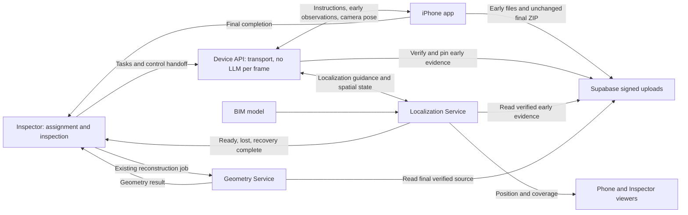

> **Revision 8 — 28 October 2026: Geometry ZIP parts take precedence over the earlier transport below.** Oleg approved the MOBILE_CAPTURE_PROMPT file format and splitting large captures into independent ZIP archives. The phone does not call `/sessions/extract`; after Storage upload it notifies only Inspector. Existing completions/sessions retain their previous transport.
>
> Each ZIP contains `capture.json`, `mesh.ply` (for LiDAR), and `frames/{original_frame_id}/{rgb.jpg,metadata.json,depth.bin?,confidence.bin?}`. Metadata uses schema_version=1.0, intrinsics.K/width/height and pose.T_world_from_camera; depth is copied without changing float32 values. capture.json contains project_id, session_id and the frame_count for that part. RGB-only: depth/confidence=null; mesh=null when no mesh is available. No new frame IDs are created.
>
> Each part contains only one segment_id; that segment's mesh is repeated in each of its parts. These are independent ZIP archives, not binary chunks of one ZIP. Maximum part size: min(server max_archive_bytes − 64 KiB, 15 MiB). If the mesh plus one frame exceeds this limit, export is explicitly blocked while originals are retained; automatic splitting of a single mesh/frame is not yet supported.
>
> Upload plan: `kind=geometry_archive`, a shared completion_id, object `capture-0001.zip` (then 0002...), media_type=application/zip and actual byte_length/sha256. The server assigns the key: `{session.storage.key_prefix}geometry/{completion_id}/{name}`. The bucket root is not used.
>
> After all parts, `kind=capture_manifest` uploads capture-manifest.json: schema_version=1.0, format=geometry_capture_parts_v1, session_id, project_id, completion_id, the full capture's frame_count and parts[]. Each part includes name, segment_id, frame_ids, depth_frame_ids (frames with BOTH depth AND confidence), byte_length, sha256 and object_key. RGB-only/frames without confidence go into separate parts with empty depth_frame_ids; consumers can avoid downloading these ZIPs.
>
> `/complete`: schema_version=0.1, completion_id, capture_ref={format:supabase_geometry_parts_v1, storage_id:capture-supabase, manifest_key, manifest_byte_length, manifest_sha256}. Inspector validates parts sequentially, retains accepted copies and returns the ordinary receipt. Support is negotiated through capture_formats in `/v1/capabilities`; the new client does not use this transport without it. The new format does not imply configured Geometry integration; that launch is outside the current mobile test.

> **Revision 7 — 28 October 2026, superseding references below to a mandatory final ZIP:** as agreed with Oleg, new iPhone sessions complete by uploading individual `observations/<id>/{rgb.jpg,frame.json,depth.f32?,confidence.u8?}` through `kind=observation_files`, followed by the shared manifest through `kind=capture_manifest`. Completion uses the existing `supabase_capture_v1`, the server-issued manifest key and actual size/SHA256. Session, observation and segment IDs and source bytes are preserved. A 150 MB capture does not become one Storage object; cloud limits remain 16 MiB per file and 4 MiB per manifest. Inspector already supports this format; Geometry receives the agreed source reference from Inspector, not a direct phone call. Prepared but unsent ZIPs without a completion request migrate to files; in-flight completion requests remain unchanged. Early observations and the final manifest reference the same IDs/bytes. ZIP remains supported for older clients but is not mandatory for new ones. Automatic Geometry integration is separate server configuration.

> **Revision 6 — 28 October 2026:** this shared contract includes the separate Localization Service workflow agreed with Oleg: Inspector assigns a task → Localization directly guides initial alignment through the app → Inspector continues inspection while Localization tracks position and coverage in parallel. Loss of alignment suspends the Inspector task until recovery. Localization is skipped without BIM. The API extensions in §13 are proposals for owner agreement, not implemented endpoints. The final Inspector ZIP and existing Geometry interface remain unchanged. Early observations are additionally transferred through existing signed upload plans. Earlier S3/PNG examples below retain historical context; linked guides describe current capture transport, and §13 describes online localization.

> **Update 2026-10-27 — first-case implementation:** the current iPhone/Inspector transport is specified in [the server-owner integration guide](../../docs/inspector-server-integration.md) and [mobile integration status](../../docs/mobile-integration-status.md). Oleg approved Supabase **signed upload plans**, using a separate scoped Inspector device token. The S3 versioning, S3 completion examples and earlier direct Supabase-user proposal below are superseded for this first case. Geometry ZIP is a separate pending API extension; dispatch stays with Inspector. The remainder preserves the broader earlier proposal for reference.

# iPhone → AI Inspector → Geometry Service + BIM / Display API — v0.1, revision 6, for agreement

Date: 2026-10-28. **PROPOSED / NOT AGREED BY ALL PARTICIPANTS.** This document defines a proposed interface; a working implementation is not established. Revision 4 reflects the Inspector owner's clarification: Inspector creates session_id; the iPhone stores the complete RGB-D capture in S3 and returns its reference to Inspector after capture completes; Inspector starts Geometry Service using that reference. The phone does not communicate directly with Geometry Service.

The runtime architecture context comes from the “Design agent orchestrator” and “Open design orchestrator chat” discussions; the Inspector owner clarified current capture transport in this chat. Geometry Builder, iOS and BIM-provider details require agreement with their owners.

Revision 5 mobile clarifications: new frames use frame.json 0.2, RGB-only without LiDAR is supported, and exact upload-plans responses are added. This is an iOS-side proposal; acceptance by server implementations still needs confirmation. Limits remain configuration for future integration. PNG remains the current display API; an interactive 3D model is discussed separately and is not declared agreed in this revision.

## 1. Scope and responsibilities



- **Inspector I** creates a capture session, assigns it to an authorized phone, pins project/room/model/policy and owns state. It accepts capture completion and a manifest reference from the phone, validates the complete capture, pins its immutable version and starts G. It accepts G results, uses L results, invokes Compare, saves findings and controls B displays. During initial alignment the agent waits: L authors user instructions, and the API forwards them without LLM rewriting.
- **iPhone** receives session_id from I, saves all captures under it, uploads files to S3 and notifies I of completion after the final manifest upload. It does not create the capture session_id or invoke G. It creates local segment/observation/response/completion UUIDs. It supports local persistence/retries, text instructions and downloads of prepared BIM images.
- **S3** stores source files and the manifest under a dedicated session prefix. It is file storage; it neither processes geometry nor makes inspection decisions. Inspector grants access; the phone receives no AWS secret keys or service credentials.
- **Geometry Service G** accepts tasks only from Inspector, reads the authorized pinned S3 capture and returns observed geometry with versions and evidence references. It accepts no uploads, session registrations or commands from the iPhone and sends no events to the phone.
- **BIM / Display Service B** belongs to the Inspector system and exposes a separate API. It stores reference BIM and prepares PNGs on I's command: selected room, virtual viewpoint, target and verified results. The phone has read access. Highlighting/viewpoints do not change the source BIM geometry.
- **Localization Service L** is a separate service. Given a suitable BIM model, it guides the user through the app (door, floor, corner), calculates and validates alignment. After success it returns task control to I while continuing camera and coverage tracking for both interfaces. If alignment is lost, it temporarily takes control for recovery. L's instructions do not require an Inspector LLM call; transport through I's API does not change authorship. §13 specifies the detailed contract and control state.
- **Inspector agent** selects a useful target and explains results. The runtime validates proposals and versions, saves state and invokes tools. I owns the inspection pipeline; the separate L owns online alignment and coverage and runs its stage autonomously. No LLM call is required for every file/frame/render.

During capture, the current control owner supplies the displayed instruction: L during alignment/recovery, I during inspection. Online position and provisional coverage come from L; confirmed coverage requires evidence processing and quality checks (§13). Inspector controls the viewpoint of a separate server-generated BIM image; the user may zoom it locally. The hackathon scope is one project and phone. The Inspector owner confirmed these decisions; specific service payloads remain a team proposal.

## 2. Implemented and proposed behavior

According to the original document, iOS has local sessions/files, UUIDs, SHA-256, synthetic data and ARKit code; networking, auth and real geometric correctness are not yet verified. The app is in ios/ and the original schema is ios/AIInspector/Observation.swift. The local mobile implementation already supports RGB-only and new 0.2 frames; this does not establish server integration. The app must now accept the session ID from I, requiring a change to its local/network integration.

New frames use **frame.json 0.2**; legacy RGB-D 0.1 frames remain valid. RGB-D binary conventions do not change. The new capture manifest, S3 upload plan, I → G handoff, WebSocket and server renders require implementation. A local demo instruction is not a live AI response.

## 3. Identifiers, access and versions

- I creates session_id once and persists it before delivering it to the phone. chat_id, inspection_id and capture session_id are distinct. One inspection may have multiple sequential capture sessions; parent_session_id links additional captures. A new capture after sealed receives a new ID from I.
- I pins project_id, room_id, model_version, policy_version, capture_origin and input_mode. Redelivering an assignment does not create a new session. The phone retains the received ID after restart and does not substitute a local UUID.
- The client creates segment_id, observation_id, response_id, completion_id and upload request_id UUIDs. The runtime creates geometry_job_id, operation_key and view_id. Room/element IDs refer to the pinned BIM version.
- Phone settings: inspector_base_url and bim_base_url. S3 access arrives through restricted presigned HTTPS operations. **The phone receives neither geometry_base_url nor G's token.** Backend I has its own geometry_base_url and service identity.
- I/B APIs use HTTPS and I events use WSS; Authorization: Bearer carries audience/project/device scopes. I/G/B service credentials never reach the phone. Presigned S3 URLs are short-lived permissions for specific operations/objects, separate from the API bearer token.
- JSON uses UTF-8; dates use UTC RFC 3339. ARKit timestamp_s is monotonic time, not UTC. API envelopes and capture_manifest_v1 use schema_version="0.1". frame.json uses schema_version="0.2" for new frames; legacy RGB-D 0.1 remains accepted. An unknown version for the relevant document returns 422. Changes to units/axes/field meanings require version agreement. The contract is not yet released; document revision numbers are not frame.json versions.
- Frame hashes are lowercase SHA-256 of exact bytes. The manifest and its S3 object version are also pinned. Expired URLs may be renewed; the logical reference and original bytes remain unchanged. S3 ETags do not replace SHA-256.
- Capture state, processing state, task revision, display manifest revision, view revision and geometry/tool revisions are separate. Successful upload, completion receipt or rendering does not mean successful inspection.
- One phone writes each capture session. Every API and S3 access grant checks project/session/device scopes. A prefix alone is not authorization.

## 4. Lifecycle

1. Inspector creates and assigns session_id with pinned project/room/model. The phone receives the assignment and notifies the user by an available method; this does not promise system APNs in the current build.
2. The user opens the camera; the phone acknowledges receipt and capture-start. Each ARKit start/reset creates a separate segment_id.
3. If BIM is available and usable, L takes instruction control. Through the app it asks the user to show a known door, floor and wall/corner. I waits for the result. Without BIM, ordinary I-controlled capture begins; an unusable supplied BIM is an explicit error/blocked state, not a silent skip.
4. The phone saves observations and uploads the required source files before final completion through signed upload plans. The API validates/pins bytes and forwards evidence to L without invoking the agent. L requests additional views until alignment is usable.
5. L reports success to the app and I. I resumes instruction control while L updates camera position and coverage in both interfaces. Loss of alignment suspends I's instruction; L guides recovery, then I's current instruction resumes. Only one instruction source is active at a time (§13).
6. The user finishes capture. The phone freezes its inventory, uploads the existing final Inspector ZIP through a Supabase signed upload plan and sends the existing completion. Early observations retain the same IDs/bytes; network loss permits durable retry.
7. I validates and pins the final source, seals the capture and launches the existing G job. Geometry reads the final source and reconstructs the model; its contract is unchanged and it does not perform early localization.
8. I validates G results, L results and required comparisons, saves findings and updates displays. Online coverage does not establish construction compliance.
9. Additional capture after sealed receives a new linked session; late results/callbacks do not reopen the old one. Source capture may be retained without successful localization, but BIM coverage/inspection cannot be declared complete.

## 5. External and inter-service APIs

### App routes

Read the historical routes below alongside the current transport guide. §13 defines proposed early-observation and spatial-state routes plus camera.pose and spatial.updated; they must not be called before capability negotiation.

| Service | Method and path | Purpose | Success |
|---|---|---|---|
| I | GET /v1/devices/{device_id}/capture-assignments?after={cursor}&limit=100 | Retrieve device assignments with session_id | 200 |
| I | GET /v1/sessions/{s} | Configuration, capture/processing state and result | 200 |
| I | POST /v1/sessions/{s}/capture-start | Idempotently acknowledge the start of assigned capture | 201 / 200 |
| I | POST /v1/sessions/{s}/upload-plans | Authorized S3 PUTs for files or manifest | 201 / 200 |
| I | POST /v1/sessions/{s}/complete | Submit the completed capture reference | 202 / 200 |
| I | GET /v1/sessions/{s}/events?after={cursor}&limit=100 | Replay / fallback polling | 200 |
| I | WSS /v1/sessions/{s}/events/ws?after={cursor} | Current inspection/capture/display events | 101 |
| I | GET /v1/sessions/{s}/snapshot | Atomic session/instructions/displays/resume_cursor | 200 |
| I | GET /v1/sessions/{s}/instructions | Current instruction list | 200 |
| I | POST /v1/sessions/{s}/instructions/{i}/responses | User response/local progress | 201 / 200 |
| I | GET /v1/sessions/{s}/displays/{v} | I's current display manifest | 200 |
| B | GET /v1/projects/{project_id}/models/{model_version} | Reference BIM metadata | 200 |
| B | GET /v1/sessions/{s}/views/{v}/revisions/{r} | Exact render and PNG reference | 200 / 202 |
| B | GET /v1/assets/{artifact_id} | Prepared PNG or signed HTTPS URL from metadata | 200 / 304 |
| S3 | PUT to the presigned URL issued by I | Upload a specific file/manifest | 200 |

The app does not call G's API. s=session_id, i=instruction_id, v=view_id, r=view_revision. Cursors are opaque; list limits are configured. SESSION_UUID, VERSION_ID, illustrative sizes and zero hashes below are placeholders, not valid intake test data.

### 5.1 BIM and prepared server images

#### 5.1.1 Reference model and geometry access

B owns the immutable model_version, rooms, element IDs, normalized units and axes. I obtains room metadata and geometry through BIMPort; B exposes them to tools with service authorization. Public GET model returns metadata, for example:

```json
{
  "schema_version": "0.1",
  "project_id": "demo-building",
  "model_version": "demo-room-v1",
  "room_ids": ["room-204"],
  "is_synthetic": true,
  "units": "m",
  "axes": "right_handed_y_up",
  "elements": [
    {"element_id":"door-01","ifc_guid":null,"room_id":"room-204","type":"door","label":"Doorway"}
  ]
}
```

A USDZ 3D asset is not a mandatory response or iPhone dependency in this revision. B may use an internally prepared renderer scene. This display API does not prescribe BIM/computational geometry import formats; arbitrary RVT/IFC import on the phone is not required. G's reconstruction is a separate derived result and does not replace reference BIM.

#### 5.1.2 Immutable render at B

`render.format = raster_image_v1`: B returns a **prepared server image**; PNG is mandatory for the first integration. This is a separate room/instruction image, not an AR overlay aligned with the live camera. Inspector selects the virtual camera; local image zoom/pan neither changes its viewpoint nor writes to B.

I assigns a stable view_id for the room overview or a specific instruction. Each new command receives a positive view_revision. The phone reads the selected **ready** revision through B GET view. Example 200:

```json
{
  "schema_version": "0.1",
  "view_id": "view-ins-3",
  "view_revision": 4,
  "session_id": "SESSION_UUID",
  "inspection_id": "inspection-17",
  "project_id": "demo-building",
  "room_id": "room-204",
  "model_version": "demo-room-v1",
  "instruction_id": "ins-3",
  "instruction_revision": 1,
  "status": "ready",
  "input_refs": {"alignment":null,"coverage":null,"comparison":null},
  "render": {
    "format": "raster_image_v1",
    "rendered_at": "2026-10-27T10:01:04Z",
    "image": {
      "artifact_id": "render-ins-3-r4",
      "url": "/v1/assets/render-ins-3-r4",
      "url_expires_at": null,
      "media_type": "image/png",
      "width": 1280,
      "height": 960,
      "byte_length": 245760,
      "sha256": "0000000000000000000000000000000000000000000000000000000000000000"
    }
  },
  "error": null
}
```

- `status`: pending | ready | failed | superseded. Pending returns 202 with render/error=null and Retry-After. Terminal states return 200; ready contains render, failed contains error, and superseded contains render=null and superseded_by_revision. The last means a queued command was coalesced with a newer one; do not execute it again under the old ID. A ready result and its bytes are immutable.
- Metadata contains project/inspection/session/room/model and instruction context. A general overview has instruction_id/instruction_revision=null. I and the phone validate context against the selected task rather than trusting only an image number.
- The URL is a B path or a signed HTTPS URL issued by B. B's Authorization is not forwarded to another host. Signed URLs require url_expires_at; after expiry, the phone repeats GET for the same render revision. The URL may change while artifact_id/hash and bytes remain unchanged. Example hashes and sizes are illustrative.
- I chooses image dimensions within B's limits; 1280×960 is an example, not a mandatory size. Exceeding limits returns 422 without silently changing geometry/viewpoint. Before display, the client validates media_type, file size, hash and PNG decodability.
- Reading each revision/asset checks project access. Metadata containing temporary URLs uses Cache-Control: private, no-store. Protected image bytes may use a private cache and content-based ETag; client retention rules are separate. Cache is partitioned by user/project and cleared on logout/access revocation. A public image bucket is not implied.

#### 5.1.3 Inspector display manifest: image progress separate from task state

An instruction contains `display_view_id`; the general screen uses session.display_view_id. The reference identifies a **stable view**, not an individual render number. I's current selection is read through GET display and delivered as a full object in display.updated:

```json
{
  "view_id": "view-ins-3",
  "revision": 9,
  "session_id": "SESSION_UUID",
  "inspection_id": "inspection-17",
  "project_id": "demo-building",
  "room_id": "room-204",
  "model_version": "demo-room-v1",
  "instruction_id": "ins-3",
  "instruction_revision": 1,
  "desired_ref": {"view_id":"view-ins-3","view_revision":5},
  "ready_ref": {"view_id":"view-ins-3","view_revision":4},
  "status": "pending",
  "error": null
}
```

- The manifest's `revision` increases monotonically in I. `desired_ref` is the latest requested command; `ready_ref` is the latest selected ready result in **the same current context**. Both are nullable. `status`: idle | pending | ready | failed; pending permits an earlier ready image with an “Updating” label. Render failure is retained in display.error and does not change the inspection outcome.
- Only ready_ref authorizes displaying a new image. The phone downloads metadata and bytes, then rechecks the current manifest and context. An older image cannot replace a newer displayed one. If ready_ref changes during download, the old downloaded file must not override the current selection; with frequent updates, a suitable displayed image remains until the next finishes loading.
- A changed target, instruction text/criteria or cancellation changes instruction revision. I clears ready_ref for the old context and publishes the current manifest/instruction. Late renders from cancelled or previous instruction versions remain in history. Without a suitable image, show text and a neutral preparation status.
- New coverage, queuing a render and render completion **do not increase instruction revision** while the task's meaning is unchanged. This prevents stale_instruction during ordinary background image refresh. display.updated changes only the display manifest.
- The general room overview has its own view_id and instruction_id=null. A specific task screen uses that task's display_view_id; the overview does not replace task context. If B fails, text instructions and S3 uploads continue. After offline/disconnection, the last suitable image may be shown with its timestamp and “No current update.”

#### 5.1.4 Inspector → B command and B → Inspector notification

Only I's service identity calls `PUT /internal/v1/sessions/{s}/views/{v}/revisions/{r}`. Example command:

```json
{
  "schema_version": "0.1",
  "session_id": "SESSION_UUID",
  "inspection_id": "inspection-17",
  "project_id": "demo-building",
  "room_id": "room-204",
  "model_version": "demo-room-v1",
  "view_id": "view-ins-3",
  "view_revision": 4,
  "instruction_id": "ins-3",
  "instruction_revision": 1,
  "input_refs": {"alignment":null,"coverage":null,"comparison":null},
  "display_state": {
    "visible_element_ids": null,
    "focus_element_ids": ["door-01"],
    "highlights": [{"element_ids":["door-01"],"style":"capture_target","label":"Capture the right edge of the opening"}],
    "camera": {"position":[0,1.6,3],"target":[0,1,0],"up":[0,1,0]},
    "viewport": {"width":1280,"height":960},
    "image_media_type": "image/png"
  }
}
```

`visible_element_ids:null` means the entire selected room. Otherwise, focus/highlights must be subsets of visible authorized element IDs. Manual display-state styles: capture_target | selected | issue. Issue requires a reference to a saved finding/comparison; B derives measured coverage from validated input_refs.coverage, not an arbitrary LLM-selected color. Capture target does not claim the area is already measured. Camera uses BIM coordinates in metres; position and target differ, and up is nonzero and not parallel to the viewing direction. camera=null is allowed for a saved server-side room preset. This is a virtual camera, not a measured iPhone pose.

Input refs identify immutable I tool results (§7): `{result_id, revision}` or null. They must belong to the same inspection/session/model and, where alignment applies, the same segment and alignment version. B reads results through I's configured internal API. Arbitrary external URLs and client-provided callback URLs are rejected. The phone need not register a separate session with B: B obtains authorized context from I.

B validates IDs, BIM context, limits, schema and permissions; after durably saving the command and job it returns 201 with view_id/view_revision/status. An exact retry returns 200 with the same operation's state; different content under the same ID/revision returns 409 idempotency_conflict. I retains the original body and SHA-256 of its exact bytes as command_sha256. A retry after timeout uses the same body and IDs.

B sends `POST /internal/v1/display-events` to I's fixed address, for example:

```json
{
  "schema_version": "0.1",
  "event_id": "display-evt-17",
  "type": "render.ready",
  "project_id": "demo-building",
  "session_id": "SESSION_UUID",
  "view_id": "view-ins-3",
  "view_revision": 4,
  "command_sha256": "0000000000000000000000000000000000000000000000000000000000000000",
  "created_at": "2026-10-27T10:01:04Z",
  "error": null
}
```

Types: render.ready | render.failed | render.superseded; failed requires error, superseded requires superseded_by_revision. I acknowledges with 202 only after durable inbox storage; an exact repeat returns 200, changed event_id content returns 409. Deduplication uses source service + event_id. B uses an outbox/equivalent and retries until acknowledged; I reconciles stuck operations through B GET view, so a lost webhook does not stop display updates.

Execution order:

1. Runtime I validates current targets/results. In one local transaction it saves a changed instruction, the display manifest with desired_ref and the outgoing render command. Text is available immediately.
2. A worker delivers the command to B, which uses a recoverable queue. If B is unavailable, I's tasks and saved S3 objects are not rolled back.
3. I receives the webhook, checks it against the saved command/hash and reads B's exact state. For a ready result it validates context, refs and artifact metadata. B publishes ready only after PNG validation and durable byte storage; I does not redownload every image, while the phone checks the received bytes. A ready revision in the same current context may become ready_ref if newer than the current selection, even while a newer desired_ref is still being prepared. This allows visible progress during continuous frame arrival.
4. I atomically saves the selected ready_ref, a new manifest revision and display.updated. Stale context/results do not alter the current screen. Once superseded is confirmed, an old command is not resent as a new render.
5. WebSocket delivers the small persisted event. The phone reads the selected image from B over HTTPS. After restart, I recovers its outbox/inbox and unfinished operations; the phone recovers manifests and the event cursor from snapshot.

One active render and one latest queued command per view are sufficient. Newer commands replace queued intermediate commands; an active render may finish and be displayed if its context remains current. This coalescing loses no accepted RGB-D record or task/response event. Render queues can later be partitioned by project and worker without changing the client format.

### 5.2 Inspector creates a session and assigns it to the phone

An authorized web/backend flow initiates creation: `POST /v1/inspections/{inspection_id}/capture-sessions`. This is I's control route; the phone does not create session_id. Example request:

```json
{
  "schema_version": "0.1",
  "request_id": "CREATE_REQUEST_UUID",
  "device_id": "iphone-1",
  "room_id": "room-204",
  "capture_origin": "device",
  "input_mode": "live_capture",
  "parent_session_id": null
}
```

I validates scope/device/room, takes project/model/policy from the inspection, and creates and saves session + assignment in one transaction. 201 returns the created session; repeating request_id/body returns 200 with the same session_id; a different body under that request_id returns 409. A call without the same request_id is a new explicitly requested session, not a transport retry.

GET capture-assignments returns `{"assignments":[...session objects...],"next_cursor":null}` for the authenticated device. Supplied device_id is checked against identity and cannot expose other devices' assignments. For the MVP, the app polls on startup/foreground return and while waiting for assignment; interval/backoff is configured. The list follows server assignment order; consume a nonempty next_cursor to the end. To find new assignments after exhausting the list, start a new traversal; this is a paginated assignment list, not an event resume cursor. Duplicate assignments are deduplicated by session_id.

Example assigned session:

```json
{
  "schema_version": "0.1",
  "session_id": "SESSION_UUID",
  "inspection_id": "inspection-17",
  "project_id": "demo-building",
  "room_id": "room-204",
  "model_version": "demo-room-v1",
  "model_is_synthetic": true,
  "policy_version": "POLICY_VERSION",
  "device_id": "iphone-1",
  "capture_origin": "device",
  "input_mode": "live_capture",
  "created_at": "2026-10-27T10:00:00Z",
  "parent_session_id": null,
  "revision": 1,
  "capture_state": "assigned",
  "processing_state": "idle",
  "storage": {
    "storage_id": "capture-s3",
    "key_prefix": "projects/demo-building/sessions/SESSION_UUID/"
  }
}
```

capture_origin: device | synthetic; input_mode: live_capture | recorded_capture | synthetic_fixture. Replay does not change real-data origin to synthetic. model_is_synthetic is independent of capture origin. A session does not mix sources. I validates access to parent_session and matching project/model.

POST capture-start: `{"schema_version":"0.1","operation_id":"START_UUID","device":{"name":"iPhone","os_version":"OS_VERSION","app_version":"0.1.0"}}`. I verifies assignment and records capturing. Response 201/200: `{"session_id":"SESSION_UUID","operation_id":"START_UUID","capture_state":"capturing"}`. Repeating operation_id/body returns the original receipt; different content under the same ID returns 409. A new start operation is rejected when sealed/cancelled. A previously received assignment permits local offline frame capture; after reconnection, start acknowledgement uses the same session_id before upload plans and completion.

### 5.3 S3 upload plan, segments and manifest

**Proposed S3 configuration:** a dedicated private bucket with versioning; I issues presigned SigV4 PUTs for authorized keys with checksum and If-None-Match: *. The phone has no ListBucket/DeleteObject or persistent AWS credentials. These guarantees must be checked in a test environment for an S3-compatible provider. Backend configuration sets region, encryption, limits, URL lifetime and retention. Mechanisms: [presigned URLs](https://docs.aws.amazon.com/AmazonS3/latest/userguide/using-presigned-url.html), [conditional writes](https://docs.aws.amazon.com/AmazonS3/latest/userguide/conditional-writes.html).

Typical keys:

```text
projects/{project_id}/sessions/{session_id}/observations/{observation_id}/frame.json
projects/{project_id}/sessions/{session_id}/observations/{observation_id}/rgb.jpg
projects/{project_id}/sessions/{session_id}/observations/{observation_id}/depth.f32
projects/{project_id}/sessions/{session_id}/observations/{observation_id}/confidence.u8
projects/{project_id}/sessions/{session_id}/manifests/{completion_id}.json
```

The phone sends POST upload-plans with request_id, kind=observation_files and objects, for example:

```json
{
  "schema_version": "0.1",
  "request_id": "UPLOAD_REQUEST_UUID",
  "kind": "observation_files",
  "completion_id": null,
  "objects": [{
    "observation_id": "OBSERVATION_UUID",
    "name": "rgb.jpg",
    "media_type": "image/jpeg",
    "byte_length": 123456,
    "sha256": "0000000000000000000000000000000000000000000000000000000000000000"
  }]
}
```

I generates object_key, validates assignment, session state, permitted filenames/sizes and hashes. It returns items with status=upload_required | already_uploaded, object_key, expected sha/size, upload_url, expires_at and exact headers; already_uploaded additionally has version_id and URL=null. Presigned parameters are temporary credentials, not part of logical file identity.

Example 201/200 response when upload is required (URL, size and hash are illustrative; the URL is not functional):

```json
{
  "schema_version": "0.1",
  "request_id": "UPLOAD_REQUEST_UUID",
  "session_id": "SESSION_UUID",
  "kind": "observation_files",
  "completion_id": null,
  "items": [
    {
      "observation_id": "OBSERVATION_UUID",
      "name": "rgb.jpg",
      "status": "upload_required",
      "object_key": "projects/demo-building/sessions/SESSION_UUID/observations/OBSERVATION_UUID/rgb.jpg",
      "media_type": "image/jpeg",
      "byte_length": 123456,
      "sha256": "0000000000000000000000000000000000000000000000000000000000000000",
      "version_id": null,
      "upload_url": "https://capture-example.s3.eu-central-1.amazonaws.com/OBJECT_KEY?PRESIGNED_QUERY_PLACEHOLDER",
      "expires_at": "2026-10-27T10:15:00Z",
      "headers": {
        "Content-Type": "image/jpeg",
        "If-None-Match": "*",
        "x-amz-checksum-sha256": "AAAAAAAAAAAAAAAAAAAAAAAAAAAAAAAAAAAAAAAAAAA="
      }
    }
  ]
}
```

After validating an already uploaded object, I returns:

```json
{
  "schema_version": "0.1",
  "request_id": "UPLOAD_REQUEST_UUID",
  "session_id": "SESSION_UUID",
  "kind": "observation_files",
  "completion_id": null,
  "items": [
    {
      "observation_id": "OBSERVATION_UUID",
      "name": "rgb.jpg",
      "status": "already_uploaded",
      "object_key": "projects/demo-building/sessions/SESSION_UUID/observations/OBSERVATION_UUID/rgb.jpg",
      "media_type": "image/jpeg",
      "byte_length": 123456,
      "sha256": "0000000000000000000000000000000000000000000000000000000000000000",
      "version_id": "RGB_VERSION_ID",
      "upload_url": null,
      "expires_at": null,
      "headers": {}
    }
  ]
}
```

The response has one item per requested object, matched by observation_id + name rather than array position. Invalid requests are rejected entirely with the standard API error, without a partial plan. For kind=capture_manifest, the envelope includes the request's completion_id, item.observation_id=null, item.name="capture-manifest.json", media_type="application/json", and an object_key ending in manifests/{completion_id}.json. Other fields/status rules are unchanged. upload_required has version_id=null until successful PUT; already_uploaded requires version_id, upload_url/expires_at=null and headers={}. The phone sends the specified headers without the API Bearer token; a successful PUT without version-id requires reconciliation through I, not a fabricated receipt.

For upload_required, mandatory headers include Content-Type, If-None-Match: * and x-amz-checksum-sha256 (base64 of SHA-256 bytes, while JSON sha256 is hex). Each file uses one PutObject; ordinary RGB-D files do not require S3 multipart upload, which is a separate extension for large files. After a successful PUT, the phone saves x-amz-version-id. An S3 receipt is not an accepted inspection.

Repeating the exact upload request_id/body returns the same logical operation and fresh URLs if needed; a different body under the same request_id returns 409. Expired URLs are refreshed through I without changing object key/hash. On 412 Object exists or timeout after PUT, I obtains version_id from its saved receipt or HEAD of the current write-once object, then checks checksum/size: a match yields already_uploaded, a mismatch yields 409 file_conflict. Data under one observation_id cannot be replaced with different bytes. Access policy prohibits unsigned overwrite/delete operations. I uses the saved S3 checksum or recomputes content rather than trusting the phone's statement alone. See [S3 integrity checking](https://docs.aws.amazon.com/AmazonS3/latest/userguide/checking-object-integrity-upload.html).

Segments are not registered with G. The app creates segment_id for every ARKit start/reset/unverified relocalization and records it in frame.json and the manifest. A shared coordinate system between segments is not assumed.

After recording and file upload finish, the phone creates **capture_manifest_v1**. It first obtains a PUT plan with kind=capture_manifest, completion_id and one object named capture-manifest.json, observation_id=null; I maps it to manifests/{completion_id}.json. Example contents:

```json
{
  "schema_version": "0.1",
  "format": "capture_manifest_v1",
  "session_id": "SESSION_UUID",
  "inspection_id": "inspection-17",
  "project_id": "demo-building",
  "room_id": "room-204",
  "model_version": "demo-room-v1",
  "capture_origin": "device",
  "input_mode": "live_capture",
  "capture_closed_at": "2026-10-27T10:02:00Z",
  "observation_count": 1,
  "segments": [{
    "segment_id": "SEGMENT_UUID",
    "created_at": "2026-10-27T10:00:01Z",
    "units": "m",
    "coordinate_convention": "arkit_world_camera_v1",
    "matrix_layout": "rows_column_vectors"
  }],
  "observations": [{
    "observation_id": "OBSERVATION_UUID",
    "segment_id": "SEGMENT_UUID",
    "files": [
      {"name":"frame.json","object_key":"projects/demo-building/sessions/SESSION_UUID/observations/OBSERVATION_UUID/frame.json","version_id":"FRAME_VERSION_ID","byte_length":2048,"sha256":"0000000000000000000000000000000000000000000000000000000000000000"},
      {"name":"rgb.jpg","object_key":"projects/demo-building/sessions/SESSION_UUID/observations/OBSERVATION_UUID/rgb.jpg","version_id":"RGB_VERSION_ID","byte_length":123456,"sha256":"0000000000000000000000000000000000000000000000000000000000000000"},
      {"name":"depth.f32","object_key":"projects/demo-building/sessions/SESSION_UUID/observations/OBSERVATION_UUID/depth.f32","version_id":"DEPTH_VERSION_ID","byte_length":196608,"sha256":"0000000000000000000000000000000000000000000000000000000000000000"},
      {"name":"confidence.u8","object_key":"projects/demo-building/sessions/SESSION_UUID/observations/OBSERVATION_UUID/confidence.u8","version_id":"CONFIDENCE_VERSION_ID","byte_length":49152,"sha256":"0000000000000000000000000000000000000000000000000000000000000000"}
    ]
  }]
}
```

Each observation appears once and references a declared segment; names/keys/versions belong to the same prefix and observation. frame.json and rgb are mandatory. depth is mandatory only when frame.depth != null; confidence only when frame.confidence != null. Both files are absent for RGB-only and must not be replaced by empty files or synthetic measurements. The manifest lists the exact inventory without duplicates; observation_count equals list length. frame.json is hashed from its original saved bytes without reserialization. A new manifest does not change observation files.

Optional excluded_observations lists `{observation_id, reason}` for previously declared local records explicitly excluded from the submitted capture; it defaults to empty. Each ID belongs to this session and cannot also appear in observations; reason is nonempty. I retains exclusions and considers them when assessing evidence sufficiency: an excluded record is neither processed nor evidence of task completion.

The final manifest is uploaded **last**, once every listed object version is available. Its own version_id/sha256/byte_length are submitted to I in completion. Partial data may exist in S3 but does not become G input until I accepts the manifest.

### 5.4 Observation and binary formats

Each observation is saved locally and as separate S3 objects; the phone sends no HTTP multipart request to G. Observation files:

| Role | filename | Content-Type | Required |
|---|---|---|---|
| `metadata` | `frame.json` | `application/json` | Yes |
| `rgb` | `rgb.jpg` | `image/jpeg` | Yes |
| `depth` | `depth.f32` | `application/octet-stream` | Only when metadata.depth != null |
| `confidence` | `confidence.u8` | `application/octet-stream` | Only when metadata.confidence != null |

Each set comes from **one ARFrame**. An independently captured photograph must not be paired with an arbitrary depth frame.

- RGB: JPEG from the original `capturedImage`, without rotation, crop, resizing or EXIF rotation. Rotating the screen preview does not change files or intrinsics.
- Depth: unsmoothed `sceneDepth`, float32 little-endian, metres, row-major, no row padding; exactly `width × height × 4` bytes. NaN/Infinity/≤0 values are preserved but excluded from geometry.
- Confidence: uint8 row-major, same resolution, exactly `width × height` bytes; 0/1/2 = low/medium/high. Without a map, `confidence: null` and no file.
- A real frame is not saved without normal tracking. On sceneDepth-capable devices, the client waits for depth. Without LiDAR it saves an RGB-only observation: photograph, K_rgb, T_world_camera and time from one ARFrame; this is visual evidence, not a surface measurement. Synthetic frames use `tracking_state: synthetic`, `depth_source: synthetic_plane`.
- SHA-256 is lowercase hex of exact file bytes. `byte_length` is the exact file size. Filenames are fixed, without arbitrary paths.

Example metadata using the current Swift field names:

```json
{
  "schema_version": "0.2",
  "observation_id": "OBSERVATION_UUID",
  "frame_id": "OBSERVATION_UUID",
  "session_id": "SESSION_UUID",
  "segment_id": "SEGMENT_UUID",
  "instruction_id": null,
  "capture_origin": "device",
  "timestamp_s": 15423.234,
  "saved_at": "2026-10-27T10:00:05Z",
  "rgb_size": [1920,1440],
  "depth_size": [256,192],
  "K_rgb": [[1400,0,960],[0,1400,720],[0,0,1]],
  "T_world_camera": [[1,0,0,0],[0,1,0,0],[0,0,1,0],[0,0,0,1]],
  "tracking_state": "normal",
  "depth_source": "sceneDepth",
  "depth_unit": "m",
  "image_orientation": "native_buffer_unrotated_no_exif_rotation",
  "source_to_stored_image": [[1,0,0],[0,1,0],[0,0,1]],
  "depth_to_rgb_mapping": "Unrotated aligned buffers; pixel origin top-left, u right/v down. Scale K_rgb rows 0/1 by depthWidth/rgbWidth and depthHeight/rgbHeight. Device reprojection validation pending.",
  "rgb": {"name":"rgb.jpg","byte_length":123456,"sha256":"0000000000000000000000000000000000000000000000000000000000000000"},
  "depth": {"name":"depth.f32","byte_length":196608,"sha256":"0000000000000000000000000000000000000000000000000000000000000000"},
  "confidence": {"name":"confidence.u8","byte_length":49152,"sha256":"0000000000000000000000000000000000000000000000000000000000000000"}
}
```

Example dimensions, intrinsics and pose are illustrative, not measurements. Geometry Service checks JPEG dimensions, binary sizes, hashes, matrix shapes/finiteness, positive focal lengths, rigid-transform validity and segment/session membership. For frame.json 0.1/0.2, `frame_id == observation_id`. `instruction_id` is capture context, not proof that pixels belong to a particular BIM object. I validates instruction_id against session instruction history. A late frame with an old instruction may remain evidence but cannot establish completion of a new instruction revision. G reads source files from S3 and does not contact the phone.

For RGB-only frame.json 0.2, `depth_source="none"`, and `depth`, `depth_size`, `depth_unit`, `depth_to_rgb_mapping`, `confidence` are explicit JSON null. Other fields retain their meaning. capture_origin=device and input_mode=live_capture do not imply LiDAR. New RGB-D frames also use version 0.2 with depth fields populated as before. Legacy 0.1 is accepted only with mandatory depth under the previous schema.

I accepts and stores RGB-only as visual observations. Source acceptance does not establish suitability for reconstruction. Before starting G, the runtime checks support for the actual capture: if G requires depth, RGB-only is not sent as measurement data. Without usable RGB-D, I requests additional LiDAR capture or uses an agreed visual tool; the geometric outcome remains needs_more_data/unknown. For a mixed capture, G's result must explicitly list used and excluded observations. G's owner must confirm its specific RGB-only support; this document does not claim that algorithm is implemented.

### 5.5 Phone capture completion: reference → Inspector

POST I /v1/sessions/{s}/complete:

```json
{
  "schema_version": "0.1",
  "completion_id": "COMPLETION_UUID",
  "capture_ref": {
    "storage_id": "capture-s3",
    "manifest_key": "projects/demo-building/sessions/SESSION_UUID/manifests/COMPLETION_UUID.json",
    "manifest_version_id": "MANIFEST_VERSION_ID",
    "manifest_byte_length": 4096,
    "manifest_sha256": "0000000000000000000000000000000000000000000000000000000000000000"
  }
}
```

This is a durable reference to a specific S3 manifest, not an expiring signed URL. I resolves bucket/region from storage_id and grants temporary access itself. Arbitrary buckets, external URLs, local phone paths or another session's prefix are rejected. Session ID must match in the path, assignment, manifest and every frame. [S3 versionId](https://docs.aws.amazon.com/AmazonS3/latest/userguide/RetrievingObjectVersions.html) pins a specific version rather than reading the current object by key alone.

1. I authenticates the device, saves operation/body and capture_ref, sets capture_state=submitted and processing_state=validating, then returns 202 after durable commit: `{"session_id":"SESSION_UUID","completion":{"completion_id":"COMPLETION_UUID","status":"pending","error":null}}`. Another completion during validation returns 409 completion_in_progress. An exact ID/body retry returns 200 with that operation's state; a different body under the same ID returns 409 idempotency_conflict.
2. The worker reads the **exact manifest version**, validates byte_length/hash/schema, consistency with I's configuration, nonempty inventory/segments and no duplicates. It checks existence/size/SHA of all listed object versions and consistency with frame metadata. The capture must include observation IDs previously declared through capture_recorded; excluding a record requires an explicit reason rather than silent loss. Large data may use a validated S3 checksum; if absent/unusable, the hash is recomputed. G/tools validate geometric correctness separately.
3. Missing/mismatched files produce completion.status=rejected with missing_files/hash_mismatches details. Capture returns to capturing, no input snapshot is pinned, and G is not started. The phone finishes uploading and sends a **new** completion_id/manifest. Repeating an old rejected request returns its previous rejection.
4. Temporary S3 unavailability leaves validation pending and retries with the same IDs; it does not prove the capture is missing. On successful validation, I atomically pins the accepted source (manifest version/hash), capture_state=sealed, completion.status=accepted, processing_state=queued_geometry and the G-dispatch outbox entry.
5. After sealed, new upload plans, start operations or new completions for this session return 409 session_closed; exact replay of an accepted operation is allowed. Previously issued URLs may still exist, so **pinned object versions and hashes** ensure input immutability, not an assumption that URLs are immediately revoked. Late unrelated objects are outside the accepted manifest version.

Inspector pins the complete capture; there is no G seal call. A G error/timeout after pinning does not reopen capture. I creates a different session for new evidence. Open collecting instructions do not block submitting the capture for analysis: their actual evidence sufficiency may only be determined after processing.

### 5.6 Events, instructions and recovery

I maintains one persistent session-event history. The primary foreground transport is **WebSocket, initiated by the phone toward I**; GET events provides replay and fallback polling. Binary images/RGB-D are not included in the event stream.

GET events without after returns the beginning of available history. Example:

```json
{
  "events": [{
    "event_id": "evt-17",
    "type": "instruction.created",
    "session_id": "SESSION_UUID",
    "created_at": "2026-10-27T10:01:00Z",
    "instruction": {
      "instruction_id": "ins-3",
      "revision": 1,
      "session_id": "SESSION_UUID",
      "model_version": "demo-room-v1",
      "target_element_ids": ["door-01"],
      "display_view_id": "view-ins-3",
      "text": "Capture the right edge of the opening from another angle.",
      "language": "ru",
      "state": "pending",
      "target_region": null,
      "audio": null
    }
  }],
  "next_cursor": "cursor-17",
  "has_more": false
}
```

Types: instruction.created | instruction.updated | instruction.cancelled contain a full instruction; session.updated contains the full I GET session state; display.updated contains the full display manifest from §5.1.3. HTTP and WebSocket use identical events/cursors. Delivery is at-least-once; deduplicate by event_id and persist the cursor only after applying the entire delivered batch. Older/equal resource revisions cannot replace newer ones. Unknown types are skipped with diagnostics and cursor persistence.

Instruction states: pending | collecting | satisfied | cannot_complete | cancelled. display_view_id is nullable and contains no render revision. A changed task increases revision; ordinary display.updated does not. Cancellation removes old image context. For v0.1, target_region/audio=null; coordinates and measurements are not extracted by parsing text.

**WebSocket:** `wss://<I>/v1/sessions/{s}/events/ws?after={cursor}`, Authorization in the handshake, subprotocol inspector.events.v1. The server checks access and cursor before upgrade. It first replays after the supplied cursor, then sends new events in the same order; subscribing to live updates and reading replay must leave no event-loss gap. JSON event-batch message:

```json
{
  "type": "events.batch",
  "events": [{
    "event_id": "evt-18",
    "type": "display.updated",
    "session_id": "SESSION_UUID",
    "created_at": "2026-10-27T10:01:04Z",
    "display": {
      "view_id": "view-ins-3",
      "revision": 9,
      "session_id": "SESSION_UUID",
      "inspection_id": "inspection-17",
      "project_id": "demo-building",
      "room_id": "room-204",
      "model_version": "demo-room-v1",
      "instruction_id": "ins-3",
      "instruction_revision": 1,
      "desired_ref": {"view_id":"view-ins-3","view_revision":4},
      "ready_ref": {"view_id":"view-ins-3","view_revision":4},
      "status": "ready",
      "error": null
    }
  }],
  "next_cursor": "cursor-18",
  "has_more": false
}
```

Heartbeat uses WebSocket Ping/Pong; intervals and idle timeout are deployment settings. Auth expiry/revocation closes the stream and requires renewed access. A cursor expired before upgrade returns HTTP 410; after upgrade it sends `{"type":"stream.error","error":{"code":"cursor_expired","message":"Reload snapshot","retryable":false,"details":{}}}`, then closes. Access errors do not trigger endless reconnects with the same token.

On startup/expired cursor, the phone reads **GET snapshot**. Response `{"session":{...},"instructions":[...],"displays":[...],"resume_cursor":"..."}` represents one server snapshot: all parts include events no later than resume_cursor. The client applies it atomically and connects after resume_cursor. Events produced during snapshot download are available in replay. Existing GET instructions remains an instruction-list snapshot; new clients use snapshot for complete recovery.

On disconnection, the app retains state and reconnects after its last applied cursor with backoff+jitter. If WSS is temporarily unavailable, it uses sequential GET events, targeting 2-second polling. has_more=true immediately triggers the next batch. Only one transport is active per session; switching does not reset the cursor. A bounded socket-send queue may close a slow client with resync_required: server history remains intact and the phone recovers through replay/snapshot. Application history provides delivery reliability, not merely an open socket.

The target latency assumes foreground operation. Continuous delivery in the background is not required; returning to foreground triggers synchronization. Push/background notifications may be added separately. No inbound phone webhook is used.

**I POST response:**

```json
{
  "schema_version": "0.1",
  "response_id": "RESPONSE_UUID",
  "instruction_revision": 1,
  "action": "capture_recorded",
  "text": null,
  "observation_ids": ["OBSERVATION_UUID"],
  "input_mode": "button",
  "audio": null
}
```

Actions: acknowledged | capture_recorded | cannot_complete | message. capture_recorded means the phone locally saved the listed observation IDs for an instruction; it does not confirm upload, capture acceptance or measurement suitability. I saves IDs as declared, reconciles them with the accepted manifest, then assesses evidence using tool results. The task remains collecting until its criteria are met. capture_recorded requires a nonempty list of local observations in this session linked to instruction_id; other actions require an empty list. message requires text; cannot_complete may include a reason. input_mode: button | typed; voice is an extension.

collecting does not prevent submitting a complete capture for processing: evidence suitability may depend on Geometry Service. If processing identifies insufficient data, I finishes with needs_more_data and creates a new follow-up capture session. New capture cannot reopen a sealed session.

Receipt: `{"response_id":"RESPONSE_UUID","status":"accepted"}` acknowledges the response, not evidence sufficiency. A semantically stale instruction revision returns 409 stale_instruction with the current instruction in details. Display-manifest changes alone do not cause this conflict. An intentional new submission after conflict needs a new response_id. Exact replay of a successful response_id/body returns its original receipt **before** checking the current revision; a different body under the same ID returns 409.

### 5.6.1 Current MVP: local notifications without APNs

Agreed with Oleg: the start screen waits for an Inspector assignment without a camera or automatically opened local session. When a new assignment arrives while the app is in the foreground, the client persists it and creates a local system notification if the user granted permission. Redelivery of the same session_id creates no duplicate notification. Tapping opens the app; I validates session availability/currency before capture navigation. The user activates the camera. Without network/access, show waiting rather than an invented assignment.

This mode does not deliver new assignments while iOS suspends or closes the app. On return, the client rereads capture-assignments. A system notification is an additional signal; denied notification permission does not hide the assignment from the interface. The start screen has no test buttons or local-capture entry, only an assignment-waiting placeholder. The network assignment client still requires implementation.

### 5.6.2 Future APNs extension (disabled, not connected)

Inspector remains the initiator: after durably creating session + assignment, it saves an outgoing push operation. APNs notifies of an assignment; it is not the source of truth. Assignment polling and replay/snapshot remain mandatory on app open. Delivery/display are not guaranteed; disabled notifications do not block capture. Native APNs requires Apple Developer Program membership; the current Personal Team does not provide this integration. Web Push through a separate Home Screen web app is a possible alternative, neither selected nor implemented.

Proposed I APIs (server not yet implemented):

- PUT /v1/devices/{device_id}/push-registration with API Bearer: `{"schema_version":"0.1","provider":"apns","token":"HEX_DEVICE_TOKEN","environment":"development","topic":"com.aiinspector.capture"}`. 201 on creation, 200/204 on idempotent replacement of the device's current registration. I validates device identity and allowed topic/environment; the token grants no session rights. There is one current token per device/topic/environment without duplicate subscriptions. Refresh the APNs token on each launch; repeated PUT uses the current token, and access errors require renewed authorization.
- DELETE on the same path revokes registration on logout, returning idempotent 204. Completed logout must also detach the registration server-side; no network connection does not justify claiming successful revocation. A complete iOS logout flow is not yet available.

Example payload: `{"aps":{"alert":{"title":"AI Inspector","body":"A new capture has been assigned to you"},"sound":"default"},"schema_version":"0.1","type":"capture.assigned","event_id":"11111111-1111-4111-8111-111111111111","session_id":"22222222-2222-4222-8222-222222222222"}`. IDs are UUIDs; an outgoing event retains event_id across retries. I uses apns-push-type=alert and the registration's topic/environment. Only the server accesses the APNs signing key; keys, tokens and private task content stay out of push/debug logs. Invalid/revoked APNs tokens are deactivated; temporary errors retry with bounded backoff.

On tap, the client checks access/currency through I GET session/snapshot, then opens the assignment; cancelled/closed/inaccessible sessions do not start new capture. Existing unsaved work is not switched automatically. The user activates the camera. Foreground banners/cards are allowed without changing the active session. Current mobile code only retains a format-validated hint; authenticated lookup and navigation still require backend integration. A local test or simulation does not verify I → APNs → iPhone delivery.

### 5.7 Inspector state and result

I GET session / session.updated returns the assignment configuration from §5.2 and current state fields. Abbreviated state example:

```json
{
  "session_id": "SESSION_UUID",
  "inspection_id": "inspection-17",
  "revision": 8,
  "capture_state": "sealed",
  "processing_state": "building_geometry",
  "completion": {"completion_id":"COMPLETION_UUID","status":"accepted","error":null},
  "source": {"status":"accepted","manifest_sha256":"0000000000000000000000000000000000000000000000000000000000000000","observation_count":1},
  "geometry_job": {"job_id":"GEOMETRY_JOB_UUID","status":"processing","geometry_revision":null},
  "display_view_id": "view-room-progress",
  "result": null,
  "error": null
}
```

- capture_state: assigned | capturing | submitted | sealed | cancelled. Processing_state: idle | validating | queued_geometry | building_geometry | evaluating | completed | failed | cancelled. Capturing does not mean files are already in S3; sealed means input is pinned, while processing may continue/fail.
- completion=null before the first operation; afterwards the current pending | rejected | accepted completion is shown. Retrying an old completion_id returns that particular operation's state. Source rejection is completion.error; processing failure is the top-level error/geometry_job. A single timeout does not change an accepted operation to failed.
- source=null before initial validation; then status=pending | rejected | accepted with manifest_sha256 and accepted observation_count when known. Geometry_job=null until operation creation; status=queued | fetching | processing | ready | failed | cancelled. An internal retry does not create another job while its outcome is unknown.
- display_view_id identifies the general room/result overview with instruction_id=null. A task screen uses its own display_view_id. Image readiness and ready_ref are stored in I's separate display manifest and do not advance processing state.
- Before finalization, I saves results of every required check or an allowed reason for uncertainty. After sealed, new capture instructions belong to a follow-up session linked by I to the same inspection_id. Cancellation is recorded in I; late results cannot advance a cancelled workflow.

Example result for completed analysis:

```json
{
  "outcome": "needs_more_data",
  "analysis_origin": "mock",
  "summary": "Insufficient evidence for the right side of the opening.",
  "evidence_observation_ids": ["OBSERVATION_UUID"],
  "report_url": null
}
```

Outcome: issues_found | no_issues_detected | needs_more_data; analysis_origin: live_model | recorded_model | mock. Evidence belongs to the accepted capture; cross-session findings within an inspection retain explicit session refs. No_issues_detected is the current analysis result, not certified acceptance. Completed does not mean defect-free. Display failure does not change the saved outcome.

### 5.8 Inspector starts Geometry Service from a reference

The phone calls none of the routes in this section. I/G/B use service identities with project/session scope; original AWS storage credentials are not passed to the phone or through the app to G.

| Receiving service | Method/path | Purpose |
|---|---|---|
| G | PUT /internal/v1/jobs/{job_id} | I creates a durable geometry job from the pinned source |
| G | GET /internal/v1/jobs/{job_id} | I reconciles status and missed notifications |
| I | GET /internal/v1/sessions/{s}/capture-source | G obtains/refreshes temporary access only to the accepted capture |
| I | GET /internal/v1/sessions/{s}/capture-source/files?after={cursor}&limit=100 | G retrieves paginated references to exact object versions in the capture |
| I | POST /internal/v1/geometry-events | G reports job state/readiness/failure |
| B | PUT /internal/v1/sessions/{s}/views/{v}/revisions/{r} | I submits a render command |
| I | POST /internal/v1/display-events | B reports ready/failed/superseded |
| I | GET /internal/v1/sessions/{s}/tool-results/{result_id}/revisions/{r} | Authorized B/tool reads an immutable I result |

I creates geometry_job_id and operation_key before invoking G and persists job + outbox in the same transaction as the accepted source. Example PUT job:

```json
{
  "schema_version": "0.1",
  "job_id": "GEOMETRY_JOB_UUID",
  "operation_key": "STABLE_OPERATION_KEY",
  "session_id": "SESSION_UUID",
  "inspection_id": "inspection-17",
  "project_id": "demo-building",
  "room_id": "room-204",
  "model_version": "demo-room-v1",
  "processing_profile_version": "GEOMETRY_PROFILE_VERSION",
  "source_ref": {
    "url": "https://inspector.example/internal/v1/sessions/SESSION_UUID/capture-source",
    "manifest_sha256": "0000000000000000000000000000000000000000000000000000000000000000",
    "manifest_version_id": "MANIFEST_VERSION_ID"
  }
}
```

Source_ref.url is I's stable service reference to an already accepted S3 capture; I chooses its host/path from trusted configuration. G does not follow arbitrary phone-provided URLs. G requests this reference from I using its service identity; I checks job/session access and returns storage_id, manifest version/hash/byte_length, presigned manifest_url, expires_at and files_url from the table. The app is not involved.

GET capture-source/files returns `items` containing name, observation_id, object_key, version_id, byte_length, sha256, download_url, expires_at and next_cursor. References are limited to **exact versions in the accepted manifest**, not the whole bucket/prefix; pages read one immutable snapshot. G downloads bytes directly from S3 without forwarding I's bearer token. On URL expiry it refreshes access through I while retaining the same job/source hash. New signatures do not change job identity or require a new geometry run. Large RGB-D files are not proxied through I.

G returns 201 after durable job/queue storage; exact job_id/body replay returns 200 with that job's state; changed content for an accepted ID or the same operation_key with different inputs returns 409. Timeout retry does not create a new ID. Reprocessing after a terminal failure requires I to create an explicit new AnalysisRun/job under policy, retaining the parent job and same immutable source ref. A transport retry and a new processing run are distinct.

Example G → I ready event:

```json
{
  "schema_version": "0.1",
  "event_id": "geometry-evt-17",
  "type": "geometry.ready",
  "project_id": "demo-building",
  "session_id": "SESSION_UUID",
  "job_id": "GEOMETRY_JOB_UUID",
  "job_revision": 4,
  "manifest_sha256": "0000000000000000000000000000000000000000000000000000000000000000",
  "geometry_revision": 1,
  "created_at": "2026-10-27T10:05:00Z",
  "error": null
}
```

Types: geometry.updated | geometry.ready | geometry.failed. Updated includes job status; ready requires geometry_revision; failed requires error and geometry_revision=null. I returns 202 after durable inbox storage; exact source/event_id replay returns 200, changed payload under that event_id returns 409. G publishes through an outbox/equivalent and retries until acknowledged; I reconciles through GET job after restart/timeout.

GET job contains job/session/project, immutable inputs and source hash, status/revision/error; ready includes geometry_revision, evidence_observation_ids, excluded_observations with reasons, and artifacts. Artifact: artifact_id, kind=point_cloud | reconstructed_model, URL, media_type, byte_length, sha256. Excluded data remains visible; I validates result suitability against policy. G no longer emits observation.accepted: it processes the complete capture accepted by I.

I does not apply old/foreign job results to the current session: it checks job_id, source hash, model/profile, current workflow version and cancellation. Unknown/unready data is not successful geometry. The reconstruction/PLY format and geometric guarantees require agreement with G's owner.

## 6. Coordinates — mandatory agreement point

- All JSON matrices are **arrays of rows**, multiplied by column vectors. Swift SIMD stores columns: app serialization explicitly reorders indices.
- `T_world_camera` is 4×4, **camera → current segment world**, not world → camera. Metres, right-handed; world Y is up, the camera looks along −Z, with X right and Y up.
- `K_rgb` is the 3×3 intrinsics matrix for the saved original RGB, not the screen preview.
- Proposed pixel convention: origin at top left, u right, v down. `K_depth = diag(depthWidth/rgbWidth, depthHeight/rgbHeight, 1) × K_rgb`.
- For pixel (u,v) at depth d: `p_optical = d × inverse(K_depth) × [u,v,1]`; then `p_camera = diag(1,-1,-1) × p_optical`; then `p_world = T_world_camera × [p_camera,1]`.
- This is a proposed convention. Pixel-center convention, RGB/depth correspondence and axis signs **must be checked on real capture data** before freezing v1. Synthetic tests do not establish LiDAR quality.
- The backend transforms a point into BIM through a separately computed `T_bim_world`. Do not rewrite source poses/measurements into BIM or force measured defects onto designed surfaces.
- Current local-file `depth_to_rgb_mapping`/`coordinates` fields are explanatory; the server uses the agreed v0.1 schema rather than interpreting arbitrary prose as an algorithm.

## 7. Inspector tools: alignment, coverage and comparison

**Inspector owner's decision:** I owns the pipeline; replaceable deterministic tools perform computations. A separate LLM or HTTP service per stage is unnecessary. I supplies pinned S3 source data, G supplies reconstruction and B supplies reference geometry. Specific algorithms and supported checks require separate agreement and are not declared implemented by this document.

I's sequence after capture completion: validate and pin the S3 manifest → GeometryPort.startBuild using its source reference → accept and validate geometry.ready → obtain/validate alignment → compute coverage → perform required comparisons → save results and update the BIM render. This is the final processing path; during capture, separate L also performs alignment and coverage assessment from early observations (§13). I retains measurements and applies policy, then the agent explains the saved outcome. The pre-G gate checks input availability/integrity; it does not require coverage that still depends on G's reconstruction.

For tool execution, I stores an operation_key derived from inspection/session, operation type and immutable input versions, including manifest_sha256. This record precedes the external call. The tool supports the key or lookup by it. Completion is matched against job_id/operation_key and versions; old results remain in history without altering current context. The LLM cannot write arbitrary state/database changes or weaken pinned policy.

Minimum dependencies:

| Tool | Inputs | Validated result |
|---|---|---|
| Alignment | model_version, segment_id, calibration, immutable evidence and independent reference data | T_bim_world, method/version, error and ambiguity metrics, valid/invalid/unknown status under policy |
| Coverage | Room geometry, usable alignment revision for the segment, RGB-D/poses/intrinsics and quality measures | Versioned observed/unknown/insufficient regions, evidence refs and quality issues |
| Compare | Pinned BIM, final geometry revision, usable alignment, policy/tolerances | Measurements by element/check ID, uncertainty, evidence and unchecked elements; I calculates outcome |

All results accepted by I are available through a fixed internal GET tool-result. Envelope:

```json
{
  "schema_version": "0.1",
  "result_id": "coverage-17",
  "revision": 3,
  "kind": "coverage",
  "inspection_id": "inspection-17",
  "session_id": "SESSION_UUID",
  "project_id": "demo-building",
  "room_id": "room-204",
  "model_version": "demo-room-v1",
  "policy_version": "POLICY_VERSION",
  "created_at": "2026-10-27T10:05:03Z",
  "producer": {"tool":"coverage-tool","version":"TOOL_VERSION"},
  "status": "valid",
  "input_refs": {
    "alignment": {"result_id":"alignment-17","revision":1},
    "manifest_sha256": "0000000000000000000000000000000000000000000000000000000000000000",
    "geometry_revision": 1
  },
  "evidence_observation_ids": ["OBSERVATION_UUID"],
  "payload": {
    "geometry_package_version": "ROOM_GEOMETRY_VERSION",
    "regions": [{"region_id":"door-01-surface-right","element_id":"door-01","state":"observed"}],
    "quality_issues": []
  }
}
```

The envelope defines Inspector's minimum persistence/read boundary. Detailed payloads for each kind, surface-partitioning methods and acceptance criteria require agreement with tool implementations; an example region is neither an implemented algorithm nor a verified real ID. B applies coverage only when it supports the explicitly agreed payload and geometry_package_version. Unsupported versions do not become fabricated coverage: no measured overlay is displayed, I retains a compatibility error, and the task target remains available.

Alignment payloads require segment_id, T_bim_world and quality; an ARKit reset requires a separate result for the new segment. Coverage region IDs belong to the prepared geometry of the pinned model. Large masks/inventories may be immutable content-hashed artifacts rather than event arrays. Missing evidence, visibility in an RGB frame and confirmed depth measurement are distinct states. I does not declare a whole element covered based on one measured region. Coverage percentages require an agreed denominator/assessment extent.

Before usable alignment and an agreed coverage payload, input_refs.coverage=null: B may show BIM and the target, while measured coverage/camera position remain unknown. “Capture here” highlighting does not mean “already captured.” A more accurate recalculation may lower coverage; result version, not percentage, is monotonic. Alignment errors do not become findings of a displaced wall.

Exact tolerance, uncertainty, sufficiency criteria and Compare schema are pinned through a separate policy/contract. no_issues_detected is not automatically compliant: I checks scope completeness and uncertainty. Insufficient data yields needs_more_data/internal inconclusive.

Voice remains an extension: existing text may be spoken locally. Audio upload/recognition and input_mode=voice require separate agreement and do not block text.

## 8. Errors, retries and preservation

I/B/G API errors:

```json
{
  "code": "capture_source_incomplete",
  "message": "Some capture files are unavailable",
  "retryable": false,
  "details": {"missing_files":["observations/OBSERVATION_UUID/depth.f32"],"hash_mismatches":[]}
}
```

| Case | Action |
|---|---|
| 400 / 422 | Correct the data; do not automatically repeat the unchanged request |
| 401 / 403 API | Renew access for the relevant service while preserving the queue |
| 403 / expired presigned S3 URL | Request a fresh upload plan/download grant from I; retain source IDs/hash |
| 404 | Check assigned session, model, file version or job; a missing file is not uploaded |
| 409 | Inspect the code; do not create a new ID for an ordinary retry |
| 410 cursor_expired | Apply I's snapshot and resume after resume_cursor |
| 412 S3 conditional PUT | Reconcile the existing object through I; match → already_uploaded, otherwise file_conflict |
| 413 / limits exceeded | Show the limit; do not change RGB/depth without an agreed schema |
| 429 | Honor Retry-After |
| Network / timeout / 5xx | Retry the same operation/IDs/bytes with backoff and jitter |

Suggested backoff: 1, 2, 4, 8… up to 30 seconds, longer for Retry-After. The queue survives restart. The phone distinguishes local_saved, uploaded_s3, accepted_by_inspector and processed; files are not deleted after one PUT or HTTP 202. Local/S3/render retention periods are configured before integration.

I retains accepted completion/job/tool/display operations and outbox/inbox records. G failure does not reopen the source; B failure does not cancel source acceptance or analysis results. Presigned URLs, AWS/API credentials and frame contents stay out of debug logs. S3 lifecycle rules must not delete accepted source versions while required processing/retries use them; retention covers old pinned versions as well as current objects.

## 9. Confirmed decisions and open dependencies

Previously confirmed Inspector-owner decisions and Oleg's revision 6 product clarifications (new L APIs require implementation-owner agreement):

- Inspector creates the session ID and passes it to the iPhone.
- The phone stores the entire RGB-D capture in S3 under that ID and returns its reference to Inspector after completion.
- Inspector starts Geometry Service using the reference; iPhone and G have no direct connection.
- Revision 6 extends the earlier workflow: during capture, L displays position and provisional/confirmed coverage from processed early observations; G's final reconstruction remains separate.
- Inspector coordinates inspection; separate L controls alignment/recovery and then continues monitoring. I's API may transport messages without an LLM call for each one.
- B provides prepared server BIM images; I sets the viewpoint and the phone zooms locally. Image updates target 2–5 seconds; capture upload and reconstruction have separate durations.
- The hackathon uses one project and one phone; interfaces retain scopes/versions for future expansion.

Agree with implementation owners:

- [ ] G accepts job/source references from I, reads authorized S3 versions, supports operation keys, job status and callbacks; the phone does not invoke G.
- [ ] iOS accepts the backend session_id, retains it offline, writes segments/frame.json and the final manifest, and uses S3 checksum/presigned PUT plus I completion.
- [ ] S3 bucket/region/versioning, conditional-write/checksum policies, backend roles, URL/retention lifetimes and a test environment are configured.
- [ ] I/B PNG, display manifests, WebSocket/snapshot/replay, render commands/webhooks and project-scoped tokens are confirmed.
- [ ] Capture/file/image limits, request rates, queue limits, event history and timeouts are configured rather than selected by the LLM.
- [ ] B's computational geometry, alignment/coverage/Compare payloads, supported checks and quality/tolerances are agreed. This contract does not declare them implemented.

## 10. Integration acceptance

1. I creates one session_id; repeated creation requests and assignments create no second session. The phone retains the ID across restart.
2. All local/S3 captures and the manifest carry this session ID. Camera reset creates a segment, not a new capture session; segments are not combined without alignment.
3. The phone communicates only with I/B/S3: its network client/configuration has no mandatory G endpoint/token.
4. Interrupted S3 PUT and timeout after successful storage recover using the same object/checksum; 412 is reconciled without hidden overwrite. frame.json and binary hashes match saved bytes.
5. Completion with missing/substituted files is rejected without starting G. I pins the exact accepted manifest/file versions; a later S3 version does not change job input.
6. After restart/timeout, I sends G the same job_id/operation_key/source. G refreshes expired access through I, reads S3 and does not contact the phone.
7. Geometry is validated on real RGB-D: axes, intrinsics, depth and measured error; excluded frames are explicit. Mock/synthetic/recorded origins are distinguished.
8. Only L instructions appear during localizing/relocalizing, and I instructions during inspecting. After handoff, both interfaces receive position/coverage; unknown and preliminary are not shown as verified_capture. Test alignment loss/recovery, absent BIM and stale callbacks (§13).
9. Render/progress does not change semantic task revision. Capture acknowledgement does not complete a task without validation; collecting does not block full-capture processing.
10. WSS replay/snapshot, repeated callbacks and older geometry/render revisions neither lose events nor replace current context. Expired PNG URLs refresh for the same artifact/hash.
11. After sealed, new capture receives an I-issued ID with parent_session_id. G/B failures and late events neither reopen old capture nor duplicate operations.
12. Conditions for 2–5-second display refresh are measured separately from upload/geometry time; report p50/p95, network, model and resolution.
13. Access by another device/project to assignments, manifests, S3 URLs, jobs and PNGs is rejected. Knowing a UUID or object prefix does not make data public.

## 11. Revision history and migration

**Revision 6:** separate Localization Service, autonomous guidance during alignment, return of control to Inspector, parallel telemetry/coverage and temporary takeover on alignment loss. §13 adds proposed APIs. This replaces earlier “only after complete capture” restrictions. Existing Geometry and final ZIP remain unchanged. This revision updates the same shared file; the separate localization document was removed.

Revision 1 proposed direct iPhone APIs to G/I and G → I notifications. Revision 2 separated B with a local scene; revision 3 clarified server PNG, WebSocket and Inspector-owned tools.

**Revision 4 replaces capture transport following the owner's latest clarification:** I creates session_id; iPhone → S3 → completion reference to I → I submits G job → G reads S3. Phone-facing G session/segment/observation/upload endpoints, G's durable phone receipt, G observation.accepted and I → G seal were removed. Inspector and its pinned S3 manifest become the source of truth for the accepted full capture. Measured coverage during capture is not promised.

Revision 4 retained frame.json 0.1; revision 5 proposes frame.json 0.2 with nullable depth and legacy 0.1 reading. RGB-D binary conventions remain; S3 object uploads replace phone-to-G HTTP multipart. capture_recorded replaces observations_submitted with explicit local-progress semantics. Session creation, completion, geometry jobs and source ownership change. This transport change is incompatible with an already released client; participants must select one revision before implementation. Proposed schema_version=0.1 describes an unreleased contract, not compatibility with old endpoints.

This revision follows the latest Inspector discussion in this chat and “Open design orchestrator chat” for server-render/WebSocket behavior. The original attachment is historical; this repository copy is the current proposal. The BIM provider and detailed tool/Compare schemas remain separate dependencies.

## 12. Inspector execution and future growth

In the new workflow, L is a separate localization/coverage service; backend I retains coordination, transport APIs, the B adapter and durable queues. Logical ports do not require deploying every module as a microservice immediately. Later separation of tools/renderers into processes does not change identifiers, versions or public events.

- **State:** one authoritative inspection/session record, with expected-state-version checks when applying proposals/results. I atomically saves domain changes and outbox entries; receiving services use durable inboxes and deduplication. The orchestrator checkpointer does not replace domain storage or external-operation keys.
- **Scheduling:** capture registration/source validation, tools and rendering use separate bounded queues. Fast transport retries messages; the runtime decides which current context applies. Queues may be partitioned by project/session with concurrency limits and cross-project fairness. A broker is optional for the hackathon; durable delivery is mandatory.
- **Rendering:** prepared BIM is cached by project/model_version, then updated display state/refs are applied. I coalesces frequent coverage updates and invokes the agent on meaningful changes. Render jobs never process arbitrary user scripts or URLs. Images/large data travel as protected HTTPS artifacts; events contain small references.
- **Versions:** task revision, display manifest revision, view revision, geometry revision and tool-result revision have different scopes. Neither event cursors nor G revisions replace I/B result versions. Application checks all necessary inputs, including policy/model/segment/alignment.
- **Observability:** correlation/operation IDs connect I capture completion, geometry/tool/render jobs, inbox/outbox and display events; credentials, signed URLs and frame payloads stay out of debug logs. Metrics include queue age, retries, tool/render errors, event lag, new-image latency and coalesced intermediate renders.
- **Latency measurement:** separately record capture finish→all S3 objects uploaded, I completion→geometry ready, geometry→tool results, and accepted I display state→render.ready→phone display. The 2–5-second target applies only to the last image-update path in foreground under agreed network/model conditions. Full-capture upload and reconstruction are measured separately and are not promised within 2–5 seconds. Establish p50/p95 and volume/resolution on real runs before promising an SLA.
- **Expansion:** multiple independent capture sessions/projects use the same scopes/protocol. Multiple phones writing one session, AR overlays, free interactive 3D navigation and video streaming are separate extensions requiring explicit capability/schema agreement.

Transport references: [WebSocket, RFC 6455](https://www.rfc-editor.org/rfc/rfc6455) for connections and Ping/Pong; [HTTP Caching, RFC 9111](https://www.rfc-editor.org/rfc/rfc9111) for Cache-Control. Replay, snapshots, idempotency and versions are Inspector application rules above transport.


## 13. Localization Service: control, early observations and online coverage

Oleg confirmed the product workflow; the following wire schemas are proposed to implementation owners. They form part of this shared contract, not a separate source of truth. API terms/examples remain in English.

### 13.1. Scope and responsibilities

- iPhone collects RGB, optional LiDAR depth/confidence, camera calibration and pose;
  displays instructions and localization status. It does not align to BIM.
- Inspector owns assignment, authorization, early evidence validation/storage,
  Localization Service dispatch, durable state and operator/device delivery.
- Localization Service (proposed separate microservice) owns geometric localization,
  ambiguity checks, camera-to-BIM transformation and coverage calculation.
- Existing Geometry Service retains post-capture reconstruction and its current
  input contract. This proposal does not change its ZIP format or require it to
  process early observations. The current final Inspector ZIP flow also stays intact.
- Inspector is the LLM coordinator. Its API layer may authenticate and relay data,
  but pose updates and geometry calculations never require an LLM call.
  Localization Service authors and controls its own user-facing localization
  instructions. The API relays these unchanged; the Inspector LLM waits for
  localization completion and does not rewrite or approve each instruction.
- Viewer displays camera/frustum and coverage; inspection compliance is separate.
- First acceptance target: one real room, known door, LiDAR phone, real BIM geometry.
  RGB-only capture stays supported; RGB-only localization is not promised by this MVP.
- A stored BIM upload is insufficient: Localization Service needs parsed geometry, stable element
  IDs, units and a pinned model revision. Capture-only/unbound sessions cannot localize.

### 13.2. User flow

1. Inspector assigns an inspection task. Phone receives the assignment through the
   existing device channel and displays it; the user opens the camera. Notification
   delivery does not imply APNs support in the current Personal Team build.
2. After acknowledgement/capture-start, if the task has a usable pinned BIM model,
   control passes to Localization Service. It tells the user directly through the
   app: face the known door, show the floor, show the adjacent corner. Inspector
   waits; it does not generate intermediate localization instructions.
3. Phone uploads requested observations early through existing observation_files
   signed upload plans and declares evidence batches ready. The API validates/pins
   bytes and relays them without an LLM call. One observation is one photo/metadata.
4. Localization Service requests additional views until the alignment is validated.
   Ambiguous openings do not produce an arbitrarily chosen pose. It reports
   completion to both the app and Inspector, which resumes inspection guidance.
5. During inspection, Localization Service keeps processing camera telemetry and
   coverage in parallel. The same spatial state is available to the phone and
   Inspector UI; the LLM receives meaningful changes, not every camera pose.
6. If alignment is lost, pause the current Inspector instruction and let Localization
   Service guide recovery. Resume that instruction after validated recovery.
7. Without BIM, skip localization and continue ordinary Inspector-guided capture.
   A supplied but unprocessable BIM is an explicit blocked/unsupported state, not
   a silent no-BIM success. Final ZIP/completion remains unchanged.

#### Instruction ownership and handoff (normative product flow)

The durable spatial snapshot contains `guidance`:

```json
{
  "phase":"localizing",
  "owner":"localization",
  "control_revision":3,
  "active_instruction_id":"55555555-5555-4555-8555-555555555555",
  "paused_inspector_instruction_id":null,
  "reason":"initial_alignment"
}
```

| Phase | Instruction owner | Transition |
|---|---|---|
| awaiting_camera | inspector | Camera starts: localizing with BIM, inspecting without BIM |
| localizing | localization | Validated alignment: inspecting; failure: blocked |
| inspecting | inspector | Lost alignment/reset with BIM: relocalizing |
| relocalizing | localization | Validated recovery: inspecting, resume paused task |
| blocked | localization | Explicit retry: localizing/relocalizing; cancellation: finished |
| finished | none | No further guidance; final capture lifecycle is authoritative |

Only one active instruction is shown. The API durably commits ownership changes
using expected `control_revision`; authenticated service callbacks include stable
operation ID, session/segment/model identity and alignment revision. Identical
replays are idempotent; stale/conflicting updates return 409. Only validated
Localization results can release the localization gate. Inspector cannot bypass it
by emitting another inspection instruction. Session cancellation takes precedence.

Instructions carry `source=localization|inspector`, `control_revision`, session and
segment scope, ID, text and status (active/paused/satisfied/cancelled). New Inspector
instructions cannot displace localization guidance; a paused instruction is restored
only if still applicable and not cancelled. The phone routes responses by source/ID;
transport through the shared API does not make the LLM the instruction author.

A `spatial.updated` event announces the committed snapshot revision to both consumers.
On reconnect, fetch authoritative state before showing instructions; do not replay
obsolete prompts. Background monitoring here means parallel work while the camera
and app are active, not guaranteed suspended-iOS execution. Failure keeps the gate
blocked with an explicit retry/cancel choice; raw capture may still be preserved
without claiming localization or completed BIM inspection.

### 13.3. Negotiation and pinned localization context

Proposed capability under GET /v1/capabilities:

```json
{"live_localization":{"protocol":"live_bim_v1","enabled":true,"pose_hz":5,"stale_after_ms":2000,"max_batch_observations":10,"rgb_only_localization":false}}
```

Missing/disabled capability means existing ZIP-only operation. Current device WSS
accepts only ping/pong; **do not send pose messages to the existing implementation**.
Server and client must both support the extension before enabling it.

Proposed new GET `/v1/sessions/{session_id}/spatial-state` returns a durable snapshot:
`protocol`, `session_id`, increasing `revision`, `context`, `alignments`,
`instructions`, `guidance`, `coverage_ref`. It is separate from the existing strict Session model.
Context (operator-created, pinned before capture):

```json
{
  "model_version":"bim-revision-7",
  "model_sha256":"MODEL_BYTES_SHA256",
  "room_id":"room-204",
  "entry_element_id":"BIM_DOOR_ID",
  "starting_side":"inside_room",
  "bim_frame_id":"bim-revision-7-local-meters",
  "units":"m",
  "coordinate_convention":"right_handed_y_up",
  "model_to_bim_transform_ref":"SERVER_OWNED_TRANSFORM_REF",
  "initial_instruction":"Stand inside the room facing the entry door. Capture the opening, floor and adjacent corner."
}
```

Strings in uppercase are placeholders, not valid production IDs/hashes. The server
must validate the door belongs to the selected room/revision. Normalize original
BIM axes, units and large survey offsets once on the backend; retain the reversible
source-to-working-frame transform. Viewer geometry uses this same working frame.
A revision/context change requires a new session, not silent rebinding.

#### Registering a new ARKit segment (client preparation clarification)

Before sending telemetry for a new segment, the client calls POST
`/v1/sessions/{session_id}/spatial-segments` with `protocol=live_bim_v1`,
`operation_id` and `segment_id` (UUID). 201/200 returns session_id and segment_id.
An identical body is idempotent; conflicting IDs return 409. The API permits only the assigned
phone and a capturing session, persists the segment and informs L of camera start/reset.
Only then is camera.pose allowed. A new segment invalidates previous alignment;
late telemetry cannot make an old segment current again. The client retains
photos even when L is unavailable, without presenting localization as successful. The
live_localization capability is enabled only when this route and the others are supported.

### 13.4. Early evidence (new endpoint; existing upload plans)

Upload originals as described in the current iOS guide. Preserve frame schema 0.2,
original unrotated RGB, its calibration, optional depth/confidence, exact bytes and
hashes. No preview resizing in this first increment. Uploads use returned signed
URLs only; device auth is sent to Inspector, never forwarded to storage.

POST `/v1/sessions/{session_id}/evidence-batches`:

```json
{
  "protocol":"live_bim_v1",
  "batch_id":"11111111-1111-4111-8111-111111111111",
  "purpose":"localization",
  "instruction_id":null,
  "segment_id":"22222222-2222-4222-8222-222222222222",
  "observations":[{
    "observation_id":"33333333-3333-4333-8333-333333333333",
    "files":[
      {"name":"frame.json","object_key":"RETURNED_FRAME_KEY","byte_length":2048,"sha256":"ACTUAL_FRAME_SHA256"},
      {"name":"rgb.jpg","object_key":"RETURNED_RGB_KEY","byte_length":123456,"sha256":"ACTUAL_RGB_SHA256"}
    ]
  }]
}
```

Example inventory is abbreviated RGB-only. LiDAR observations must include their
actual depth/confidence file refs. `purpose`: localization or coverage. Each batch
has one segment; all IDs and context must agree with frame metadata. `instruction_id`
references a spatial instruction or null; do not rewrite immutable frame.json to
attach a later instruction. Files must belong to this session's upload plans/prefix.

202 response: `protocol`, `session_id`, `batch_id`, `status=validating`.
GET `/v1/sessions/{session_id}/evidence-batches/{batch_id}` returns the same identity,
status (`validating|queued|processing|completed|rejected|failed`), nullable `error`
and nullable `alignment_id`. 200 on identical POST replay; 409 on changed body with
the same ID. Failed transient processing retries the same batch, not new evidence.
File validation failure requires correction under new observation/batch IDs.

Inspector verifies byte counts/hashes, metadata and context, then pins immutable
copies before dispatch. Localization Service reads these verified sources through a service
adapter; the phone never calls Localization Service. Internal Localization Service route names remain its
owner's choice. Device telemetry is relayed by the Inspector API layer directly
to this service; only meaningful state changes reach the LLM coordinator. Job input includes batch/context/segment IDs, source refs, purpose,
prior alignment if any; job output follows sections 13.5 and 13.7.

Early accepted observations remain in the final ZIP with the **same IDs and bytes**.
Final validation must reject cross-transport hash conflicts and omitted accepted
evidence for this MVP. Hash-identical duplicates are one observation, not double
coverage. The server must enforce this explicitly; current mixing support alone
is not proof of this new rule. Final ZIP is still required and remains self-contained.
After submitted/sealed/cancelled, reject new evidence; delayed job results cannot
reopen the session or replace final results. Early processing is provisional.

### 13.5. Alignment result and coordinate contract

One independent alignment per `segment_id`. ARKit reset/restart never inherits the
previous segment transform automatically. All transforms use metres, 4x4 matrices
serialized as rows and column-vector multiplication:

```text
p_bim = T_bim_arkit * p_arkit
T_bim_camera = T_bim_arkit * T_arkit_camera
```

`T_arkit_camera` is the existing frame `T_world_camera`, not its inverse. ARKit
camera forward is local -Z. Derive the frustum from original image size/intrinsics;
handle camera-vs-image axes explicitly. Portrait UI rotation is not a change to
stored camera calibration. Rigid transforms only after BIM unit normalization:
finite values, last row [0,0,0,1], orthonormal rotation with determinant +1.

Each spatial snapshot alignment contains:

| Field | Meaning |
|---|---|
| alignment_id, revision | Stable ID and monotonically increasing revision |
| segment_id, bim_frame_id, model_version | Exact coordinate/model scope |
| status | pending, needs_more_evidence, localized, lost, failed, unsupported |
| T_bim_arkit | 4x4 or null; only localized authorizes live rendering |
| evidence_observation_ids | Observations used, not guessed IDs |
| quality | overlap_fraction, residual_rmse_m, ambiguity_margin (nullable), policy_version |
| valid_from_sequence | First telemetry sequence covered by this revision |
| analysis_origin | live, recorded, synthetic; independent of capture_origin |
| error | null or code/message/retryable/details |

Quality thresholds and ambiguity metric are owned/versioned by Localization Service and must
be measured on fixtures and a real room. No universal invented “95% confidence”.
Do not force structural deviations to match BIM through nonrigid fitting.
When an alignment is refined, recompute dependent provisional coverage; preserve
provenance. Older results cannot overwrite newer revisions.

Localization Service creates and delivers needs_more_evidence instructions directly
through the API, without Inspector LLM mediation. Persist a spatial instruction with
`source=localization`, `control_revision`, `instruction_id`,
`segment_id`, `text`, nullable `target_element_id`, `status` (active/satisfied/cancelled).
Batch submission links the response. Voice can later render the same text; no audio
transport is required now. This supplements the current first-case null instruction.

### 13.6. Camera telemetry

Proposed phone-to-Inspector message on the existing authenticated device WSS:

```json
{
  "type":"camera.pose",
  "protocol":"live_bim_v1",
  "session_id":"44444444-4444-4444-8444-444444444444",
  "segment_id":"22222222-2222-4222-8222-222222222222",
  "sequence":42,
  "frame_timestamp_s":123.45,
  "tracking_state":"normal",
  "tracking_reason":null,
  "T_arkit_camera":[[1,0,0,0],[0,1,0,0],[0,0,1,0],[0,0,0,1]],
  "intrinsics":[[1000,0,960],[0,1000,720],[0,0,1]],
  "image_size":[1920,1440]
}
```

Illustrative calibration, not device defaults. Timestamp is ARFrame monotonic
seconds, not UTC; sequence increases across reconnects within a segment. Persist
its counter or create a new segment if continuity is lost. Tracking enum:
normal/limited/not_available; matrix may be null when unavailable. Report degradation
immediately. Keep existing ping/pong heartbeat separately.

Start at negotiated 5 Hz; bounded latest-value queue, no backlog replay. Server
checks assigned device/session, capturing state, increasing sequence, finite matrices
and known segment. Phone may send pose before localization; viewer must not place
it into BIM until localized. Never interpret telemetry as a saved photograph.

Server records receipt time. Viewer marks camera stale after negotiated silence,
on disconnect or non-normal tracking. Do not compare phone monotonic time with
server UTC. Recovery after lost tracking requires validated alignment/relocalization;
no green “live” icon based only on reconnect.

GET spatial-state includes `latest_pose` with server receipt time and sequence;
latest_pose does not advance durable spatial revision. Initial operator UI can poll
this endpoint at 5 Hz while visible (project-scoped operator auth); this avoids
inventing an unimplemented browser WSS endpoint. Device gets its own scoped access.
Durable alignment/instruction/coverage changes emit `spatial.updated` through the
existing event envelope/cursor; event contains session_id and spatial_revision,
then clients fetch snapshot. Telemetry does not consume durable replay cursors.

### 13.7. Coverage semantics

Track surface patches, not whole-wall green flags. Proposed `coverage_ref` points
to a project-authorized artifact endpoint with artifact ID, SHA256 and revision.
Artifact has model_version, bim_frame_id, partition_revision and patches:
`patch_id`, `element_id`, BIM-space polygon/triangles, state, observation_ids,
alignment_id/revision, method, quality_policy_version, analysis_origin.
States: unseen, preliminary, verified_capture. Current camera frustum is a separate
transient overlay, never accumulated as capture coverage.

Preliminary means an uploaded saved observation projects onto the patch according
to BIM; actual occluders may be unknown. Verified_capture requires processed evidence,
visibility/occlusion checks, acceptable distance/angle/image quality and a validated
alignment. Depth agreement may help but missing/invalid depth is not confirmation.
For first LiDAR implementation, depth-unsupported patches stay preliminary.
“Verified” means capture coverage, never construction compliance.

No arbitrary coverage percentage without a defined observable surface denominator.
Store evidence links and allow coverage downgrades on alignment revision, conflicts
or invalid evidence. Partial occlusion must leave the hidden patch unverified.

### 13.8. Authorization, retry and lifecycle

All new HTTP routes use existing scoped device/operator authorization. Service
results require service auth; device cannot submit its own accepted alignment.
No arbitrary storage URLs from clients. Reuse existing limits and signed-upload
renewal; negotiate early batch/telemetry limits before enabling. Standard API errors
retain code/message/retryable/details. Persist batches and original bytes locally.
Offline: keep capturing, show spatial feedback unavailable, upload/reconcile later.
On background: stop live indication; no APNs/background-execution promise.
Final completion is independent of successful localization: capture can be preserved
as unlocalized. UI must not claim BIM coverage or compliance in that case.

### 13.9. Implementation sequence and acceptance

1. Owners agree this extension, door/model identity, quality policy and Localization Service job
   adapter. Backend advertises capability only after routes/handlers exist.
2. Backend early verification/pinning and spatial snapshot; iOS durable early uploads
   and localization status. Fixture job explicitly labelled synthetic.
3. Real known-door localization on LiDAR; targeted extra-evidence loop.
4. Telemetry + web camera/frustum; then preliminary and evidence-verified coverage.
5. Phone BIM viewer and RGB-only localization are later independent increments.

Acceptance checks before calling this live:
- Handoff: Inspector assignment -> Localization guidance -> Inspector inspection;
  loss pauses/resumes the same task. Duplicate/out-of-order callbacks and reconnect
  never display two owners or revive cancelled instructions. No BIM skips the gate;
  invalid supplied BIM blocks it explicitly.
- Known rigid transform fixture proves translation/rotation/direction and intrinsics;
  real doorway test checks projected geometry against visible landmarks.
- Symmetric door, wrong room, incomplete floor/wall evidence -> no false localization.
- ARKit reset, tracking loss, offline return, delayed/out-of-order results -> no stale
  transform applied to a new segment; stale camera is visibly marked.
- Repeat early upload/batch after timeout -> same source/job, no duplicates; unauthorized
  device, changed hashes, wrong prefix, sealed session -> explicit rejection.
- Early + final ZIP has identical IDs/hashes; no lost files or duplicate coverage.
- Occluded wall stays unverified; merely aiming without saving produces no coverage.
- RGB-only phone can finish existing ZIP flow without fabricated depth/localization.
- Old server/no capability continues existing workflow; live extension stays disabled.

This document does not implement or validate these features. Localization Service algorithm,
thresholds and real-room accuracy remain to be agreed and tested.


### Cloud Localization handoff — 29 October

For the rectangular-room prototype, iPhone calls authenticated
`POST /v1/sessions/{session_id}/localization` on Inspector with `{}` before opening
localization. Inspector checks assigned device/project and active capture state,
then transfers the session's pinned IFC to Localization using server credentials.
Response: `{session_id, model_version, endpoint, session_token}`. The phone must
verify IDs/version and require HTTPS; it must never receive the service credential.

Localization internal `POST /internal/localization/sessions` accepts binding
`{session_id, project_id, room_id, model_version, ifc_base64}` with service Bearer.
SHA256 must match model_version (`upload-sha256:<hash>`); repeats are idempotent,
changing a session's binding is rejected. Files are not fetched from arbitrary URLs.

Phone uses `X-Localization-Code: <session_token>` with session-specific routes:
`GET /v1/localization/sessions/{id}/config` returns room/meshes; start, observations,
pose, finish and GET session retain the existing lab JSON shapes. An observation
is one RGB/depth/frame bundle. Geometry and final capture uploads are unchanged.
Unsupported IFC returns422; unavailable service returns503, with local captures
preserved. Current importer supports one axis-aligned rectangular room, four walls,
one floor/space, one or more doorways on any wall, optional windows, metre units. No fixed model is bundled.
Tokens are session scoped but do not yet expire on Inspector abort. Inspector LLM
instruction-owner handoff remains separate from this capture/localization adapter.


### Rectangular room openings and entry selection — 29 October

`GET /v1/localization/sessions/{id}/config` additionally returns
`entry_selection_required` and `room.doors`, `room.openings`, `room.entry_element_id`,
`room.entry_confirmed`, `room.bim_frame_id`, `room.T_bim_ifc`.
Each door has `element_id`, `label`, `name`, `opening_id`, `axis`, `plane`, `low`, `high`.
Bounds and meshes use the same right-handed Y-up room coordinates in metres.
Each aperture has `opening_id`, `kind`, `axis`, `plane`, `low`, `high`.

For one door, entry is selected automatically. For multiple doors, iPhone shows
numbered doors on the 3D model and requires explicit choice before capturing:
`POST /v1/localization/sessions/{id}/entry` with `{"entry_element_id":"<IfcDoor GlobalId>"}`.
It returns the same configuration shape, with updated meshes/room and
`entry_selection_required:false`. Phone refreshes session state then calls `start`.
Repeated choice is idempotent. A different entry after segment start or evidence
submission is rejected (422); create a new session to change entry. A finished
session rejects selection. Provision retries and service restart preserve the choice.

Selecting an entry rotates/translates IFC into the solver frame, putting that
wall at X=0 without reflection. `T_bim_ifc` maps original IFC coordinates into this
frame; `bim_frame_id` identifies the selected entry. All poses, meshes, opening bounds
and coverage in this session use that same frame. Consumers must not reuse another
session's frame merely because the IFC hash matches.

Windows are displayed as IfcWindow meshes. Window and door apertures on every wall
are excluded from wall coverage and from points at/beyond openings used in wall
registration. This is not verification of window/door installation or glazing.
The operator still aims the first photo at the selected door from inside; automatic
visual recognition of which door is being viewed is not implemented. Complex room
shapes and whole-building extraction remain out of scope. Final Supabase upload,
Geometry formats and Inspector completion are unchanged.
