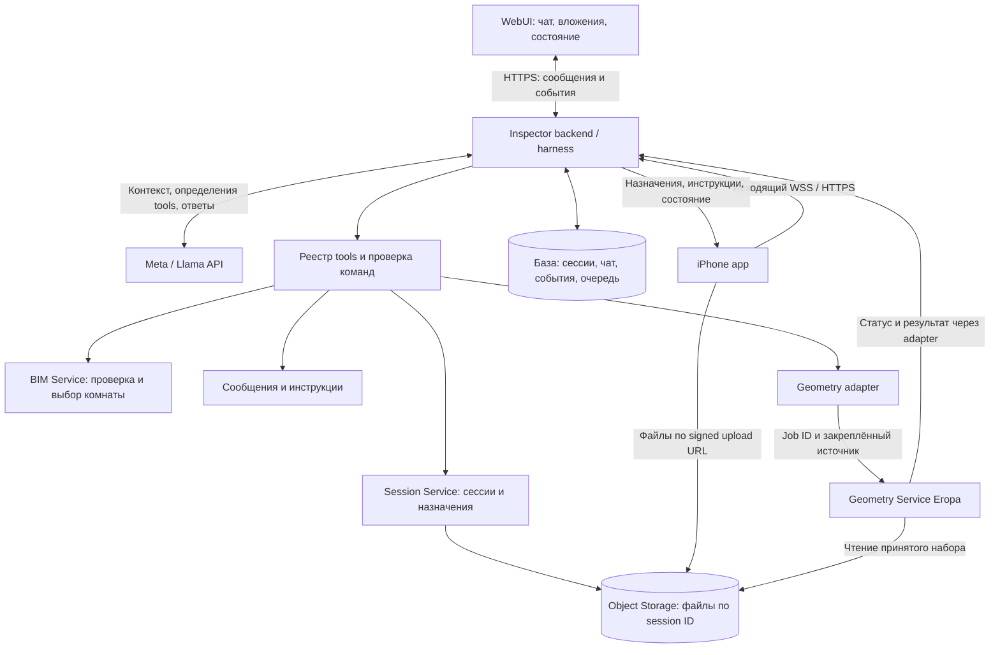
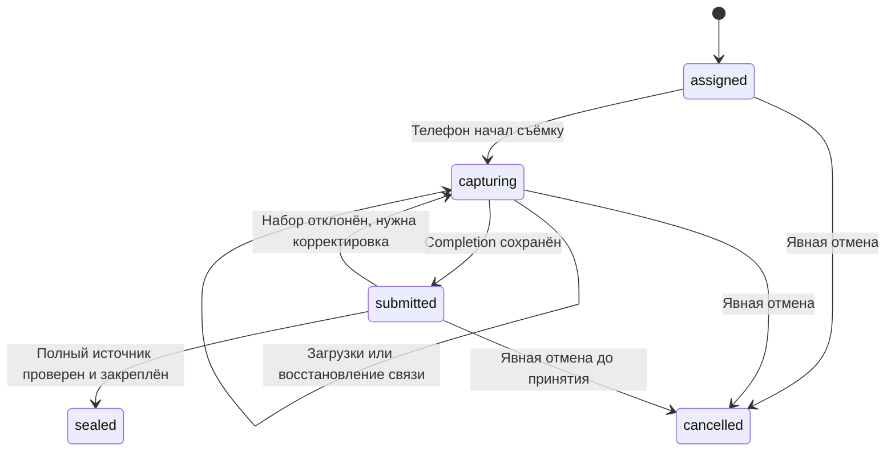

# AI Construction Inspector: архитектура первого тестового запуска

Дата: 28 октября 2026. Основание: описание владельца продукта в этом чате и текущее содержимое backend.

**Статус:** рабочее описание целевой v1. Решения ниже — предложение для реализации; они не означают, что iPhone, Meta API, BIM-сервис и Geometry уже интегрированы. Состояние существующего кода указано отдельно в разделе 9.

Читать по порядку:

1. Этот overview — продукт, компоненты и последовательность работы.
2. [Контракты агента и сервисов](agent-tools-contracts-v1.ru.md) — tools, HTTP API, события, данные и отмена.
3. [Результаты исследования и порядок реализации](research-and-implementation-v1.ru.md) — проверенные факты, оставшиеся эксперименты и критерии готовности.

## 1. Что должна делать первая версия

Пользователь пишет в веб-чат запрос и при необходимости прикладывает BIM. Агент на модели Meta/Llama понимает задачу, при необходимости обращается к BIM-сервису, организует съёмку на назначенном iPhone и сообщает пользователям о ходе работы и проблемах. После окончания съёмки и проверки полного набора файлов система передаёт Geometry Service Егора задание на реконструкцию и сохраняет ответ.

Успех этого запуска: один запрос прошёл путь от веб-чата до сохранённого результата Geometry с сохранением той же сессии при отключениях. Сам по себе результат реконструкции ещё не является заключением о соответствии стройки BIM.

| Входит в v1 | Следующие версии |
|---|---|
| Текстовый запрос, необязательное вложение BIM | Полноценная проверка соответствия BIM и фактической геометрии |
| Выбор: ответить в чате, подготовить BIM или начать съёмку | Alignment, измеренное coverage и нормативные проверки |
| Проверка поддерживаемого BIM и выбор комнаты, когда этого требует задача | Поддержка дополнительных BIM-форматов и сложное редактирование моделей |
| Создание, доставка, восстановление и явная отмена сессии | Несколько одновременно снимающих устройств в одной сессии |
| Загрузка съёмки, сообщения с телефона, прогресс в вебе | Генерация и исполнение произвольного кода агентом |
| Завершение, проверка входа, запуск Geometry, получение результата | Интерактивный 3D и полный серверный display/render pipeline |

Для BIM-ветки предлагается начать с IFC; поддерживаемые версии схем и конкретный BIM-провайдер ещё требуют проверки. RVT не считается автоматически поддержанным. Для съёмки без BIM эта зависимость отсутствует.

## 2. Основная конструкция

Доступ Geometry к хранилищу выдаётся Inspector: сервис получает служебную ссылку на источник, затем ограниченные ссылки на его файлы. Произвольного доступа ко всему bucket у него нет.

**Harness** здесь — серверная среда агента. Она принимает запросы, собирает контекст, вызывает Llama, исполняет разрешённые tool calls, сохраняет результаты и возобновляет работу после событий. **Модель** выбирает действия и формулирует ответы. **Сервисы** выполняют операции и проверяют их допустимость.

Это логические границы. Для тестового запуска harness, Session Service, сообщения и worker могут оставаться модулями одного backend. BIM и Geometry доступны через адаптеры; разделение всех модулей на отдельные процессы не является условием v1.

## 3. Кто за что отвечает

| Компонент | Ответственность |
|---|---|
| WebUI | Отправить текст и file references, показать чат, session ID, загрузку, ошибки и результат |
| Agent runtime / harness | Вызвать Llama, проверить tool call, сохранить ход выполнения и продолжить его после события |
| Meta / Llama | Понять намерение, определить необходимость BIM, выбрать доступный tool, объяснить ситуацию пользователю |
| BIM Service | Определить поддерживаемый формат по содержимому, разобрать модель, найти комнату, вернуть проверенный контекст |
| Session Service | Создать session ID, закрепить параметры, подготовить storage prefix, назначить телефон, хранить состояние |
| iPhone app | Получить и сохранить session ID, снимать, сохранять файлы локально, загружать, сообщать о проблемах и завершении |
| База данных | Долговременно хранить сессии, сообщения, квитанции операций, события и задания |
| Object Storage | Хранить BIM и исходные/принятые файлы съёмки; в текущем capture-пути используется Supabase |
| Worker и очередь | Проверять загрузки, повторять сетевые операции, отправлять и отслеживать Geometry jobs |
| Geometry Service Егора | Реконструировать геометрию из принятого набора и вернуть версионированный результат или ошибку |

Все предметные возможности, которые нужны агенту, представлены tools. Входящий веб-запрос, iPhone completion и callback Geometry являются событиями/API backend; модели не нужно вызывать tool, чтобы «принять» уже пришедшее событие.

## 4. Путь одного запроса

### 4.1. Запрос и решение о BIM

1. WebUI отправляет обязательный непустой текст и ноль или несколько ссылок на загруженные вложения. Загрузка файла и текст сообщения — отдельные операции с устойчивыми ID.
2. Backend сохраняет сообщение, проверяет доступ к вложениям и создаёт выполнение агента.
3. Агент определяет, какое действие требуется. Обычный вопрос не создаёт съёмочную сессию.
4. Если задача требует BIM явно или по смыслу, агент вызывает BIM tool. Сам факт вложения не требует семантической BIM-валидации.
5. Если нужен выбор комнаты, BIM tool возвращает найденную комнату или список кандидатов. При неоднозначности агент запрашивает уточнение до запуска съёмки.

| Запрос | Действие |
|---|---|
| «Как пользоваться приложением?» + вложение | Ответить в чате, BIM tool не нужен |
| «Сними комнату, модель не используем» | Создать capture-only session |
| «Покажи комнату 204 из приложенной модели» | Проверить BIM и найти комнату; съёмку создавать только при необходимости |
| «Сравни проём с проектом» + модель | BIM требуется по смыслу, даже без слова BIM; собственно Compare пока вне v1 |
| «Проверь по проекту», но модели нет | Запросить модель или ссылку на ранее доступную модель |

Проверки размера, принадлежности файла и безопасного приёма выполняются для каждого upload. Их нельзя отключить решением модели «BIM не нужен». BIM tool отвечает уже за смысловую проверку формата и содержимого.

### 4.2. Сессия и подключение телефона

6. Агент вызывает session tool с устройством, целью съёмки и проверенным контекстом. Backend генерирует session ID и сохраняет его до отправки телефону.
7. Backend создаёт в Object Storage prefix с этим ID. В базе это запись сессии; «папка» — отдельное понятие файлового хранилища.
8. iPhone сам устанавливает исходящее соединение с backend. Он может подключиться до создания задания или получить его позже из snapshot.
9. Приложение сохраняет ID локально, подтверждает получение и сообщает о фактическом начале съёмки. Агент не запускает камеру телефона удалённо.

### 4.3. Съёмка, загрузки и сообщения

10. Телефон сохраняет наблюдения локально и загружает файлы прямо в storage по разрешениям backend. Модель не принимает все фото в своё окно контекста.
11. В веб поступают состояния и прогресс. Сообщение телефона «комната завалена, снять невозможно» сначала сохраняется, затем отображается в вебе и запускает новый ход агента.
12. Агент может объяснить проблему и передать телефону уточнение или инструкцию. Отключение телефона меняет индикатор связи, сохраняя съёмочную сессию.

**Batch** — транспортная порция файлов. **Capture set** — весь набор одной сессии. Можно загружать много порций или один ZIP; граница для Geometry одна: законченный, проверенный набор. Появление очередной порции не запускает реконструкцию.

### 4.4. «Всё снято» и Geometry

13. Нажатие «Всё снято» фиксирует локальный список данных. Приложение показывает «Догружаем файлы», пока загрузка не закончена.
14. Телефон загружает финальный manifest последним и отправляет backend completion со стабильным completion ID. При отсутствии сети операция остаётся в локальной очереди.
15. Backend подтверждает сохранение сообщения, затем worker проверяет manifest, полноту, размеры, hashes и контекст файлов. При успехе он закрепляет неизменяемый источник и закрывает capture для новых файлов.
16. Workflow запускает Geometry через зарегистрированный tool/adapter. На уровне tool достаточно session ID; adapter добавляет job ID, operation key и ссылку на конкретный принятый источник.
17. Geometry читает источник, присылает состояние и результат. Backend проверяет соответствие заданию, сохраняет ответ и публикует его в веб. Агент объясняет итог, не придумывая измерений или заключения о соответствии BIM.

Для стандартной v1 запуск Geometry после принятия source — заранее разрешённое продолжение workflow. Новое решение LLM в этот момент не обязательно: текущий worker уже делает автоматическую постановку. Tool для агента и автоматический переход должны использовать одну операцию, чтобы не создавать два задания. Подробности — в [контрактах](agent-tools-contracts-v1.ru.md#6-geometry-tool-и-существующий-worker).

## 5. Жизнь сессии и восстановление

Есть четыре разных сущности:

| ID | Назначение | Когда меняется |
|---|---|---|
| chat_id | Переписка в вебе | При создании нового чата |
| inspection_id | Контекст задачи/инспекции | При создании новой инспекции |
| session_id | Конкретный набор съёмки | При новой съёмке, а не при переподключении |
| agent_run_id | Один ограниченный ход агента | При новом сообщении или значимом событии |

URLSession iOS, соединение WebSocket и запрос в Meta API имеют собственные идентификаторы. Ни один из них не заменяет session ID продукта.

Обработка ведётся отдельно: idle → validating → queued_geometry → building_geometry → completed / failed / cancelled. Уже sealed capture сохраняется закрытым даже при сбое или отмене обработки.

- Уход приложения в фон, force quit, потеря сети, закрытие веб-страницы и перезапуск backend не создают новую сессию и не означают отмену.
- При открытии приложение восстанавливает локальный ID, получает snapshot/replay и актуальное состояние с сервера, затем продолжает недоставленные операции с прежними ID.
- Если локальная ARKit-система координат потеряна, создаётся новый segment ID внутри прежней открытой session. Это не гарантирует выравнивание сегментов; поддержку должен подтвердить Geometry.
- До явного окончания/отмены нет автоматического закрытия только по таймауту связи. Срок хранения данных — отдельная согласуемая политика.
- Новая досъёмка после sealed получает новую session с parent_session_id. Старый набор не дополняется.

Постоянная сессия означает сохраняемое состояние. Llama не должна бесконечно работать или держать HTTP-запрос открытым, ожидая телефон. Runtime сохраняет ожидание и запускает следующий ход по событию.

## 6. Что агент может выполнять

Для v1 принимается режим **только предопределённые tools**. Модель выбирает имя операции и аргументы. Backend проверяет схему, права и текущее состояние, выполняет функцию и возвращает структурированный результат.

Примеры: проверить BIM, выбрать комнату, создать/прочитать сессию, послать инструкцию, получить проблему с телефона, отменить съёмку, запустить/проверить Geometry. Запись сообщений в чат также идёт через сохраняемую серверную операцию.

SDK Llama нужен backend для вызова модели. HTTP-клиенты/SDK сервисов нужны реализациям tools. Терминал, shell и интерпретатор, доступный модели, для этого не требуются. Шаблоны инструкций можно выбирать и заполнять параметрами; их изменение не должно превращаться в исполнение сгенерированного кода.

## 7. Минимальные гарантии

1. Истина о сессии хранится в backend, а не только в памяти модели или телефона.
2. Повтор сетевой операции с тем же ID и содержимым не создаёт вторую сессию, сообщение или Geometry job. Изменённое содержимое под тем же ID даёт конфликт.
3. События могут доставляться повторно; получатели удаляют дубликаты по event ID и учитывают revision.
4. Geometry запускается только для принятого и неизменяемого источника. «Все файлы должны быть загружены» проверяется сервером.
5. Съёмка и данные принадлежат конкретному проекту и назначенному устройству; session ID сам по себе не предоставляет доступ.
6. Сбой Llama не уничтожает сессию, файлы и очередь обработки. Исходное сообщение пользователя с телефона видно в вебе даже без успешного ответа модели.
7. Отмена явная, сохраняемая и идемпотентная. Поздние ответы отменённых операций не возвращают workflow в активное состояние.

## 8. Что показывать пользователям

Веб: ответ агента, текущая цель, session ID, телефон online/offline, «снимает / догружает / проверяем файлы / строим геометрию / готово / ошибка / отменено», сообщения телефона и ссылка на доступный результат.

iPhone: назначенная сессия, цель/инструкция, состояние загрузки, поле сообщения о проблеме, «Всё снято», явная отмена и восстановление незавершённой съёмки при открытии приложения. Прогресс upload и полнота геометрического покрытия — разные показатели.

## 9. Что уже есть в этом checkout

Оценка основана на коде и документации, а не на проверке установленного приложения на физическом iPhone.

| Возможность | Состояние backend |
|---|---|
| Capture-only session без BIM | Реализован POST /v1/capture-sessions |
| Сохранение BIM и prompt | Реализовано; BIM имеет статус stored_unvalidated, парсинга нет |
| Постоянные session ID, квитанции повторов | Реализованы, SQLite |
| Supabase prefix, signed upload plans, ZIP/отдельные файлы | Реализованы |
| Device WebSocket, snapshot/replay, acknowledgements, capture-start | Реализованы; есть Swift transport reference |
| Completion, проверка source, принятие снимка входных данных | Реализованы |
| Очередь Geometry, повтор доставки, callbacks/polling, сохранение geometry_result | Реализованы со стороны Inspector; реальный сервис требует настройки и согласованного прогона |
| Web-чат, история сообщений, Llama adapter, реестр agent tools | Требуют реализации |
| BIM-валидация, поиск комнаты и выдача room context | Требуют реализации и выбора провайдера |
| Сообщения/инструкции телефон ↔ веб | Требуют реализации; device WS сейчас принимает только ping/pong, бизнес-команды идут по HTTP |
| Явный пользовательский cancel API | Требует реализации, хотя состояния cancelled уже учитываются |
| Реальная мобильная интеграция, background/recovery QA | Не подтверждены этим checkout |

Источники внутри проекта: [README](../README.md), [HTTP-маршруты](../src/ai_inspector/api.py), [схемы](../src/ai_inspector/schemas.py), [workflow](../src/ai_inspector/workflow.py), [iOS guide](ios-integration.md), [web guide](web-integration.md). Более широкий предлагаемый межсервисный контракт родительского проекта, iphone-geometry-bim-inspector-api-v0.1.md (редакция 5), описывает также display/alignment/coverage и не считается подтверждением реализации этих возможностей.

## 10. Что реализовать следующим

Сначала проверить доступ к Meta API и tool-calling на выбранной модели, затем добавить сохраняемый чат и harness поверх существующего backend. Параллельно по зависимостям доступны работы по iPhone recovery, сообщениям и согласованию Geometry. BIM-ветка подключается после проверки формата и контракта комнаты. Подробный backlog с порядком, владельцами по ролям и приёмкой находится в [плане реализации](research-and-implementation-v1.ru.md#3-порядок-реализации).
