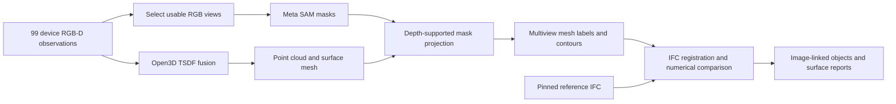

# Evidence cases — 3 November 2026

[Download the evidence and reproduce the results](data-access.md). Git retains methods, protocols, scripts, figures and compact summaries; detailed JSON and source data are versioned Release assets.

Start with the real-room Geometry case. It connects a device capture to a completed reconstruction, an IFC reference and image-linked comparison results. Drawing/photo and Progress4D provide complementary evidence about requirement handling and dated observations.

For the recovered algorithm history and quantitative comparison, see [Geometry workflow evolution](workflow-evolution.md): paired projection diagnostics and controlled numerical comparisons calculated on GCP.

[Numerical comparison with four figures](controlled-comparison.md): real-room residuals, 26 camera-pose cases and 18 known-displacement cases, with all inputs/results and a reproducible runner.

## 1. Real-room Geometry: capture → reconstruction → IFC comparison

[Download the real-room capture and results](https://github.com/TykhinBiriukov/ai-construction-inspector/releases/tag/evidence-2026-11-03). The [package manifest](geometry-case-manifest.json) records file hashes, provenance and verification boundaries. The [comparison result](data-access.md#geometry-reports) is included in the downloadable records archive.

| Item | Recorded evidence |
|---|---|
| Source | Real room, device capture closed 30 October 2026; `standalone_capture_v1`, `live_capture` |
| Capture identity | `2b6b4560-c2d5-482d-880b-21f34502b9f2` |
| Inputs | 99 observations: RGB JPEG, float32 depth, confidence bytes and frame metadata for each; 396 files, 83,037,743 bytes |
| Frame metadata | Intrinsics, camera-to-world poses, timestamps, depth size/unit, tracking state and image mapping |
| Reference | IFC SHA256 `4a618081be81cad4b7bba0eec22486038bc96d37e4778276d2f20a7d8143c51d` |
| Completed job | `54a47af7-ec32-4275-aee2-d07bd92550b1`; 1 November 2026, 22:33:38–22:47:16 UTC |
| Pipeline | `mesh-contours-v1`; original result manifest and implementation fingerprint included |
| Output | Point cloud, reconstructed mesh, segmented mesh, image/mask/overlay evidence and scan-versus-IFC reports |
| Compact report | 6 object candidates: 2 matched, 4 unmatched scan candidates; 5 observed surfaces |
| Evidence identity | All 16 distinct object-evidence frame IDs resolve to observations in the same capture |

The package was assembled from existing Geometry/Supabase artifacts on 3 November. All 396 input hashes and sizes, the IFC hash, all 12 stage-manifest hashes, and the three output PLY hashes were checked. Reading these artifacts did not rerun reconstruction or model inference.

### What our Geometry Service computed

Supabase stores the source observations and committed artifacts; it does not perform the reconstruction. Our Geometry Service coordinates the numerical pipeline and hosted Meta SAM segmentation, validates inputs, persists stage results and constructs the comparison/evidence report. The recorded stage order reconstructs the unlabelled surface **before** applying semantic masks to the mesh.

The reconstruction report identifies **Open3D VoxelBlockGrid TSDF 0.20.0 on CPU**, ARKit coordinates and metre units. It integrates **99/99 frames**, skips none, and produces **469,270 surface points, 466,800 vertices and 896,924 triangles**. The point cloud is extracted from the fused TSDF surface; it is not a concatenation of raw depth samples. These counts describe output size, not accuracy. The [reconstruction report](data-access.md#geometry-reports), [first SAM report](data-access.md#geometry-reports), [final SAM report](data-access.md#geometry-reports), [mesh-label report](data-access.md#geometry-reports) and [numerical comparison](data-access.md#geometry-reports) are included in the downloadable records archive, with their exact paths listed in the data guide.

Our pipeline then selects RGB views, obtains SAM masks, checks image/geometry projection, combines depth-supported views into mesh labels, derives opening-boundary candidates, registers observed geometry to the IFC and computes surface/opening comparisons. The mesh-label report records 449,584 labelled faces and 447,331 unknown faces after preprocessing, using a minimum of two supporting views and class purity 0.65. It retains 238 supported and 46 unconfirmed image observations; its 30 candidate groups are not guaranteed distinct physical objects. Unknown surface labels are preserved rather than filled by the model. Original RGB frames, segmentation masks and overlays remain linked through stable frame IDs. This separates Meta's semantic segmentation from numerical measurement and explicit visibility/alignment gates.

| Stage in this completed job | Recorded wall time |
|---|---:|
| Source download | 125.8 s |
| TSDF reconstruction | 48.1 s |
| Input preparation and validation | 7.5 s |
| Mesh preprocessing | 66.4 s |
| View selection | 6.8 s |
| Image segmentation | 161.2 s |
| Projection alignment | 18.9 s |
| Mesh segmentation / multiview transfer | 325.9 s |
| Boundary candidates | 5.8 s |
| Scan-versus-BIM comparison | 25.3 s |
| Opening comparison and evidence | 17.4 s |

These are stage timestamps from the retained job, including stage I/O, not isolated GPU inference timings. Total job elapsed time is **818.1 s (13.6 min)**. Earlier segmentation work and cache reuse must be considered separately before calling this a cold-start runtime; the retained stage reports and history accompany the package. This audit performed no new SAM calls or geometry processing.

### First SAM run and subsequent reuse

The [database run/stage history](data-access.md#geometry-reports) records three completed jobs for this same capture on 1 November:

| Job | Total elapsed | Segmentation stage | Interpretation |
|---|---:|---:|---|
| `e25b6cb6-5b41-41ae-ace0-0bb225acdf78` | 70.6 min | 61.1 min | Original SAM computation: 462 cache misses, 0 hits |
| `4129394c-0d20-4c1c-98f1-30d472ab9191` | 3.3 min | No start/end timestamp | Do not interpret missing timestamps as a zero-cost SAM inference |
| `54a47af7-ec32-4275-aee2-d07bd92550b1` | 13.6 min | 2.7 min | Final retained comparison; inference cache reused |

The final segmentation report names **Meta SAM 3.1**, 77 selected/processed views and six prompts (`wall`, `floor`, `ceiling`, `window`, `window frame`, `door`). It records **462 cache hits, 0 misses and 462 prefetched entries**, and 284 detections: 122 wall, 51 floor, 23 door, 41 ceiling and 47 window instances across images. These are image detections, not 284 independent physical objects. The report's `newly_processed_count: 77` refers to processing the frames at this stage; it does not mean 77 new network inferences because the lower-level SAM cache records the hits explicitly.

The first-run report confirms 462 cache misses and no hits, while the final run confirms all 462 cached results were reused. Both reports are included in the archive.

This distinguishes the team's original model computation from the later reuse of its outputs. The short final run is not evidence of a 13.6-minute uncached reconstruction-and-SAM workflow. The segmentation stage duration includes service work and artifact handling; it is not a provider billing measurement.

### What the result means

The comparison uses metres, `scan_minus_ifc` differences and a 0.1 m tolerance. The five sampled surfaces have P95 absolute deviations of approximately **27, 66, 31, 99 and 53 mm**. The team confirmed on 4 November 2026 that the reference IFC was built from laser measurements of the real room. These values therefore compare reconstructed observed surfaces with the laser-measured IFC reference after rigid alignment. They report surface-deviation P95 per element, rather than a single scanner accuracy or the error of every opening dimension. The provenance of the laser measurements is team-confirmed; raw laser readings and instrument metadata are not included in this archive. The report labels the observed portions within tolerance; every surface retains `whole_element_verified: false`. This flag describes verification of the entire IFC element, including unobserved faces; it is not a failed accuracy test on the observed surface. The surface-comparison code initializes it to false while reporting measured deviations separately.

All six object candidates retain `absolute_accuracy_verified: false` and incomplete boundary support. The contour extractor initializes this flag to false; it does not perform an external-reference calibration test. The flag means that this artifact carries no attached absolute-accuracy verification, not that a measured accuracy test failed. Control dimensions should be linked to the matching object, capture and measurement definition in a separate verification record. A matched candidate is an association to an IFC element, not a compliance verdict. Unmatched candidates may include fragmented observations; their count is not a count of construction defects. The prepared viewer also retains its rigid alignment and boundary limitations.

This is a completed **Geometry computation** on real captured data. Its `agent_review.executed: false` is emitted by the Geometry opening-comparison stage before downstream review; it is not a live status field for Geometry Inspector or Geometry Verifier. Those agents store their review lifecycle separately. The [Inspector status receipt](inspector-review-status.json) records one review as `cancelled` when queried on **3 November 2026** (created and last updated on 2 November). It documents that historical attempt, not the present service state or every subsequent review. To establish a later completed review, attach its receipt and accepted report with the same capture/result identities; preserve the original computation artifact.

The `implementation` value identifies Geometry code **and numerical/model dependency versions** through a SHA-256 fingerprint, as defined in [inspection.py](../../../geometry-engine/geometry_engine/inspection.py). This is useful runtime identity, distinct from a source Git commit. The historical export does not contain a mapping to a runtime Git SHA; the package-assembly commit is a separate identity. Device metadata's “Device reprojection validation pending” is a literal string emitted by [Observation.swift](../../../ios/AIInspector/Observation.swift), not the outcome of a per-capture reprojection test. A device validation record must identify hardware, calibration, coordinate convention and measured residuals.

### Inspect and reproduce

1. Download and extract the release archive. Verify its SHA256 against `geometry-case-manifest.json`, then verify the per-file hashes in the archive's `SHA256SUMS`.
2. Read `capture-manifest.json`, `reference.ifc`, `result-manifest.json`, the stage manifests and the numerical reports. Follow an object in `demo/geometry-demo/result.json` through `assets.json` to its RGB, mask and overlay; its `frame_id` resolves to `capture/observations/<frame_id>/`.
3. Inspect `outputs/point_cloud.ply`, `outputs/mesh.ply` and `outputs/segmented_mesh.ply` with a PLY-capable viewer. `demo/geometry-demo/comparison.json.gz` is the saved application-viewer projection; it is not a second independent reconstruction.
4. To rerun analysis, follow the [Geometry setup](../../reproducible-setup.md#4-geometry-profile-rgb-d-reconstruction-and-ifc-comparison) and [capture upload contract](../../../geometry-engine/README.md). Put the preserved files in your own configured storage, keeping the manifest paths consistent. Use your own credentials and a new job; retain the new code revision, parameters, model/cache status and result manifest. A rerun may differ from the historical output and uses compute/model access.

The archive is approximately 135 MB compressed. It includes primary inputs/outputs, selected intermediate numerical reports, all stage manifests and the demo evidence. Original stage manifests describe the complete service outputs, while the archive packages selected evidence. The [artifact inclusion inventory](artifact-inclusion.json) maps each manifest entry to packaged bytes by SHA-256, including files stored under a different path. Omitted entries include segmentation masks, normalized metadata, numerical intermediates and generated viewers, not just caches. This evidence package supports inspection of the retained results; restoring every stage checkpoint requires the corresponding omitted artifacts.

No credentials or expiring signed URLs are included. Reading the archived outputs requires no model key. The release is an evidence snapshot, not a new deployment or a clean-environment reproduction claim.

## 2. Drawing/photo: from joint context to frozen requirements

The implementation evolved from a single shared conversation into three isolated model contexts: **drawing-only checklist → photo against checklist → fresh review of both sources and the draft**. This makes the requirement set inspectable before judging the observation. Replacing a photo can reuse the same checklist rather than silently changing the requirements. These are cooperating model stages; the recorded evidence does not establish a universally better multi-agent architecture.

### Same-input legacy/staged run

The [complete saved reports and audit diagnostics](data-access.md#drawing-and-progress) include matching input hashes and separate prompt versions.

| Recorded run | Prompt | Time | Model calls | Findings |
|---|---|---:|---:|---|
| Shared history (`legacy`) | `drawing-photo-0.2.3` | 46.448 s | 5 | 6 match |
| Isolated stages (`staged`) | `drawing-photo-staged-0.1.0` | 72.977 s | 5 | 4 match, 2 inconclusive |

Both use Muse Spark 1.3. This is one development comparison, not a repeated or held-out benchmark. Different verdicts demonstrate different behavior; without independent labels they do not prove that either run is more accurate. Wall times include that run's service/model conditions and are not a general performance guarantee. Audit records contain call diagnostics and intermediate judgments, not full raw provider request/response transcripts.

### Frozen checklist and replacement observations

The [saved 0.3.0 records](data-access.md#drawing-and-progress) contain three completed analyses with the same 11-item checklist, prompt/config hashes, evidence regions and task identities:

| Observation | Time | Match | Inconclusive | Mismatch |
|---|---:|---:|---:|---:|
| Original | 135.8 s | 4 | 7 | 0 |
| Edited local insulation gap | 93.3 s | 3 | 8 | 0 |
| Original resubmitted as replacement | 75.0 s | 4 | 7 | 0 |

The gap image is a generative edit of the original development image. The intended mismatch was **not obtained**: the model treated the gap as potentially attributable to the cutaway view. This failure remains in the record. The six input bindings were checked against local source SHA256 values; all three result responses were read back unchanged from the retained service database. That is persistence evidence, not a new browser/restart acceptance test.

Original drawing/photo source images are not included in this release. Their hashes and evidence coordinates are retained; external readers can inspect the judgments but cannot independently assess the image interpretation from the JSON alone. The separate window walkthrough uses curated visual observations and manually marked regions; its displayed findings are not these model runs.

## 3. Progress4D: construction progress and evaluator coverage

**Two different quantities must be kept separate.** Construction progress describes installed work relative to the planned task quantities. The table below instead describes **visible-element detection recall in a historical development evaluation**. It is not the percentage of work completed by builders, and it is not a general accuracy score for the whole product.

For this evaluator, `visible_recall = correctly reported present elements / reference elements that exist and are visible in at least two photos`. Thus week 4 is **11 / 50 = 22.0%** and week 5 is **11 / 57 = 19.3%**. These percentages come from the archived evaluator outputs, not the construction-progress indicator. Undecided elements are not automatically reported as absent.

The [six-week saved evaluation](progress4d-evaluation.json) records the later local version of the normal scenario. Its input surveys are rendered development scenes; they are separate from the real-room RGB-D capture above.

| Survey week | Correctly reported present elements | Existing elements visible in at least two reference views | Detection recall for this archived run |
|---|---:|---:|---:|
| 1 | 44 | 44 | 100.0% |
| 2 | 64 | 66 | 97.0% |
| 3 | 40 | 48 | 83.3% |
| 4 | 11 | 50 | 22.0% |
| 5 | 11 | 57 | 19.3% |
| 6 | 127 | 155 | 81.9% |

This retained evaluation reports no false-present, false-absent or hidden-as-present entries for these dates. Low coverage in weeks 4–5 remains material; absence of false positives is not complete monitoring. These are development measurements against the scene evaluator, not field accuracy. The full surveys and evaluator environment are not packaged here, so these JSON measurements are inspectable historical results rather than an independently reproduced benchmark.

The seventh displayed week is a prepared scene, not an additional successful reconstruction. Schedule projections are conditional scenarios, not measured remaining durations. See [Progress4D setup and numerical gates](../../../progress4d_service/README.md).

## Remaining acceptance work

The recovered local package establishes the real capture/result chain; the public repository exposes its numerical reports and existing model-run evidence. The source archive is now public for independent inspection. The reference IFC derives from laser measurements, as confirmed by the team on 4 November 2026. Raw readings, instrument metadata, later agent reviews and additional validation runs can extend this historical package when linked by capture/result identity. The package alone does not establish their presence or absence elsewhere in the project. No new benchmark judges were run for this documentation/data release.
