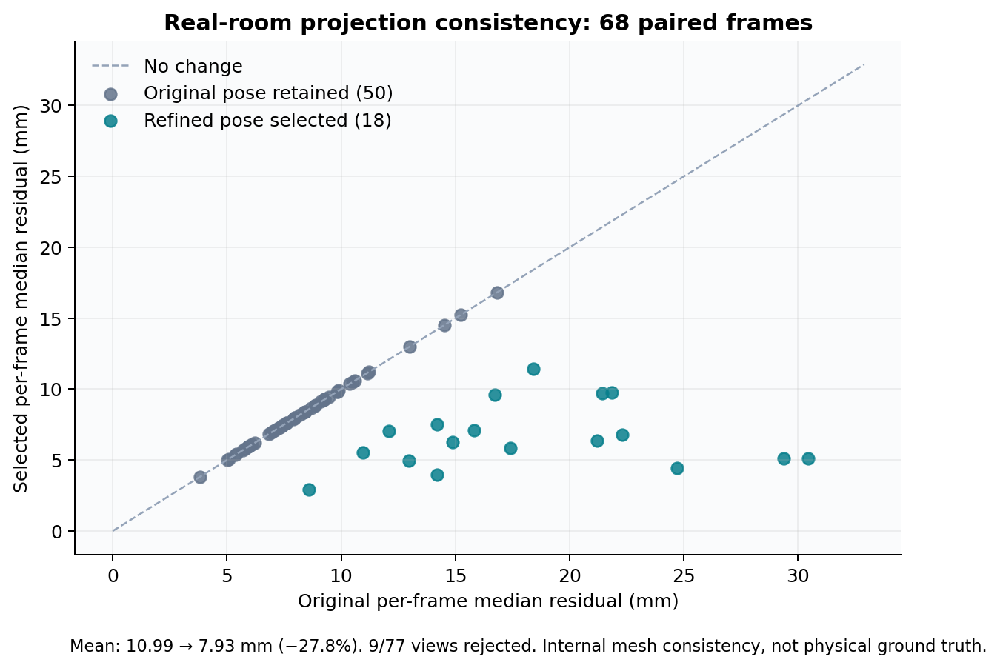
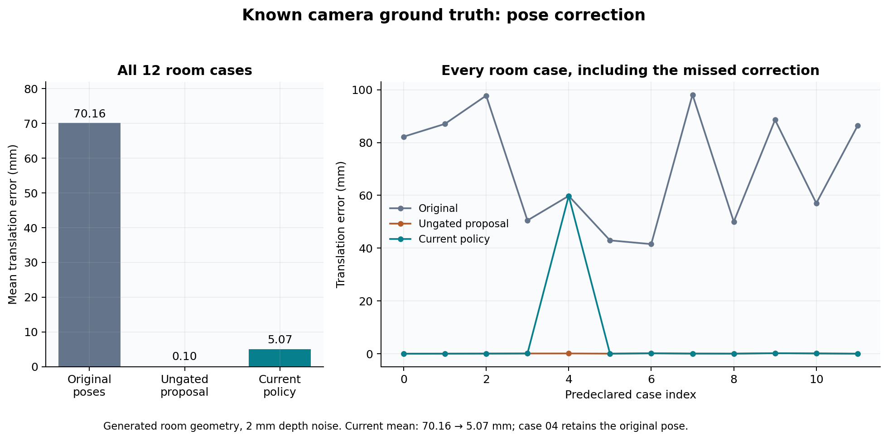
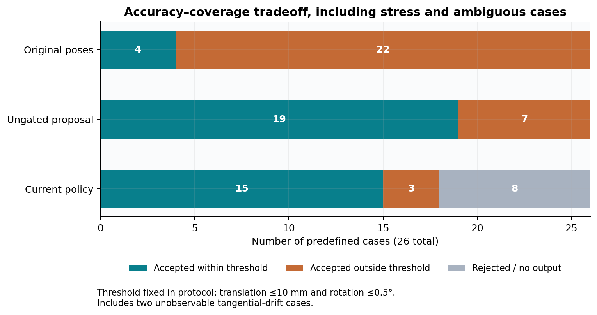
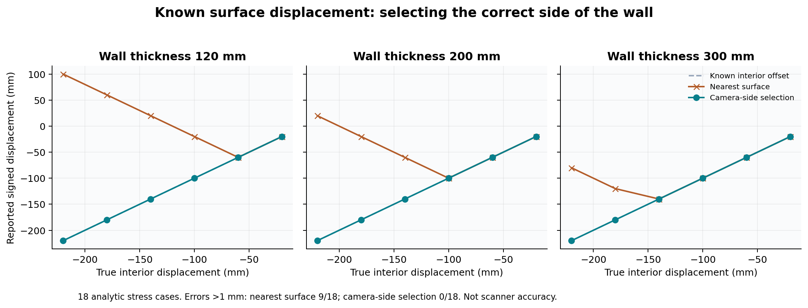

# Geometry design comparison with known numerical ground truth

We evaluated the numerical choices behind Geometry on the real-room diagnostic record and on **44 predeclared controlled cases** executed on GCP. The results support two decisions: correcting supported projection-camera drift, and selecting the observed side of a BIM surface instead of whichever surface is nearest. They also expose the cost and limits of conservative acceptance gates.

| Question | Comparison | Result |
|---|---|---|
| Does correction improve real-capture projection consistency? | Same 68 retained frames, original vs selected pose | Mean frame-median depth residual **10.99 → 7.93 mm (−27.8%)**; 9 additional views rejected |
| Can correction recover a known camera pose? | 12 generated room scenes, original vs current policy | Mean translation error **70.16 → 5.07 mm (−92.8%)**; all 12 produce output, one retains an inaccurate original pose |
| Does visible-side selection prevent a wrong BIM correspondence? | 18 two-sided-wall cases, nearest-surface vs camera-side selection | Errors above 1 mm: **9/18 → 0/18**; mean absolute signed-offset error **82.22 mm → numerical zero** |

These are separate experiments, not percentages that can be pooled into one “accuracy” score. The first uses actual capture data but measures mesh consistency; the other two have exact constructed geometry and known numerical answers. Numerical zero in an analytic wall fixture is not zero physical measurement error on site.

## Real-room paired evidence

Every accepted frame is shown; points below the diagonal improve. The 50 retained original poses remain on the diagonal, while 18 accepted refinements reduce residuals. The comparison uses the same accepted-frame cohort on both sides and reports 9/77 rejected views separately. The [full methodology and all 77 rows](workflow-evolution.md#2-paired-projection-comparison-on-the-real-capture) retain the source hashes and within-frame pixel partition. Since the source capture also built the mesh, this figure alone cannot establish physical accuracy.

## Experiment A — camera pose with known ground truth

### Methods

We used the actual `align_frame` and `choose_camera` implementation from Geometry revision `a7217c7fa3e66f4b98d289954a7b42bbd214e386`. The two executed numerical modules match their copies in `main` byte-for-byte. No model or service implementation was changed.

The three alternatives are:

1. **Original pose:** the direct projection choice used by the historical workflow.
2. **Ungated proposal:** the same current ICP candidate, emitted regardless of acceptance checks. This is an explicit ablation, not a claim that we recovered an entire historical ICP implementation.
3. **Current policy:** retain a good original pose, accept a supported bounded correction, or reject the observation. The test observes the actual policy decision while exposing the candidate transform for evaluation.

For 12 seeded varied room scenes, we render depth from a known camera pose, add 2 mm depth noise and missing samples, then perturb the input pose by 4–10 cm and up to 1.5°. Ground truth comes from the scene/camera construction, independently of the incorrect starting pose. We compare Euclidean translation error and geodesic rotation error against that truth. Scene construction is inspired by the existing numerical regression fixture, with variations fixed before execution; this is not an external blind field dataset.

The protocol also includes four clean-pose controls, four larger-drift cases (30 cm / 6°), four featureless-plane normal-drift cases and two tangential-drift ambiguity controls. All **26 cases** are retained.

### Results and the non-winning case

| Method, 12 moderate-drift room cases | Mean translation error | Mean rotation error | Cases outside 10 mm / 0.5° threshold |
|---|---:|---:|---:|
| Original pose | 70.157 mm | 0.633° | 12/12 |
| Ungated proposal | 0.097 mm | 0.003° | 0/12 |
| Current policy | 5.069 mm | 0.019° | 1/12 |

The current policy corrects 11 cases and retains the original pose for case `moderate-04`. That case's pose error stays at **59.788 mm**, even though its candidate would reduce it to **0.122 mm**: the candidate does not clear the policy's minimum 5 mm improvement in depth residual. Depth consistency is not the same objective as absolute pose recovery. This is a concrete tradeoff and a candidate for a separately authorized code investigation; it has not been silently tuned away.

All four clean-pose controls retain the exact original pose under the current policy. Ungated fitting introduces small changes (mean 0.182 mm) by fitting noise. All four larger-drift cases are rejected under the current policy's bounded-correction contract; ungated fitting recovers three of them within the declared threshold and leaves one outside it.

For the four single-plane normal-drift cases, neither method recovers a full pose; the policy rejects them instead of returning the 80 mm error. For the two tangential-drift controls, **all methods retain a 120 mm tangential ambiguity**. A featureless plane cannot observe this motion. The current raw-pose path can accept such an observation when depth consistency is adequate; acceptance must not be interpreted as a calibrated full-pose certificate.

This figure uses the error threshold fixed in the protocol: translation ≤10 mm **and** rotation ≤0.5°. Rejections are shown separately rather than counted as accurate results. The case mix deliberately includes stress/ambiguity scenarios and is not a prevalence estimate for construction sites.

## Experiment B — known displacement versus wrong-side correspondence

The reference contains an interior and an exterior wall face. We vary wall thickness over 0.12, 0.20 and 0.30 m and true interior displacement over −0.02, −0.06, −0.10, −0.14, −0.18 and −0.22 m: **18 cases**. The camera observes the interior side. The target measurement is displacement relative to that interior face, not distance to an arbitrary nearby face.

The reference is supplied as analytic triangles; IFC parsing is outside this fixture. We run the same actual `compare_surfaces` implementation twice with identical geometry, categories and thresholds. The ablation omits `camera_positions`; the current variant supplies the camera side. This isolates that single design choice. It is not a full old/new pipeline comparison.

| Metric | Nearest surface, no camera-side filter | Camera-side selection |
|---|---:|---:|
| Cases with measurement | 18/18 | 18/18 |
| Mean absolute signed-offset error | 82.222 mm | <0.000001 mm |
| Maximum error | 320.000 mm | <0.000001 mm |
| Cases with error >1 mm | 9/18 | 0/18 |

The nearest-surface choice sometimes selects the outer face and changes both magnitude and sign. Camera-side selection retains the intended interior reference in every predefined case. This provides direct numerical evidence for the visibility-aware matching rule. The fixtures are analytic planar surfaces with supplied structural labels; they do not test SAM accuracy, uncertain registration, sensor calibration or real-wall roughness.

## Why these choices, and what “better” means here

For this inspection task, reducing residuals alone is insufficient: a result must preserve its source surface and disclose unsupported observations. The comparisons support **correction plus explicit acceptance checks**, and **camera-side-aware BIM matching**, as defensible design choices for that contract. They do not show that the current gate minimizes pose error: the ungated candidate is more accurate on the moderate room subset and recovers some larger corrections that the current policy refuses. The benefit of the gate is selective output with clear bounds and refusal behavior, at a measured coverage cost.

Meta SAM provides the semantic observations in the real-room pipeline. These experiments examine the numerical handling downstream of those observations; no additional Meta calls were made, and synthetic structural labels are supplied in the wall test. The measured outcomes are projection consistency, camera-pose recovery and wall-side correspondence.

## Reproduction and execution record

- [Protocol fixed before execution](controlled-benchmark/protocol.txt)
- [Benchmark generator and runner](controlled-benchmark/benchmark.py)
- [Every case, true/input/output transforms and execution hashes](data-access.md#experiment-records)
- [Per-stratum summary](controlled-benchmark/summary.json)
- [Plot generation](controlled-benchmark/plot_results.py), [pinned plotting dependencies](controlled-benchmark/plot-requirements.txt) and [SVG figures](controlled-benchmark/figures/camera-ground-truth.svg)

Executed once on the existing GCP `e2-standard-2` VM inside the pinned Geometry image, with **network disabled, 1 CPU, 2 GB memory and a 600-second timeout**. The container had no credentials, database access or live-service volumes. The 26 pose calculations took approximately 2.29 seconds in total, excluding imports, fixture generation and plotting; this timing is not a comparative performance claim. No production pipeline code or configuration was changed.

Download and extract the [experiment records](data-access.md#reproduce-the-figures) before plotting or inspecting complete cases; only the compact summary remains in Git. The runner uses `/work` for its protocol and outputs; plot generation also reads the earlier real-room diagnostic metrics from `/historical/metrics.json`. With the dependencies from `geometry-engine/pyproject.toml`, copy the benchmark script and protocol to a disposable working directory, mount it at `/work` in a disposable environment and run `python /work/benchmark.py`. Preserve archived results before writing a rerun. Plotting writes PNG and SVG files; no API keys are required. Scripts, source-module hashes and library versions are recorded with the result. All cases and negative controls are published; no seed, threshold or algorithm was tuned after viewing their results.
